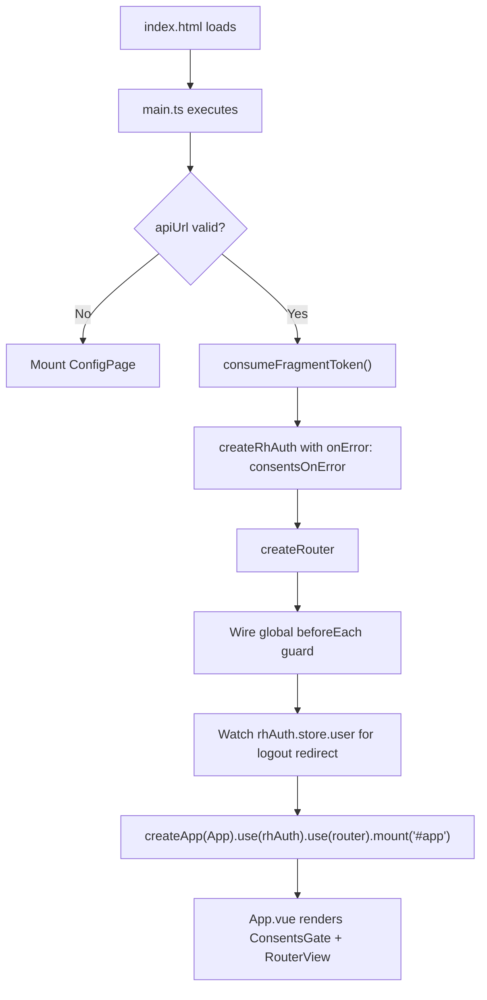

# App Bootstrap and Entry Point

This page documents the startup sequence of the Ulabase Vue starter application, from the HTML entry point through token capture, authentication setup, router creation, guard wiring, and final mount.

## Bootstrap Sequence



*Bootstrap sequence from page load to first render.*

## Two Code Paths

The entry point (`src/main.ts`) branches into two entirely different bootstrap paths based on whether a valid API base URL is configured in `src/environments/environment.ts`.

### Unconfigured Path (apiUrl empty or invalid)

When `isValidApiBaseUrl(environment.apiUrl)` returns `false`, the application:

1. Logs an error to the console explaining the configuration requirement
2. Creates a minimal Vue app mounting only `ConfigPage.vue` with no router, no authentication store, and no consents gate
3. The ConfigPage displays setup instructions directing the developer to create a Ulabase service and run `npx ulabase setup`

This path deliberately avoids creating an auth store because without a service endpoint, the store would attempt session checks against a non-existent backend.

### Configured Path (valid apiUrl)

When the API URL is valid, the full application bootstrap proceeds through these steps:

1. **Token capture** — `consumeFragmentToken()` runs before any other initialization
2. **Auth store creation** — `createRhAuth()` initializes the authentication store with the API base URL and error handler
3. **Router creation** — `createRouter()` with `createWebHistory()` and the application routes
4. **Guard wiring** — A single `beforeEach` guard dispatches to `authGuard` or `publicGuard` based on route meta
5. **User watcher** — A `watch` on `rhAuth.store.user` detects session loss and redirects authenticated-route users to login
6. **App mount** — `createApp(App).use(rhAuth).use(router).mount('#app')`

## Fragment Token Capture

The `consumeFragmentToken()` function handles tokens that arrive in the URL fragment (hash), which occurs during:

- **Email verification flows** — Verification links include an `access_token` in the fragment
- **OAuth callbacks** — OAuth providers redirect back with tokens in the fragment

### Timing Criticality

Token capture must run **before** `createRhAuth()` because the auth store checks the session immediately upon creation. If a token arrives via URL fragment but isn't stored before the session check, the store would find no session and treat the user as signed out.

### Implementation Details

The function:
1. Parses `window.location.hash` for an `access_token` parameter
2. If found, calls `setToken(accessToken)` to store it in the auth module
3. Calls `scheduleRefresh()` to schedule token refresh using the API base URL
4. Checks for a `flow=signup` query parameter to set the `justSignedUp` flag (used by the signup page)
5. Cleans the URL by removing the hash and signup parameter using `history.replaceState()`

## Guard Wiring

A single global `beforeEach` guard in `main.ts` handles all route protection by reading `to.meta.guard`:

```typescript
router.beforeEach((to, from) => {
  if (to.meta.guard === 'auth') return rhAuth.authGuard.call(undefined, to, from, noNext);
  if (to.meta.guard === 'public') return rhAuth.publicGuard.call(undefined, to, from, noNext);
  return true;
});
```

- **`auth` guard** — Redirects unauthenticated users to the login page; allows authenticated users through
- **`public` guard** — Redirects authenticated users into the app; allows unauthenticated users through
- **No meta** — Route is unguarded (e.g., invitation acceptance page)

The `noNext` function is a no-op because the kit's guards return their verdict rather than calling the traditional `next()` callback.

## User Watcher

Vue Router guards run only on navigation events. When a user's session ends while they are already on an authenticated page (token expiration, forced logout from another tab, server-side revocation), the `beforeEach` guard never fires and the user remains on a route they can no longer access.

A `watch` on `rhAuth.store.user` closes this gap:

```typescript
watch(rhAuth.store.user, (user, previous) => {
  if (user || !previous) return;
  if (router.currentRoute.value.matched.some(r => r.meta.guard === 'auth'))
    void router.push('/auth/login');
});
```

- **`user` is truthy** — A session exists; no action needed.
- **`previous` is falsy** — The store was never in a signed-in state; this is the initial session check finding no session, not a logout. The watcher skips the redirect.
- **User becomes `null` while on an auth-guarded route** — The watcher redirects to `/auth/login`.

Routes without `meta.guard` (e.g., invitation acceptance) are unaffected.

## App.vue Structure

The root component (`src/App.vue`) wraps `RouterView` inside `ConsentsGate`:

```vue
<template>
  <ConsentsGate>
    <RouterView />
  </ConsentsGate>
</template>
```

### Why ConsentsGate Must Be Above the Authenticated Shell

The ConsentsGate must sit **above** the router view, not inside the authenticated shell, because:

1. A user blocked by the consents gate has no valid session — the `/users/me` endpoint returns HTTP 451
2. The `authGuard` would bounce such a user to the login page
3. The user would never reach a screen inside the app to accept terms
4. By placing ConsentsGate at the root, blocked users see the acceptance overlay regardless of which route they attempt

The overlay is purely a user-experience feature; removing it via dev tools doesn't bypass enforcement — the server's Guards rule still returns 451 for all requests.

## Consents Signal Integration

The `consentsOnError` callback passed to `createRhAuth()` watches for HTTP 451 responses from the API. When detected, it sets a reactive `blocked` flag that ConsentsGate observes. This bridges the gap between:

- The auth store's session restoration (which happens on its own schedule)
- The consents gate's UI (which needs to know when to appear)

Without this callback, "blocked by consents" and "signed out" would be indistinguishable to the application.

## Configuration

The application's behavior is controlled by `src/environments/environment.ts`:

- **`apiUrl`** — The Ulabase service URL; empty triggers the ConfigPage fallback
- **`features`** — Controls which routes are registered (email registration, password reset, OAuth login, team invitations)

## Related Pages

- [Routing and Guards](./routing-and-guards.md) — Detailed guard behavior and route configuration
- [Consents Gate](../concepts/consents-gate.md) — How the consents acceptance flow works
- [Feature Flags](../concepts/feature-flags.md) — Controlling feature availability via environment configuration
- [Service Configuration](../operations/service-configuration.md) — Setting up the Ulabase service URL
