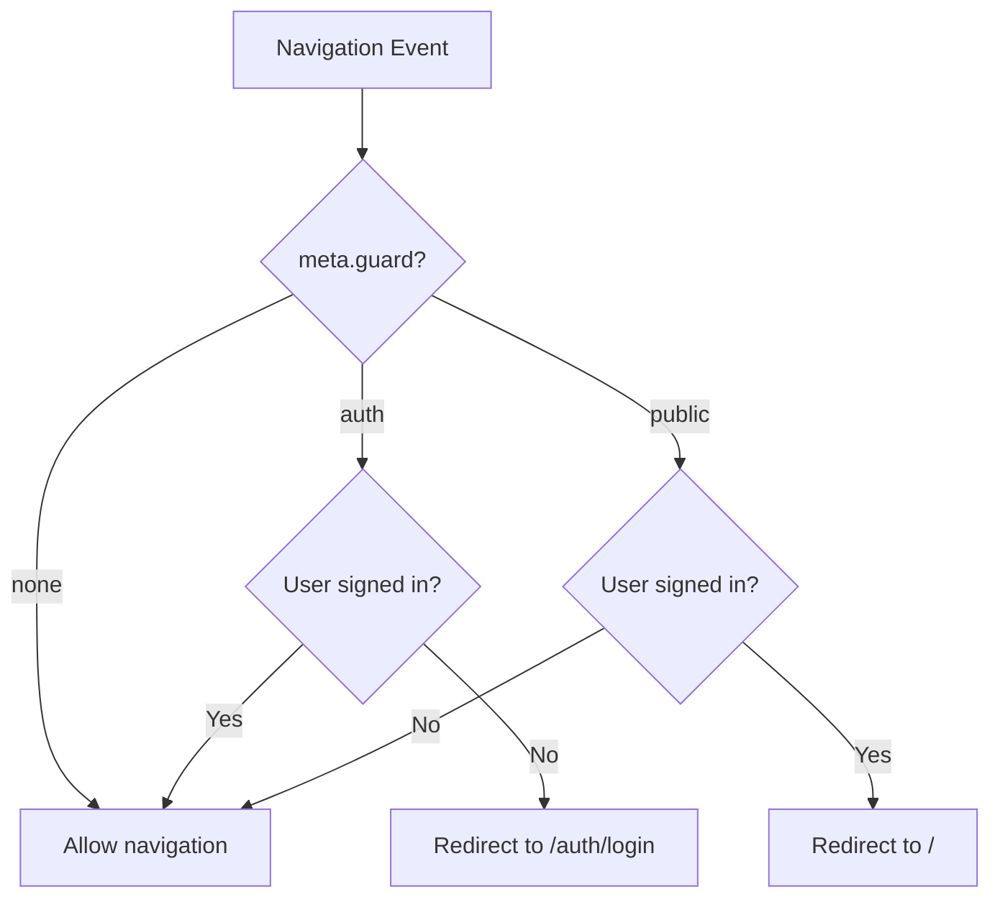
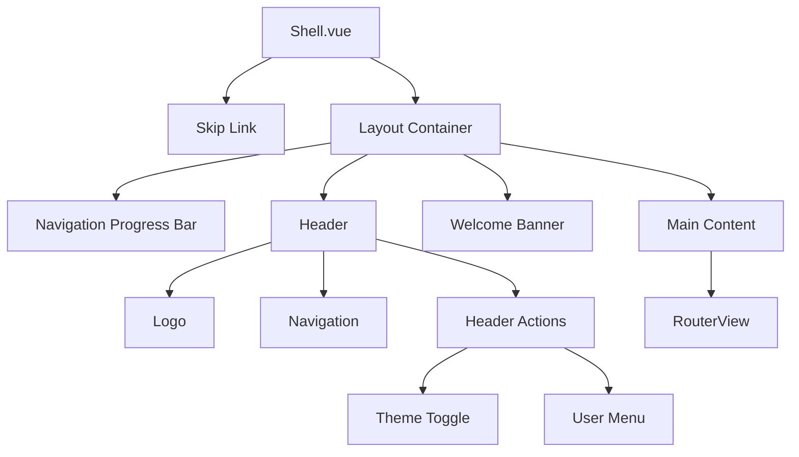

# Routing and Navigation Guards

This page documents the routing system of the Ulabase Vue starter application, including the route map, feature-flag gating, lazy loading, navigation guards, and the shell layout that wraps authenticated content.

## Route Map Overview

The application defines all routes in `src/routes.ts`. Routes are organized into three categories:

1. **Public auth routes** — Login, signup, verification, and password reset pages
2. **Unguarded routes** — Invitation acceptance (works for all auth states)
3. **Authenticated routes** — Wrapped in the Shell layout with `auth` guard

### Feature-Flag Gated Routes

Routes are conditionally included based on feature flags from `src/environments/environment.ts`:

| Feature Flag | Routes Affected |
|--------------|-----------------|
| `emailRegistration` | `/auth/signup`, `/auth/verify` |
| `passwordReset` | `/auth/forgot-password`, `/auth/reset-password` |
| `oauthLogin` | `/auth/signup` (shared with emailRegistration) |
| `teamInvitations` | `/invitations/accept` |

### Complete Route Map

| Path | Component | Guard | Feature Flag | Description |
|------|-----------|-------|--------------|-------------|
| `/auth/login` | Login.vue | `public` | None | Login page |
| `/auth/signup` | Signup.vue | `public` | `emailRegistration || oauthLogin` | Registration page |
| `/auth/verify` | Verify.vue | `public` | `emailRegistration` | Email verification |
| `/auth/forgot-password` | ForgotPassword.vue | `public` | `passwordReset` | Password reset request |
| `/auth/reset-password` | ResetPassword.vue | `public` | `passwordReset` | Password reset form |
| `/invitations/accept` | Accept.vue | None | `teamInvitations` | Invitation acceptance |
| `/` | Shell.vue | `auth` | None | App shell with children |
| `/home` | Home.vue | `auth` (inherited) | None | Home page |
| `/teams` | Teams.vue | `auth` (inherited) | None | Team list |
| `/teams/new` | NewTeam.vue | `auth` (inherited) | None | Create team |
| `/teams/:id` | TeamDetail.vue | `auth` (inherited) | None | Team detail |
| `/account` | Account.vue | `auth` (inherited) | None | User account |
| `/:pathMatch(.*)*` | Home.vue | None | None | Catch-all fallback |

## Lazy Loading

All page components use dynamic imports for code splitting:

```typescript
const Login = () => import('./pages/auth/login/Login.vue');
const Signup = () => import('./pages/auth/signup/Signup.vue');
// etc.
```

This ensures each page is loaded only when needed, reducing initial bundle size.

## Navigation Guards

### Guard Decision Flow



*Guard decision flow for a navigation event.*

### Guard Semantics

The global `beforeEach` guard in `main.ts` reads `to.meta.guard` and dispatches to the appropriate guard from `@ulabase/kit-vue`:

- **`auth` guard** — Redirects unauthenticated users to `/auth/login`; allows authenticated users through
- **`public` guard** — Redirects authenticated users to `/`; allows unauthenticated users through
- **No meta** — Route is unguarded (e.g., invitation acceptance)

### Implementation Details

```typescript
const noNext: NavigationGuardNext = () => undefined;
router.beforeEach((to, from) => {
  if (to.meta.guard === 'auth') return rhAuth.authGuard.call(undefined, to, from, noNext);
  if (to.meta.guard === 'public') return rhAuth.publicGuard.call(undefined, to, from, noNext);
  return true;
});
```

The `noNext` function is a no-op because the kit's guards return their verdict rather than calling the traditional `next()` callback.

### Special Case: Invitation Acceptance

The `/invitations/accept` route has **no guard** — it must work for:
- Signed-out invitees without accounts (new users)
- Signed-out invitees with accounts (existing users)
- Signed-in users (already authenticated)

This route handles all three states internally in its component logic.

## Shell Layout

The Shell component (`src/pages/shell/Shell.vue`) provides the application layout for authenticated pages.

### Layout Structure



*Shell layout structure showing header, navigation, and content areas.*

### Key Features

#### Skip Link
- Hidden by default, visible on focus for keyboard navigation
- Links to `#main` for accessibility
- Styled with `.skip-link` class

#### Header Navigation
- Contains logo, main navigation links, and header actions
- Navigation links use `RouterLink` with active state detection
- Section links use `isActive()` for sub-page matching

#### User Menu Dropdown
- Displays user initials in avatar button
- Shows dropdown with user info, account link, and logout
- Implements keyboard navigation (Escape to close)
- Uses click-outside detection to close

#### Theme Toggle
- Light/dark mode toggle using `useTheme()` composable
- Persists preference in localStorage with key `rh-theme`
- Toggles `dark` class on `document.documentElement`
- Default: system preference or light mode

#### Welcome Banner
- Displays "Welcome aboard — your account is ready." after signup
- Controlled by `justSignedUp` flag from URL parameter `flow=signup`
- Dismissible with close button
- Flag cleared after display

#### Navigation Progress Bar
- Shows during route transitions
- Driven by `navigating` ref that tracks router state
- Uses CSS animation for smooth progress indication
- Prevents app from appearing frozen during lazy loading

### Implementation Details

```typescript
// Theme composable
function useTheme() {
  const dark = ref(localStorage.getItem(STORAGE_KEY) === 'dark');
  watch(dark, value => document.documentElement.classList.toggle('dark', value), {
    immediate: true,
  });
  function toggle(): void {
    dark.value = !dark.value;
    localStorage.setItem(STORAGE_KEY, dark.value ? 'dark' : 'light');
  }
  return { dark, toggle };
}

// Navigation progress tracking
const navigating = ref(false);
const stopBefore = router.beforeEach(() => {
  navigating.value = true;
});
const stopAfter = router.afterEach(() => {
  navigating.value = false;
});
```

### Layout CSS Classes

- `.layout` — Flex container with `min-height: 100vh`
- `.header` — Flex container for header elements
- `.nav` — Navigation links container
- `.header-actions` — Container for theme toggle and user menu
- `.main` — Main content area with padding
- `.nav-progress` — Fixed progress bar at top of screen

## Route Configuration

### Environment-Based Route Registration

Routes are conditionally included using JavaScript spread syntax:

```typescript
const { emailRegistration, passwordReset, oauthLogin, teamInvitations } = environment.features;

export const routes: RouteRecordRaw[] = [
  { path: '/auth/login', component: Login, meta: { guard: 'public' } },
  ...(emailRegistration || oauthLogin
    ? [{ path: '/auth/signup', component: Signup, meta: { guard: 'public' as const } }]
    : []),
  // ... other conditional routes
];
```

### Catch-All Route

The final route handles unmatched paths:

```typescript
{ path: '/:pathMatch(.*)*', component: Home }
```

This redirects any unknown routes to the home page without a guard.

## Guard Inheritance

Child routes of the Shell inherit the `auth` guard from their parent:

```typescript
{
  path: '/',
  component: Shell,
  meta: { guard: 'auth' },
  children: [
    { path: '', component: Home },      // Inherits auth guard
    { path: 'home', component: Home },  // Inherits auth guard
    { path: 'teams', component: Teams },// Inherits auth guard
    // etc.
  ],
}
```

## Related Pages

- [App Bootstrap](./app-bootstrap.md) — Application initialization and guard wiring
- [Authentication Flows](../concepts/authentication-flows.md) — Login, signup, and verification flows
- [Feature Flags](../concepts/feature-flags.md) — Controlling feature availability via environment configuration
- [Adding a New Page](../workflows/adding-a-new-page.md) — Workflow for adding new routes and pages
