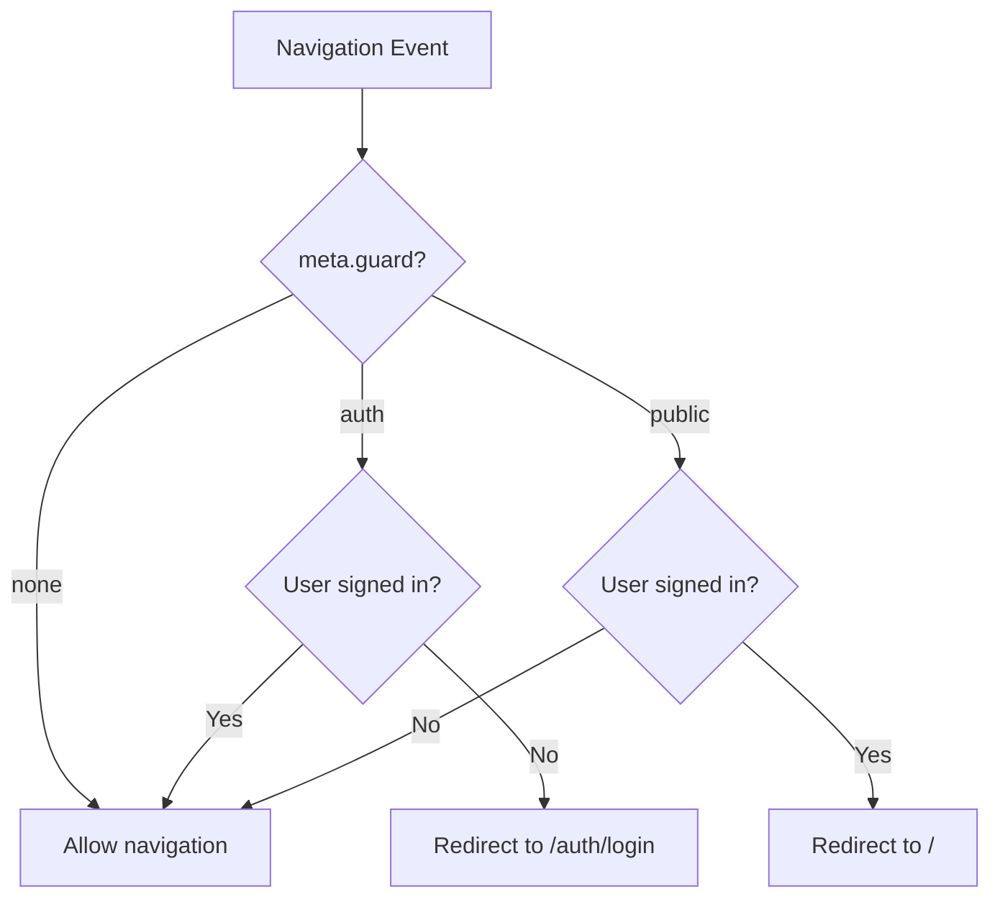
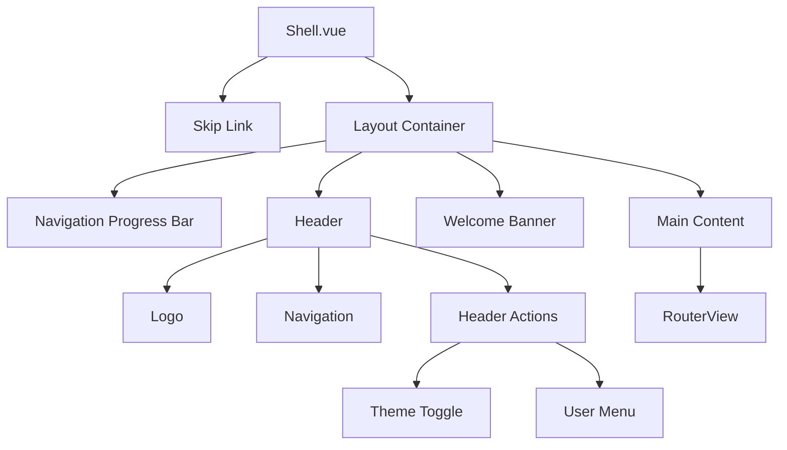

# Routing and Navigation Guards

This page documents the routing system of the Ulabase Vue starter application, including the route map, feature-flag gating, lazy loading, navigation guards, and the shell layout that wraps authenticated content. For details on what the guards actually do (authentication redirects, session management), see [Authentication Flows](../concepts/authentication-flows.md).

## Route Map Overview

The application defines all routes in `src/routes.ts`. Routes are organized into three categories:

1. **Public auth routes** — Login, signup, verification, and password reset pages (guarded with `public`)
2. **Unguarded routes** — Invitation acceptance (no guard, works for all auth states)
3. **Authenticated routes** — Wrapped in the Shell layout with `auth` guard

### Feature-Flag Gated Routes

Routes are conditionally included based on feature flags from `src/environments/environment.ts`. When a flag is `false`, the corresponding route is not registered at all:

| Feature Flag | Routes Affected | Guard |
|--------------|-----------------|-------|
| `emailRegistration \|\| oauthLogin` | `/auth/signup` | `public` |
| `emailRegistration` | `/auth/verify` | `public` |
| `passwordReset` | `/auth/forgot-password`, `/auth/reset-password` | `public` |
| `teamInvitations` | `/invitations/accept` | none |

### Complete Route Map

| Path | Component | Guard | Feature Flag | Description |
|------|-----------|-------|--------------|-------------|
| `/auth/login` | Login.vue | `public` | always | Login page |
| `/auth/signup` | Signup.vue | `public` | `emailRegistration \|\| oauthLogin` | Registration page |
| `/auth/verify` | Verify.vue | `public` | `emailRegistration` | Email verification |
| `/auth/forgot-password` | ForgotPassword.vue | `public` | `passwordReset` | Password reset request |
| `/auth/reset-password` | ResetPassword.vue | `public` | `passwordReset` | Password reset form |
| `/invitations/accept` | Accept.vue | **none** | `teamInvitations` | Invitation acceptance (intentionally unguarded) |
| `/` | Shell.vue | `auth` | always | App shell with children |
| `/home` | Home.vue | `auth` (inherited) | always | Home page |
| `/teams` | Teams.vue | `auth` (inherited) | always | Team list |
| `/teams/new` | NewTeam.vue | `auth` (inherited) | always | Create team |
| `/teams/:id` | TeamDetail.vue | `auth` (inherited) | always | Team detail |
| `/account` | Account.vue | `auth` (inherited) | always | User account |
| `/:pathMatch(.*)*` | Home.vue | **none** | always | Catch-all fallback |

## Lazy Loading

All page components use dynamic imports for code splitting:

```typescript
const Login = () => import('./pages/auth/login/Login.vue');
const Signup = () => import('./pages/auth/signup/Signup.vue');
const Verify = () => import('./pages/auth/verify/Verify.vue');
// etc.
```

This ensures each page is loaded only when needed, reducing initial bundle size. Vue Router automatically creates separate chunks for each page.

## Navigation Guards

### Guard Decision Flow



*Guard decision flow for a navigation event.*

### Guard Semantics

The global `beforeEach` guard in `main.ts` reads `to.meta.guard` and dispatches to the appropriate guard from `@ulabase/kit-vue`:

- **`auth` guard** — Redirects unauthenticated users to `/auth/login`; allows authenticated users through
- **`public` guard** — Redirects authenticated users to `/`; allows unauthenticated users through
- **No meta** — Route is unguarded (e.g., invitation acceptance, catch-all)

### Implementation Details

```typescript
const noNext: NavigationGuardNext = () => undefined;
router.beforeEach((to, from) => {
  if (to.meta.guard === 'auth') return rhAuth.authGuard.call(undefined, to, from, noNext);
  if (to.meta.guard === 'public') return rhAuth.publicGuard.call(undefined, to, from, noNext);
  return true;
});
```

The `noNext` function is a no-op because the kit's guards return their verdict rather than calling the traditional `next()` callback. This is a compatibility adapter for Vue Router's guard signature.

### Special Case: Invitation Acceptance

The `/invitations/accept` route intentionally has **no guard** — it must work for:
- Signed-out invitees without accounts (new users)
- Signed-out invitees with accounts (existing users)
- Signed-in users (already authenticated)

This route handles all three states internally in its component logic. Adding a guard would break the invitation flow for users who aren't yet signed in.

### User Watcher for Session Loss

Vue Router guards run only on navigation events. When a user's session ends while they are already on an authenticated page (token expiration, forced logout from another tab, server-side revocation), the `beforeEach` guard never fires and the user remains on a route they can no longer access.

A `watch` on `rhAuth.store.user` in `main.ts` closes this gap:

```typescript
watch(rhAuth.store.user, (user, previous) => {
  if (user || !previous) return;
  if (router.currentRoute.value.matched.some(r => r.meta.guard === 'auth'))
    void router.push('/auth/login');
});
```

- **`user` is truthy** — A session exists; no action needed.
- **`previous` is falsy** — The store was never in a signed-in state; this is the initial session check finding no session, not a logout. The watcher skips the redirect.
- **User becomes `null` while on an auth-guarded route** — The watcher redirects to `/auth/login`.

Routes without `meta.guard` (e.g., invitation acceptance) are unaffected by this watcher.

## Shell Layout

The Shell component (`src/pages/shell/Shell.vue`) provides the application layout for authenticated pages.

### Layout Structure



*Shell layout structure showing header, navigation, and content areas.*

### Key Features

#### Skip Link
- Hidden by default, visible on focus for keyboard navigation
- Links to `#main` for accessibility
- Styled with `.skip-link` class
- Important for users who navigate with keyboard or screen readers

#### Header Navigation
- Contains logo, main navigation links, and header actions
- Navigation links use `RouterLink` with active state detection
- Section links use `isActive()` for sub-page matching
- Sticky header with z-index for proper layering

#### User Menu Dropdown
- Displays user initials in avatar button
- Shows dropdown with user info, account link, and logout
- Implements keyboard navigation (Escape to close)
- Uses click-outside detection to close
- Shows active team name when available

#### Theme Toggle
- Light/dark mode toggle using `useTheme()` composable
- Persists preference in localStorage with key `rh-theme`
- Toggles `dark` class on `document.documentElement`
- Default: system preference or light mode
- Includes SSR safety check (`typeof window !== 'undefined'`)

#### Welcome Banner
- Displays "Welcome aboard — your account is ready." after signup
- Controlled by `justSignedUp` flag from URL parameter `flow=signup`
- Dismissible with close button
- Flag cleared after display to prevent showing on subsequent navigations

#### Navigation Progress Bar
- Shows during route transitions
- Driven by `navigating` ref that tracks router state
- Uses CSS animation for smooth progress indication
- Prevents app from appearing frozen during lazy loading
- Also handles router errors to reset the progress state

### Implementation Details

```typescript
// Theme composable (from Shell.vue)
function useTheme() {
  const dark = ref(typeof window !== 'undefined' && localStorage.getItem(STORAGE_KEY) === 'dark');
  watch(dark, value => document.documentElement.classList.toggle('dark', value), {
    immediate: true,
  });
  function toggle(): void {
    dark.value = !dark.value;
    localStorage.setItem(STORAGE_KEY, dark.value ? 'dark' : 'light');
  }
  return { dark, toggle };
}

// Navigation progress tracking (from Shell.vue)
const navigating = ref(false);
const stopBefore = router.beforeEach(() => {
  navigating.value = true;
});
const stopAfter = router.afterEach(() => {
  navigating.value = false;
});
const stopError = router.onError(() => {
  navigating.value = false;
});
```

### Layout CSS Classes

- `.layout` — Flex container with `min-height: 100vh`
- `.header` — Flex container for header elements (sticky, z-index: 100)
- `.nav` — Navigation links container (flex, gap, auto-scroll)
- `.header-actions` — Container for theme toggle and user menu
- `.main` — Main content area with padding (max-width: 960px)
- `.nav-progress` — Fixed progress bar at top of screen (z-index: 300)
- `.skip-link` — Accessibility skip link (hidden until focused)
- `.welcome-banner` — Success banner for new signups
- `.dropdown` — User menu dropdown (absolute positioned, z-index: 200)

## Route Configuration

### Environment-Based Route Registration

Routes are conditionally included using JavaScript spread syntax:

```typescript
const { emailRegistration, passwordReset, oauthLogin, teamInvitations } = environment.features;

export const routes: RouteRecordRaw[] = [
  { path: '/auth/login', component: Login, meta: { guard: 'public' } },
  ...(emailRegistration || oauthLogin
    ? [{ path: '/auth/signup', component: Signup, meta: { guard: 'public' as const } }]
    : []),
  // ... other conditional routes
];
```

### Catch-All Route

The final route handles unmatched paths:

```typescript
{ path: '/:pathMatch(.*)*', component: Home }
```

This redirects any unknown routes to the home page without a guard. It's important that this route comes last in the array, as Vue Router matches routes in order.

### Consents Gate and Routing

The ConsentsGate component in `App.vue` wraps the entire router view:

```vue
<ConsentsGate>
  <RouterView />
</ConsentsGate>
```

This placement is critical: a user blocked by the consents gate has no valid session (the `/users/me` endpoint returns HTTP 451), so the `authGuard` would bounce them to the login page. By placing ConsentsGate above the router view, blocked users see the acceptance overlay regardless of which route they attempt.

The overlay is purely a user-experience feature; removing it via dev tools doesn't bypass enforcement — the server's Guards rule still returns 451 for all requests.

## Guard Inheritance

Child routes of the Shell inherit the `auth` guard from their parent. The global `beforeEach` guard in `main.ts` runs on every navigation, including child routes. When a child route doesn't specify its own `meta.guard`, the guard sees the parent's `meta.guard` value:

```typescript
{
  path: '/',
  component: Shell,
  meta: { guard: 'auth' },
  children: [
    { path: '', component: Home },      // Inherits auth guard
    { path: 'home', component: Home },  // Inherits auth guard
    { path: 'teams', component: Teams },// Inherits auth guard
    { path: 'teams/new', component: NewTeam },// Inherits auth guard
    { path: 'teams/:id', component: TeamDetail },// Inherits auth guard
    { path: 'account', component: Account },// Inherits auth guard
  ],
}
```

This means you don't need to specify `meta.guard` for child routes - they automatically inherit the parent's guard. For public pages, you must explicitly set `meta: { guard: 'public' }` at the top level.

### How Guard Inheritance Works

Vue Router's `to.meta.guard` accesses the merged meta from all matched route records. For nested routes, the child route's meta is merged with its parent's meta. If a child doesn't define `meta.guard`, the parent's value is used. This is why the global `beforeEach` guard can simply check `to.meta.guard` without needing to traverse the route hierarchy.

## Related Pages

- [App Bootstrap](./app-bootstrap.md) — Application initialization and guard wiring
- [Authentication Flows](../concepts/authentication-flows.md) — What the guards actually do (redirects, session management)
- [Feature Flags](../concepts/feature-flags.md) — Controlling feature availability via environment configuration
- [Adding a New Page](../workflows/adding-a-new-page.md) — Workflow for adding new routes and pages
