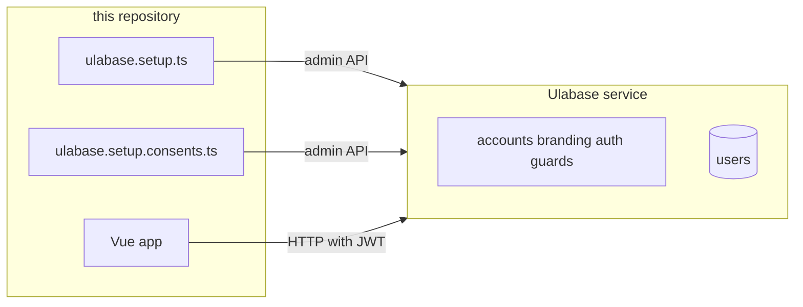
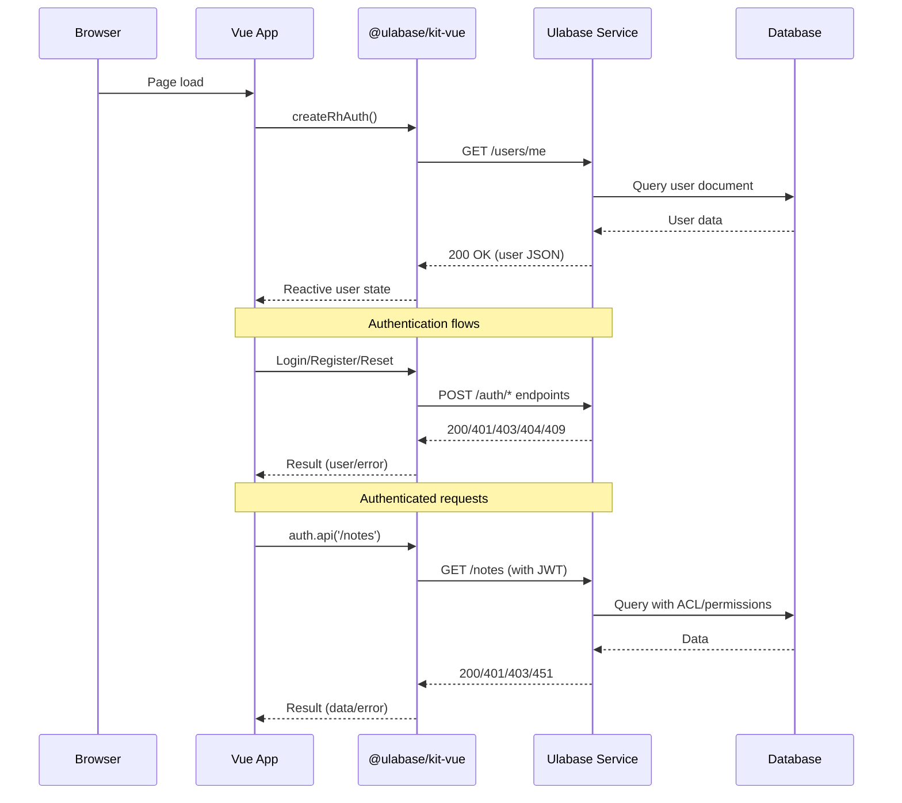

# Service Model

This page documents the mental model of the Ulabase service that the Vue starter application communicates with. The service is a managed backend that handles authentication, user management, permissions, and business rules — all configured declaratively through setup files in this repository. **This repository contains no server code**; the service runs externally and is configured via `ulabase.setup.ts` and `ulabase.setup.consents.ts`.

## App/Service Boundary

The application communicates with the Ulabase service over HTTP. The service exposes endpoints for authentication, user management, and data collections. The client-side code in this repository reacts to HTTP status codes rather than enforcing business rules. The two setup files in this repo are not part of the running app: they are one-shot declarative installers that shape the remote service through a CLI admin API.



*The repo holds the Vue app and two setup installers; the accounts, branding, auth-claims, guards, and users state all live in the external service.*

At runtime the kit mediates every call: `@ulabase/kit-vue` holds the session, attaches the bearer token, and surfaces auth failures to the app.



*The Vue app communicates with the Ulabase service via HTTP endpoints. The kit handles authentication and session management.*

## Core Service Components

### Accounts Feature

The accounts feature is the foundation of the service, providing user registration, authentication, and management. `ulabase.setup.ts` installs it and then configures it to match the app: server-side feature toggles (`registration`, `verification`, `password-reset`, `invitations`, `oauth`) are derived from `environment.features`, and `frontend-url` / `frontend-app-url` are set so verification, reset, and invitation emails link back to the app. The consents setup file runs these same accounts steps first, because a gate has nothing to block until the service can create users.

### Branding and the App Name

The name shown on the sign-in page and in every email the service sends lives in the **Branding** feature's `name` field — not in the app bundle. `ulabase.setup.ts` takes `APP_NAME` (env var, default `Ulabase Starter`) and writes it there through `getFeatureConfig` / `updateFeatureConfig`. The update is a merge with the current branding document, so a color and logo already set in the console survive; only `name` is replaced.

### Users Collection

The service maintains a `users` collection that stores user documents with the following structure:

```typescript
{
  _id: string;           // User ID
  password?: string;     // Hashed password (optional for OAuth users)
  roles: string[];       // User roles (e.g., ['user'])
  profile: {
    name?: string;
    surname?: string;
    avatarUrl?: string;
  };
  latestConsents?: {     // Only with consents gate
    tos: string;         // Version of accepted ToS
    pp: string;          // Version of accepted Privacy Policy
    acceptedAt: Date;
  };
  consents?: Array<{     // Only with consents gate
    tos: string;
    pp: string;
    acceptedAt: Date;
  }>;
  socialAuths?: Array<...>;
  teams?: Array<...>;
  team?: object;
}
```

When the consents gate is installed, the collection is validated by the `userConsentsSchema` JSON Schema. That schema requires only `_id` and `roles`: registration and invitations insert documents before password, profile, consents, or team fields exist, so demanding them would reject every signup. `acceptedAt` is declared as a BSON date (`_$date` inside the stored schema), and `_id` is required even though it arrives in the path on a `PUT /users/{id}`.

### ACL Permissions

Access Control Lists (ACL) define what operations users can perform. The service enforces these permissions server-side:

1. **Authentication endpoints** (`/auth/*`, `/token`) - public access for login, registration, and token operations
2. **User endpoints** (`/users/*`) - protected by permissions:
   - Users can read their own profile (`GET /users/me`)
   - Users can update their own consents (`PATCH /users/{userId}`) - only when the consents gate is enabled
   - Team operations require appropriate team membership
3. **Data endpoints** (your own collections) - protected by collection-specific permissions

The consents setup adds exactly one permission, `userCanPatchOwnConsents`: `PATCH /users/{userId}` scoped to the caller's own id and to the `consents` field via `bson-request-whitelist(consents)`. Nothing authorizes that PATCH out of the box — without the permission the acceptance is a `403` and the user is locked out, and a guards rule never sees a request the ACL already refused.

The permission's `mergeRequest` is what makes the server the source of truth for acceptances. It stamps `latestConsents` with the current `TOS_VERSION` / `PP_VERSION` and `acceptedAt: '@now'`, and `$push`es the same entry onto the `consents` history. The client sends an empty `consents` array and states nothing about versions or timestamps — it could otherwise accept terms it was never shown or backdate an acceptance.

### JWT Claims

JSON Web Tokens (JWT) carry user information and are used for authentication. Which user-document properties appear in the token is the `account-properties-claims` list on the **`auth` feature** (a feature that is always on and configured like any other). This repo's setup never calls an `/auth-config/{srvId}` endpoint: `ulabase.setup.consents.ts` reads and writes that list through `admin.getFeatureConfig(srvId, 'auth')` and `admin.updateFeatureConfig(srvId, 'auth', ...)`, merging rather than replacing so a service may carry claims of its own.

The consents setup adds exactly two paths:

- `latestConsents/tos`
- `latestConsents/pp`

The guards rule compares those claims on the token (`@user.latestConsents.*`), not a database read. That is why the claims must exist: a missing claim compares false for every token-authenticated user — including one who just accepted — and blocks them permanently while the condition still looks reasonable. Only these two are added; the `consents` history grows at every acceptance and belongs in the document, not in a base64-readable token.

### Guards Rules

Guards are server-side rules that block requests based on conditions. The consents gate uses a guard rule that:

- Blocks authenticated users who haven't accepted current Terms/Privacy Policy
- Returns HTTP 451 (Unavailable For Legal Reasons)
- Excludes anonymous callers (`equals(@authenticated, 'true')` is not satisfied), auth endpoints, token endpoints, and the acceptance request itself
- **Does not exclude `/users/me`** - This is what makes the gate work without client-side probing
- Allows the request when the rule cannot be evaluated (`on_error: 'allow'`), so a broken condition never locks everyone out

The rule id is `consentsGate`; its condition blocks when *either* acceptance is missing (`not (A and B)`), and the check compares the full condition string so a version bump reports as outstanding work rather than as satisfied.

## Request Path and Endpoints

The application and setup scripts communicate with the service through these key paths:

### Authentication Endpoints (`/auth/*`)

| Endpoint | Method | Purpose | Status Codes |
|----------|--------|---------|--------------|
| `/auth/register` | POST | User registration | 201, 400, 409 |
| `/auth/login` | POST | Email/password login | 200, 401 |
| `/auth/verify` | POST | Email verification | 200, 400 |
| `/auth/forgot-password` | POST | Request password reset | 200, 404 |
| `/auth/reset-password` | POST | Reset password with token | 200, 400 |
| `/auth/oauth/authorize/{provider}` | GET | Start OAuth sign-in | 200, 400 |
| `/auth/oauth/callback/{provider}` | GET | OAuth callback | 200, 400 |

### Token Endpoint

| Endpoint | Method | Purpose | Status Codes |
|----------|--------|---------|--------------|
| `/token` | GET | Refresh JWT token | 200, 401 |
| `/token?renew=true` | GET | Force token renewal | 200, 401 |

### User Endpoints

| Endpoint | Method | Purpose | Status Codes |
|----------|--------|---------|--------------|
| `/users/me` | GET | Get current user profile | 200, 401, 451 |
| `/users/{userId}` | PATCH | Update own consents (consents setup) | 200, 401, 403, 404, 451 |
| `/users/_meta` | GET | Get collection metadata | 200, 401 |

### Schema Endpoints (setup-time)

| Endpoint | Method | Purpose | Status Codes |
|----------|--------|---------|--------------|
| `/schemas/{id}` | GET | Get JSON schema | 200, 401, 404 |
| `/schemas/{id}` | PUT | Create/update JSON schema | 200, 401 |

### Feature Configuration (admin API, setup-time)

Service feature state is not read or written by the app. The setup scripts use the CLI admin client — `installFeature`, `getFeatureConfig`, `updateFeatureConfig`, `putSchema`, `putPermission` — against features such as `accounts`, `branding`, `auth`, `guards`, and `origin-allowlist`. Redacted secrets come back as bullets and are passed straight through on update so the server restores the stored value.

## Client-Side Reaction to Status Codes

The Vue application **reacts to status codes rather than enforcing rules**. This is a fundamental architectural principle:

| Status Code | Client Interpretation | Action |
|-------------|----------------------|--------|
| **401** | "Logged out" | Redirect to login page |
| **403** | "Not authorized" | Show error message |
| **404** | "Not found" | Show error message |
| **409** | "Conflict" (e.g., duplicate) | Show error message |
| **451** | "Blocked by consents gate" | Show consents overlay |

The client never pre-checks permissions or validates business rules. It simply sends requests and handles responses. `src/consents-signal.ts` is the 451 case: it raises a reactive flag on any `451` surfaced through `createRhAuth`'s `onError`, because session restoration absorbs failures and would otherwise make "blocked" and "signed out" look identical.

## Declarative Service Configuration

The service is configured declaratively from two files in this repository. Each step is a `check` and an `apply`, so a re-run against an already-configured service writes nothing; `--dry-run` reports what is missing.

### ulabase.setup.ts (Base Configuration)

1. **Accounts feature installed** - Installs the accounts plugin
2. **Branding carries the app name** - Sets `name` on the Branding feature, merged with the existing config
3. **Accounts configured to match the app** - Feature toggles from `environment.features`, plus `frontend-url` and `frontend-app-url`
4. **Google OAuth credentials** (conditional) - Only when the app enables Google sign-in
5. **Origin allowlist** - Allows the app's origin to call the service
6. **App points at service** - Writes the service URL into `src/environments/environment.ts` (`apiUrl`), deliberately last

### ulabase.setup.consents.ts (Consents Gate Configuration)

Imports the accounts setup and appends the gate's documents (accounts first, `appPointsAtService` kept last):

1. **User schema stored** - `userConsentsSchema`, compared canonically so an old copy is replaced
2. **Users collection validated** - Attaches the schema at `/users/_meta`
3. **Acceptance permission** - `userCanPatchOwnConsents` with the server-side `mergeRequest`
4. **JWT claims** - Adds `latestConsents/tos` and `latestConsents/pp` to `account-properties-claims` on the `auth` feature
5. **Guards feature installed** - Installs the guards plugin
6. **Consents gate rule** - `consentsGate`, `status_code: 451`, `on_error: 'allow'`
7. **App points at service** - Same final step as the base setup

`TOS_VERSION` and `PP_VERSION` at the top of the consents file are the only place the demanded versions live: both the permission's `mergeRequest` and the guard condition are derived from them. Publishing new terms is editing two strings and re-running the setup. The `Version …` line in `public/terms.html` and `public/privacy.html` is the one place left to keep in step by hand.

## Key Architectural Principles

1. **Server-side enforcement**: All business rules, permissions, and validation happen on the service
2. **Client-side reaction**: The Vue app only reacts to HTTP status codes
3. **Declarative configuration**: The service is configured from setup files, not manual console steps
4. **Single source of truth**: Feature flags in `environment.ts` drive both client and server configuration
5. **Idempotent setup**: Running setup multiple times produces the same result
6. **No server code in repo**: This repository contains only client-side Vue code and setup files

## Related Pages

- [Authentication Flows](../concepts/authentication-flows.md) - Detailed authentication flows
- [Consents Gate Pattern](../concepts/consents-gate.md) - How the consents gate works
- [Feature Flags](../concepts/feature-flags.md) - Client and server feature toggles
- [Service Configuration](../operations/service-configuration.md) - Setup file details
- [Quickstart](../quickstart.md) - Get the starter running
- [@ulabase/kit-vue Integration](../integrations/ulabase-kit-vue.md) - Client-side integration details
