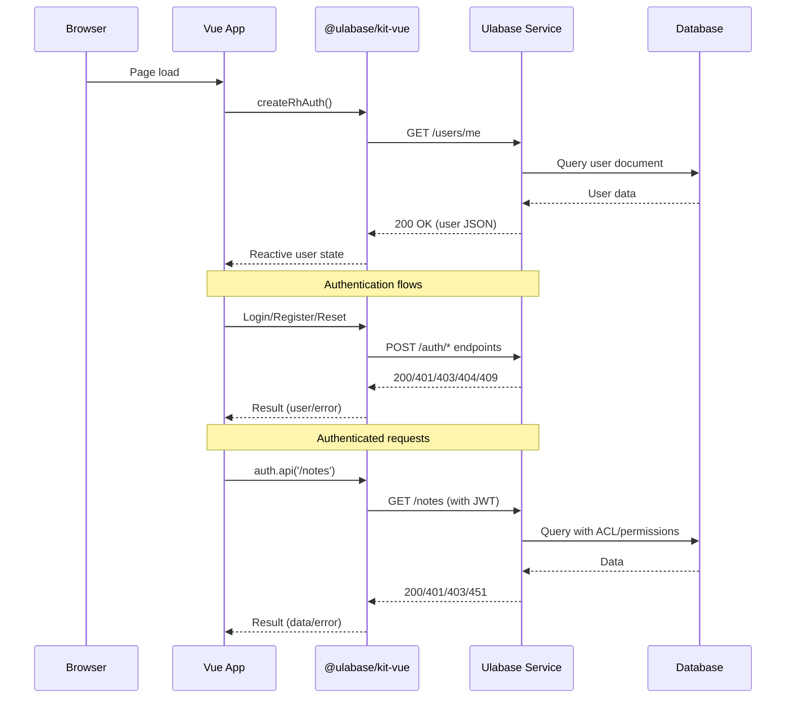

# Service Model

This page documents the mental model of the Ulabase service that the Vue starter application communicates with. The service is a managed backend that handles authentication, user management, permissions, and business rules—all configured declaratively through setup files in this repository. **This repository contains no server code**; the service runs externally and is configured via `ulabase.setup.ts` and `ulabase.setup.consents.ts`.

## App/Service Boundary

The application communicates with the Ulabase service over HTTP. The service exposes RESTful endpoints for authentication, user management, and configuration. The client-side code in this repository reacts to HTTP status codes rather than enforcing business rules.



*The Vue app communicates with the Ulabase service via HTTP endpoints. The kit handles authentication and session management.*

## Core Service Components

### Accounts Feature

The accounts feature is the foundation of the service, providing user registration, authentication, and management. It's installed via the `ulabase.setup.ts` file and includes:

- **User registration** with email/password or OAuth
- **Email verification** flows
- **Password reset** functionality
- **Team invitations** (when enabled)
- **Session management** via JWT tokens

### Users Collection

The service maintains a `users` collection that stores user documents with the following structure:

```typescript
{
  _id: string;           // User ID
  password?: string;     // Hashed password (optional for OAuth users)
  roles: string[];       // User roles (e.g., ['user'])
  profile: {
    name?: string;
    surname?: string;
    avatarUrl?: string;
  };
  latestConsents?: {     // Only with consents gate
    tos: string;         // Version of accepted ToS
    pp: string;          // Version of accepted Privacy Policy
    acceptedAt: Date;
  };
  consents?: Array<{     // Only with consents gate
    tos: string;
    pp: string;
    acceptedAt: Date;
  }>;
  socialAuths?: Array<...>;
  teams?: Array<...>;
  team?: object;
}
```

The collection's schema is validated by a JSON Schema (`userConsentsSchema` when consents are enabled), which defines required fields and allowed structure.

### ACL Permissions

Access Control Lists (ACL) define what operations users can perform. The service enforces these permissions server-side:

1. **Authentication endpoints** (`/auth/*`, `/token`) - Public access for login, registration, and token operations
2. **User endpoints** (`/users/*`) - Protected by permissions:
   - Users can read their own profile (`GET /users/me`)
   - Users can update their own consents (`PATCH /users/{userId}`) - only when consents gate is enabled
   - Team operations require appropriate team membership
3. **Data endpoints** (`/notes`, `/teams`, etc.) - Protected by collection-specific permissions

### JWT Claims

JSON Web Tokens (JWT) carry user information and are used for authentication. The service includes these claims in tokens:

- **Standard claims**: `sub` (user ID), `iat`, `exp`, `iss`
- **User properties**: `profile`, `roles`, `teams`, etc.
- **Consent claims** (when enabled): `latestConsents/tos`, `latestConsents/pp`

These claims are configured in the service's auth-config and are read by guards and permissions.

### Guards Rules

Guards are server-side rules that block requests based on conditions. The consents gate uses a guard rule that:

- Blocks authenticated users who haven't accepted current Terms/Privacy Policy
- Returns HTTP 451 (Unavailable For Legal Reasons)
- Excludes anonymous callers, auth endpoints, and the acceptance request itself
- **Does not exclude `/users/me`** - This is what makes the gate work without client-side probing

### auth-config

The auth-config endpoint (`/auth-config/{srvId}`) configures service-wide authentication settings, including:

- **account-properties-claims**: Which user properties appear in JWT tokens
- **OAuth provider credentials**: Client IDs and secrets for Google, GitHub, etc.
- **Feature toggles**: Registration, verification, password reset, etc.

## Request Path and Endpoints

The application communicates with the service through these key endpoints:

### Authentication Endpoints (`/auth/*`)

| Endpoint | Method | Purpose | Status Codes |
|----------|--------|---------|--------------|
| `/auth/register` | POST | User registration | 201, 400, 409 |
| `/auth/login` | POST | Email/password login | 200, 401 |
| `/auth/verify` | POST | Email verification | 200, 400 |
| `/auth/forgot-password` | POST | Request password reset | 200, 404 |
| `/auth/reset-password` | POST | Reset password with token | 200, 400 |
| `/auth/oauth/callback/{provider}` | GET | OAuth callback | 200, 400 |
| `/auth/accept-consents` | POST | Accept ToS/Privacy Policy | 200, 400 |

### Token Endpoint

| Endpoint | Method | Purpose | Status Codes |
|----------|--------|---------|--------------|
| `/token` | GET | Refresh JWT token | 200, 401 |
| `/token?renew=true` | GET | Force token renewal | 200, 401 |

### User Endpoints

| Endpoint | Method | Purpose | Status Codes |
|----------|--------|---------|--------------|
| `/users/me` | GET | Get current user profile | 200, 401, 451 |
| `/users/{id}` | GET | Get user by ID | 200, 401, 403, 404 |
| `/users/{id}` | PATCH | Update user (limited) | 200, 401, 403, 404 |
| `/users/_meta` | GET | Get collection metadata | 200, 401 |

### Configuration Endpoints

| Endpoint | Method | Purpose | Status Codes |
|----------|--------|---------|--------------|
| `/auth-config/{srvId}` | GET | Get auth configuration | 200, 401 |
| `/auth-config/{srvId}` | PATCH | Update auth configuration | 200, 401 |
| `/schemas/{id}` | GET | Get JSON schema | 200, 401, 404 |
| `/schemas/{id}` | PUT | Create/update JSON schema | 200, 401 |

## Client-Side Reaction to Status Codes

The Vue application **reacts to status codes rather than enforcing rules**. This is a fundamental architectural principle:

| Status Code | Client Interpretation | Action |
|-------------|----------------------|--------|
| **401** | "Logged out" | Redirect to login page |
| **403** | "Not authorized" | Show error message |
| **404** | "Not found" | Show error message |
| **409** | "Conflict" (e.g., duplicate) | Show error message |
| **451** | "Blocked by consents gate" | Show consents overlay |

The client never pre-checks permissions or validates business rules. It simply sends requests and handles responses.

## Declarative Service Configuration

The service is configured declaratively from two files in this repository:

### ulabase.setup.ts (Base Configuration)

Configures the accounts feature with these steps:

1. **Accounts feature installed** - Installs the accounts plugin
2. **Accounts configured to match the app** - Sets app-name, frontend URLs, and feature toggles
3. **Google OAuth credentials** (conditional) - Only when OAuth is enabled
4. **Origin allowlist** - Allows the app's origin to call the service
5. **App points at service** - Writes the service URL into `environment.ts`

### ulabase.setup.consents.ts (Consents Gate Configuration)

Extends the base configuration with consents gate documents:

1. **User schema stored** - Defines the user document structure with consents fields
2. **Users collection validated** - Attaches schema to users collection
3. **Acceptance permission** - Allows users to PATCH their own consents
4. **JWT claims** - Adds consent claims to tokens
5. **Guards feature installed** - Installs the guards plugin
6. **Consents gate rule** - Creates the blocking rule for unaccepted consents
7. **App points at service** - Writes the service URL (placed last)

## Key Architectural Principles

1. **Server-side enforcement**: All business rules, permissions, and validation happen on the service
2. **Client-side reaction**: The Vue app only reacts to HTTP status codes
3. **Declarative configuration**: The service is configured from setup files, not manual console steps
4. **Single source of truth**: Feature flags in `environment.ts` drive both client and server configuration
5. **Idempotent setup**: Running setup multiple times produces the same result
6. **No server code in repo**: This repository contains only client-side Vue code and setup files

## Related Pages

- [Authentication Flows](../concepts/authentication-flows.md) - Detailed authentication flows
- [Consents Gate Pattern](../concepts/consents-gate.md) - How the consents gate works
- [Service Configuration](../operations/service-configuration.md) - Setup file details
- [@ulabase/kit-vue Integration](../integrations/ulabase-kit-vue.md) - Client-side integration details
