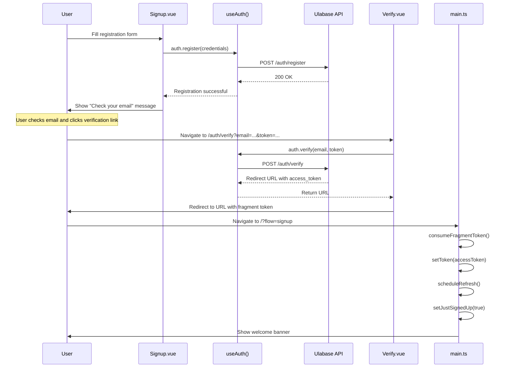
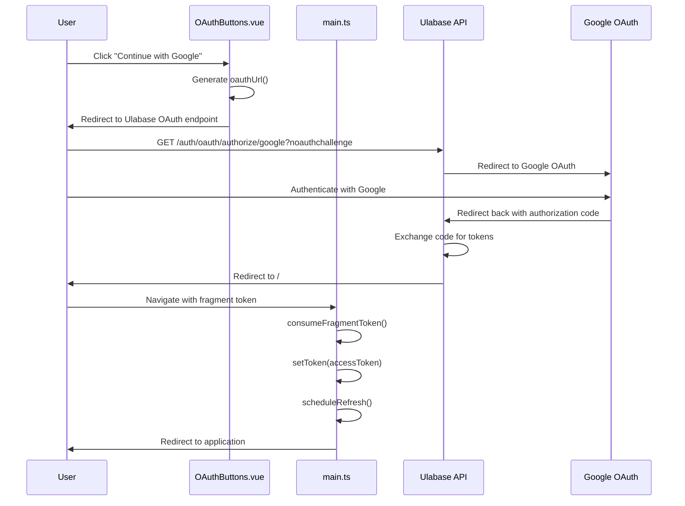
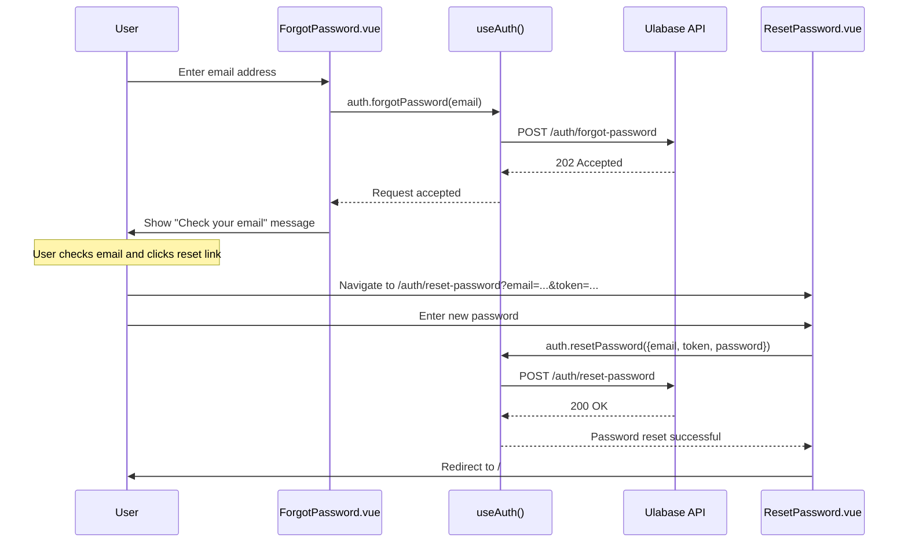

# Authentication Flows

This page documents all authentication flows in the Ulabase Vue starter application, including email/password registration with email verification, login, OAuth (Google), password reset, and session management. The authentication system is built on `@ulabase/kit-vue`, which provides Vue composables, router guards, and API integration.

## Overview

The application supports multiple authentication methods, controlled by feature flags in `src/environments/environment.ts`:

- **Email/password registration** with email verification (`emailRegistration: true`)
- **Password reset** via email (`passwordReset: true`)
- **OAuth login** with Google (`oauthLogin: false` by default)
- **Session management** via JWT tokens with automatic refresh

All authentication flows are handled through the `useAuth()` composable from `@ulabase/kit-vue`, which provides methods for registration, login, verification, password reset, and session management.

## Email/Password Sign-up Flow

The email/password sign-up flow involves user registration, email verification, and session establishment.

### Flow Steps

1. **User submits registration form** on `/auth/signup`
2. **`auth.register()` is called** with team name, first name, last name, email, and password
3. **Verification email sent** by the Ulabase service
4. **User clicks verification link** which arrives at `/auth/verify` with email and token parameters
5. **`auth.verify()` is called** and returns a redirect URL with `access_token` in the fragment
6. **Fragment token consumed** by `consumeFragmentToken()` in `src/main.ts`
7. **Session established** and user redirected to the application

### Key Components

- **`src/pages/auth/signup/Signup.vue`** - Registration form with validation
- **`src/pages/auth/verify/Verify.vue`** - Email verification page
- **`src/just-signed-up.ts`** - Flag management for welcome banner

### Registration Flow Diagram



*Email/password sign-up flow from registration through verification to session establishment.*

### Error Handling

- **Duplicate email (409)**: "An account with this email already exists."
- **Invalid/expired token**: "This verification link is missing required information." or "The verification link is invalid or has expired."
- **Missing parameters**: "This verification link is missing required information."

## Login Flow

The login flow authenticates users with email and password.

### Flow Steps

1. **User submits login form** on `/auth/login`
2. **`auth.login()` is called** with email and password
3. **Session established** and user redirected to `/`

### Key Components

- **`src/pages/auth/login/Login.vue`** - Login form with validation

### Error Handling

- **Invalid credentials (401)**: "Invalid email or password."
- **Invalid token error**: "This link is invalid or has expired." (when `?error=invalid_token` query parameter present)

## OAuth Flow (Google)

The OAuth flow enables authentication via Google sign-in.

### Flow Steps

1. **User clicks Google button** on login or signup page
2. **`oauthUrl()` generates authorize URL** pointing to Ulabase's OAuth endpoint
3. **User redirected to Google** for authentication
4. **Google redirects back** to Ulabase callback URL with authorization code
5. **Ulabase exchanges code** for tokens and redirects to application with `access_token` in fragment
6. **Fragment token consumed** by `consumeFragmentToken()` in `src/main.ts`
7. **Session established** and user redirected to application

### Key Components

- **`src/pages/auth/oauth-buttons/OAuthButtons.vue`** - OAuth button component
- **`src/oauth-url.ts`** - OAuth URL generation
- **`src/main.ts`** - Fragment token consumption

### OAuth Flow Diagram



*OAuth flow for Google sign-in from button click to session establishment.*

### OAuth Configuration

OAuth requires configuration on both the Google Cloud console and the Ulabase service:

1. **Google Cloud console**: Create OAuth client with redirect URI: `https://<srvId>.ulabase.app/auth/oauth/callback/google`
2. **Environment configuration**: Set `oauthLogin: true` in `src/environments/environment.ts`
3. **Service setup**: Run `GOOGLE_CLIENT_ID=… GOOGLE_CLIENT_SECRET=… ulabase setup --srv <srvId>`

## Password Reset Flow

The password reset flow allows users to reset forgotten passwords.

### Flow Steps

1. **User requests reset link** on `/auth/forgot-password`
2. **`auth.forgotPassword()` is called** with email
3. **Reset email sent** (always returns 202 to prevent email enumeration)
4. **User clicks reset link** which arrives at `/auth/reset-password` with email and token parameters
5. **User submits new password** on reset form
6. **`auth.resetPassword()` is called** with email, token, and new password
7. **Session established** and user redirected to `/`

### Key Components

- **`src/pages/auth/forgot-password/ForgotPassword.vue`** - Reset request form
- **`src/pages/auth/reset-password/ResetPassword.vue`** - New password form

### Password Reset Flow Diagram



*Password reset flow from request through email to password change.*

### Error Handling

- **Invalid/expired token (401)**: "This reset link is invalid or has expired."
- **Missing parameters**: "This password reset link is missing required information."
- **Password too short**: "Password must be at least 8 characters."

## Session Management

Session management handles token storage, refresh, and authentication state.

### Key Mechanisms

1. **Fragment token consumption**: `consumeFragmentToken()` in `src/main.ts` extracts `access_token` from URL fragment
2. **Token storage**: `setToken()` stores token in localStorage/sessionStorage
3. **Automatic refresh**: `scheduleRefresh()` schedules token refresh before expiration
4. **Session restoration**: `createRhAuth()` automatically checks session on initialization

### Implementation Details

```typescript
// src/main.ts
function consumeFragmentToken(): void {
  const hash = window.location.hash;
  if (hash) {
    const params = new URLSearchParams(hash.substring(1));
    const accessToken = params.get('access_token');
    if (accessToken) {
      setToken(accessToken);
      scheduleRefresh({ apiBaseUrl: environment.apiUrl });
    }
  }

  const search = new URLSearchParams(window.location.search);
  const isSignup = search.get('flow') === 'signup';
  if (isSignup) {
    setJustSignedUp(true);
    search.delete('flow');
  }

  if (!hash && !isSignup) return;

  const query = search.toString();
  history.replaceState(null, '', window.location.pathname + (query ? `?${query}` : ''));
}
```

### Just-Signed-Up Flag

The `just-signed-up` flag controls display of a welcome banner for new users:

1. **Flow detection**: `?flow=signup` query parameter sets `setJustSignedUp(true)`
2. **Banner display**: Shell.vue reads flag and shows welcome banner
3. **Flag clearing**: Flag is immediately cleared after reading to prevent showing on subsequent navigations
4. **URL cleanup**: Query parameter is removed from URL

### Authentication Guards

Authentication guards protect routes based on authentication state:

- **`auth` guard**: Redirects unauthenticated users to `/auth/login`
- **`public` guard**: Redirects authenticated users to `/`
- **No guard**: Route is unguarded (e.g., invitation acceptance)

Guards are implemented in `src/main.ts` using `@ulabase/kit-vue` guards:

```typescript
router.beforeEach((to, from) => {
  if (to.meta.guard === 'auth') return rhAuth.authGuard.call(undefined, to, from, noNext);
  if (to.meta.guard === 'public') return rhAuth.publicGuard.call(undefined, to, from, noNext);
  return true;
});
```

## Feature Flag Dependencies

Authentication flows are controlled by feature flags in `src/environments/environment.ts`:

| Feature Flag | Affects |
|--------------|---------|
| `emailRegistration` | Sign-up form, verification page |
| `passwordReset` | Forgot password and reset password pages |
| `oauthLogin` | OAuth buttons on login and signup pages |
| `oauthProviders` | Available OAuth providers (default: `['google']`) |
| `teamInvitations` | Invitation acceptance page (not directly auth, but related) |

When a feature flag is `false`:
1. The corresponding route is not registered
2. UI elements linking to that route are hidden
3. The API endpoint may still exist but is not accessible through the UI

## Error Handling Patterns

Authentication errors follow consistent patterns:

### HTTP Status Codes
- **401**: Invalid credentials or expired tokens
- **409**: Conflict (e.g., duplicate email during registration)
- **451**: Blocked by consents gate (Terms of Service/Privacy Policy not accepted)

### User-Facing Messages
- **Generic fallback**: "Something went wrong. Please try again."
- **Specific errors**: Mapped from status codes to user-friendly messages
- **Field validation**: Real-time validation with `touched` state tracking

### API Integration
All authentication API calls use the `useAuth()` composable which:
- Handles HTTP requests to `/auth/*` endpoints
- Manages JWT token lifecycle
- Provides consistent error handling
- Integrates with the consents gate system

## Consents Gate Integration

The consents gate interacts with authentication flows:

1. **Session restoration**: First `/users/me` request may return 451 if consents not accepted
2. **Error propagation**: `consentsOnError` handler raises blocked flag on 451
3. **UI blocking**: `ConsentsGate.vue` component blocks UI until consents accepted
4. **Token renewal**: After accepting consents, token must be renewed with `GET /token?renew=true`

The gate is positioned **above** authentication guards in `App.vue` to ensure blocked users see the consents overlay rather than being redirected to login.
