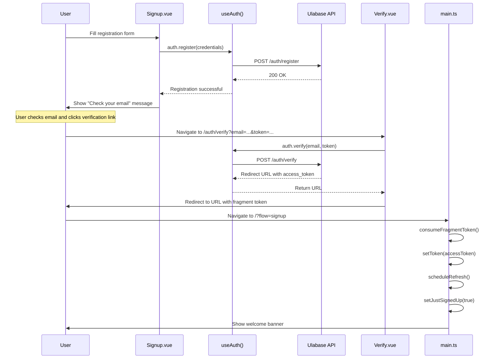
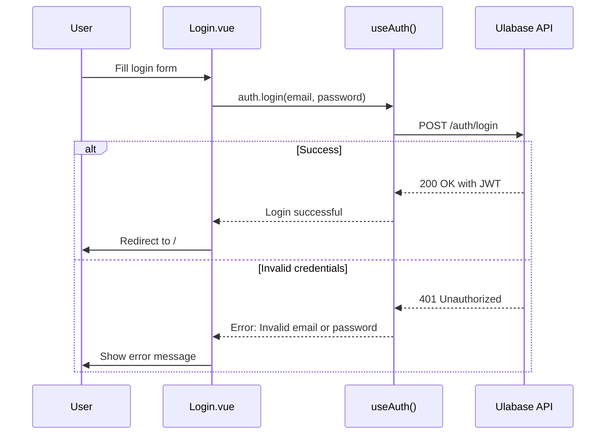
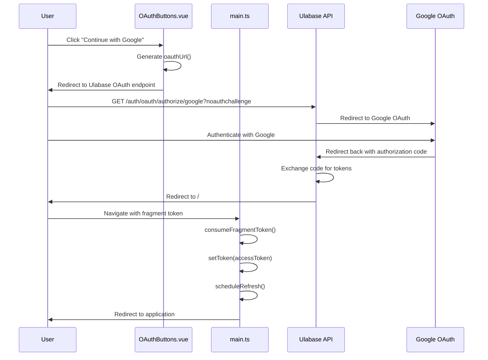
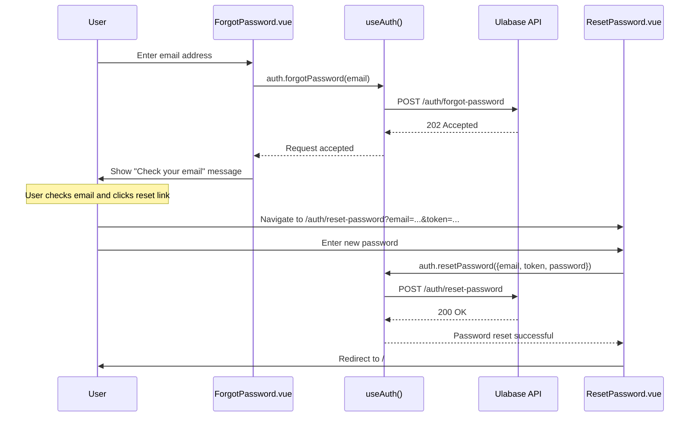
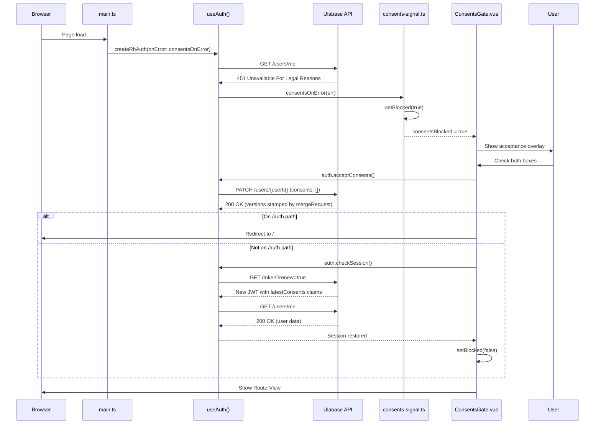

# Authentication Flows

This page documents all authentication flows in the Ulabase Vue starter application, including email/password registration with email verification, login, OAuth (Google), password reset, and session management. The authentication system is built on `@ulabase/kit-vue`, which provides Vue composables, router guards, and API integration.

## Overview

The application supports multiple authentication methods, controlled by feature flags in `src/environments/environment.ts`:

- **Email/password registration** with email verification (`emailRegistration: true`)
- **Password reset** via email (`passwordReset: true`)
- **OAuth login** with Google (`oauthLogin: false` by default)
- **Session management** via JWT tokens with automatic refresh

All authentication flows are handled through the `useAuth()` composable from `@ulabase/kit-vue`, which provides methods for registration, login, verification, password reset, and session management.

## Email/Password Sign-up Flow

The email/password sign-up flow involves user registration, email verification, and session establishment.

### Flow Steps

1. **User submits registration form** on `/auth/signup`
2. **`auth.register()` is called** with team name, first name, last name, email, and password
3. **Verification email sent** by the Ulabase service
4. **User clicks verification link** which arrives at `/auth/verify` with email and token parameters
5. **`auth.verify()` is called** and returns a redirect URL with `access_token` in the fragment
6. **Fragment token consumed** by `consumeFragmentToken()` in `src/main.ts`
7. **Session established** and user redirected to the application

### Key Components

- **`src/pages/auth/signup/Signup.vue`** - Registration form with validation
- **`src/pages/auth/verify/Verify.vue`** - Email verification page
- **`src/just-signed-up.ts`** - Flag management for welcome banner

### Registration Flow Diagram



*Email/password sign-up flow from registration through verification to session establishment.*

### Verification Page Behavior

The verification page (`Verify.vue`) handles multiple scenarios:

1. **Missing parameters**: Shows "This verification link is missing required information." if email or token is missing
2. **Error query parameter**: Shows "The verification link is invalid or has expired." if `?error` is present
3. **Valid parameters**: Calls `auth.verify(email, token)` and redirects to the returned URL
4. **Loading state**: Shows "Verifying your email…" while the verification is in progress

The verification page is protected by the `public` guard, so authenticated users are redirected to the application.

### Error Handling

- **Duplicate email (409)**: "An account with this email already exists."
- **Invalid/expired token**: "This verification link is missing required information." or "The verification link is invalid or has expired."
- **Missing parameters**: "This verification link is missing required information."

## Login Flow

The login flow authenticates users with email and password.

### Flow Steps

1. **User submits login form** on `/auth/login`
2. **`auth.login()` is called** with email and password
3. **Session established** and user redirected to `/`

### Key Components

- **`src/pages/auth/login/Login.vue`** - Login form with validation

### Login Flow Diagram



*Login flow from form submission to session establishment or error display.*

### Login Page Features

The login page includes several user experience features:

1. **Password visibility toggle**: Users can show/hide their password
2. **Real-time validation**: Email and password fields are validated after being touched
3. **Loading state**: Button shows "Logging in…" while the request is in progress
4. **Error handling**: 401 errors map to "Invalid email or password." message
5. **OAuth integration**: OAuth buttons appear when `oauthLogin` feature is enabled
6. **Navigation links**: Forgot password and create account links appear based on feature flags
7. **Query parameter handling**: `?error=invalid_token` shows appropriate error message

### Error Handling

- **Invalid credentials (401)**: "Invalid email or password."
- **Invalid token error**: "This link is invalid or has expired." (when `?error=invalid_token` query parameter present)

## OAuth Flow (Google)

The OAuth flow enables authentication via Google sign-in.

### Flow Steps

1. **User clicks Google button** on login or signup page
2. **`oauthUrl()` generates authorize URL** pointing to Ulabase's OAuth endpoint
3. **User redirected to Google** for authentication
4. **Google redirects back** to Ulabase callback URL with authorization code
5. **Ulabase exchanges code** for tokens and redirects to application with `access_token` in fragment
6. **Fragment token consumed** by `consumeFragmentToken()` in `src/main.ts`
7. **Session established** and user redirected to application

### Key Components

- **`src/pages/auth/oauth-buttons/OAuthButtons.vue`** - OAuth button component
- **`src/oauth-url.ts`** - OAuth URL generation
- **`src/main.ts`** - Fragment token consumption

### OAuth Flow Diagram



*OAuth flow for Google sign-in from button click to session establishment.*

### OAuth URL Construction

The `oauthUrl()` function in `src/oauth-url.ts` constructs the OAuth authorize URL:

```typescript
export function oauthUrl(provider: string): string {
  return `${environment.apiUrl}/auth/oauth/authorize/${provider}?noauthchallenge`;
}
```

The `noauthchallenge` query parameter tells the Ulabase service not to redirect to login if the user isn't authenticated, allowing the OAuth flow to proceed.

### OAuth Providers

The system supports multiple OAuth providers, configured in `environment.features.oauthProviders`:
- **Google**: Default provider with SVG icon
- **GitHub**: Supported with SVG icon
- **Custom providers**: Can be added by extending the providers array

Each provider gets its own button with appropriate branding and icon.

### OAuth Configuration

OAuth requires configuration on both the Google Cloud console and the Ulabase service:

1. **Google Cloud console**: Create OAuth client with redirect URI: `https://<srvId>.ulabase.app/auth/oauth/callback/google`
2. **Environment configuration**: Set `oauthLogin: true` in `src/environments/environment.ts`
3. **Service setup**: Run `GOOGLE_CLIENT_ID=… GOOGLE_CLIENT_SECRET=… ulabase setup --srv <srvId>`

## Password Reset Flow

The password reset flow allows users to reset forgotten passwords.

### Flow Steps

1. **User requests reset link** on `/auth/forgot-password`
2. **`auth.forgotPassword()` is called** with email
3. **Reset email sent** (always returns 202 to prevent email enumeration)
4. **User clicks reset link** which arrives at `/auth/reset-password` with email and token parameters
5. **User submits new password** on reset form
6. **`auth.resetPassword()` is called** with email, token, and new password
7. **Session established** and user redirected to `/`

### Key Components

- **`src/pages/auth/forgot-password/ForgotPassword.vue`** - Reset request form
- **`src/pages/auth/reset-password/ResetPassword.vue`** - New password form

### Password Reset Flow Diagram



*Password reset flow from request through email to password change.*

### Email Enumeration Prevention

The password reset flow is designed to prevent email enumeration:
- **ForgotPassword.vue**: Always shows "Check your email" message regardless of email existence
- **API behavior**: Always returns 202 Accepted to prevent revealing which emails are registered
- **Security**: Attackers cannot determine if an email address has an account

### Error Handling

- **Invalid/expired token (401)**: "This reset link is invalid or has expired."
- **Missing parameters**: "This password reset link is missing required information."
- **Password too short**: "Password must be at least 8 characters."

## Session Management

Session management handles token storage, refresh, and authentication state. The system uses JWT tokens with automatic refresh and fragment-based token landing for OAuth and email verification flows.

### Token-in-Fragment Landing

The token-in-fragment pattern is used for secure token transmission without exposing tokens in server logs:

1. **Fragment URL**: After successful verification or OAuth, the Ulabase service redirects to `{appUrl}/#access_token={jwt}`
2. **Fragment consumption**: `consumeFragmentToken()` in `src/main.ts` extracts the token from the URL fragment
3. **Token storage**: `setToken()` stores the token for subsequent API calls
4. **Refresh scheduling**: `scheduleRefresh()` schedules automatic token refresh before expiration
5. **URL cleanup**: The fragment is removed from the URL using `history.replaceState()`

This pattern is used by both email verification and OAuth flows, ensuring tokens are never sent to the server in referrer headers.

### Session Restoration

Session restoration happens automatically when the application loads:

1. **Create auth store**: `createRhAuth()` creates the authentication store
2. **Check session**: The store automatically checks `/users/me` to restore the session
3. **Token validation**: If a valid token exists, the user is restored to authenticated state
4. **Consents gate**: If the user hasn't accepted required consents, the request returns 451

### Just-Signed-Up Flag

The `just-signed-up` flag controls display of a welcome banner for new users:

1. **Flow detection**: `?flow=signup` query parameter sets `setJustSignedUp(true)`
2. **Banner display**: Shell.vue reads the flag and shows a welcome banner
3. **Flag clearing**: Flag is immediately cleared after reading to prevent showing on subsequent navigations
4. **URL cleanup**: Query parameter is removed from URL

### Authentication Guards

Authentication guards protect routes based on authentication state:

- **`auth` guard**: Redirects unauthenticated users to `/auth/login`
- **`public` guard**: Redirects authenticated users to `/`
- **No guard**: Route is unguarded (e.g., invitation acceptance)

Guards are implemented in `src/main.ts` using `@ulabase/kit-vue` guards. The guards ignore the `next` parameter and return their verdict directly:

```typescript
const noNext: NavigationGuardNext = () => undefined;
router.beforeEach((to, from) => {
  if (to.meta.guard === 'auth') return rhAuth.authGuard.call(undefined, to, from, noNext);
  if (to.meta.guard === 'public') return rhAuth.publicGuard.call(undefined, to, from, noNext);
  return true;
});
```

### Session Watcher

A watcher in `main.ts` monitors the user state and redirects to login when a session ends while on an authenticated page:

```typescript
watch(rhAuth.store.user, (user, previous) => {
  if (user || !previous) return;
  if (router.currentRoute.value.matched.some(r => r.meta.guard === 'auth')) void router.push('/auth/login');
});
```

This ensures users are redirected to login when their session expires or is invalidated, rather than staying on a page that would fail with authentication errors.

### Token Renewal After Consents

After accepting consents, the token must be renewed to include the latest consent claims:

1. **Accept consents**: `auth.acceptConsents()` records the user's acceptance
2. **Renew token**: `auth.checkSession()` calls `/token?renew=true` to get a new JWT
3. **Session restored**: The new token includes the updated consent claims
4. **Gate cleared**: The consents gate is dismissed and the app continues

## Feature Flag Dependencies

Authentication flows are controlled by feature flags in `src/environments/environment.ts`:

| Feature Flag | Default | Routes Affected | UI Elements Affected |
|--------------|---------|-----------------|----------------------|
| `emailRegistration` | `true` | `/auth/signup` (with `oauthLogin`), `/auth/verify` | Registration form, verification page |
| `passwordReset` | `true` | `/auth/forgot-password`, `/auth/reset-password` | Forgot password link, reset password forms |
| `oauthLogin` | `false` | `/auth/signup` (with `emailRegistration`) | OAuth buttons on login and signup pages |
| `oauthProviders` | `['google']` | N/A | Available OAuth provider buttons |
| `teamInvitations` | `true` | `/invitations/accept` | Invitation acceptance page |

### Feature Flag Logic

Routes are conditionally included based on feature flags:

```typescript
// From routes.ts
...(emailRegistration || oauthLogin
  ? [{ path: '/auth/signup', component: Signup, meta: { guard: 'public' as const } }]
  : []),
...(emailRegistration
  ? [{ path: '/auth/verify', component: Verify, meta: { guard: 'public' as const } }]
  : []),
...(passwordReset
  ? [
      { path: '/auth/forgot-password', component: ForgotPassword, meta: { guard: 'public' as const } },
      { path: '/auth/reset-password', component: ResetPassword, meta: { guard: 'public' as const } },
    ]
  : []),
```

### UI Element Visibility

When a feature flag is `false`:
1. The corresponding route is not registered
2. UI elements linking to that route are hidden
3. The API endpoint may still exist but is not accessible through the UI
4. Conditional rendering in templates controls visibility:

```vue
<template v-if="features.oauthLogin">
  <OAuthButtons :providers="features.oauthProviders" />
  <div v-if="features.emailRegistration" class="divider"><span>OR</span></div>
</template>
```

## Error Handling Patterns

Authentication errors follow consistent patterns across all flows:

### HTTP Status Code Mapping

| Status | Context | User-Facing Message |
|--------|---------|---------------------|
| 401 | Login | "Invalid email or password." |
| 401 | Password reset | "This reset link is invalid or has expired." |
| 409 | Registration | "An account with this email already exists." |
| 451 | Any authenticated request | Consents gate overlay (not an Alert) |

### Flow-Specific Error Messages

**Registration (Signup.vue):**
- 409: "An account with this email already exists."
- Other: Generic fallback

**Verification (Verify.vue):**
- Missing parameters: "This verification link is missing required information."
- Invalid/expired token: "The verification link is invalid or has expired."
- Error query parameter: Handled by URL parameter

**Login (Login.vue):**
- 401: "Invalid email or password."
- `?error=invalid_token`: "This link is invalid or has expired."

**Password Reset (ForgotPassword.vue):**
- Always shows "Check your email" regardless of email existence (202 response)

**Password Reset (ResetPassword.vue):**
- 401: "This reset link is invalid or has expired."
- Missing parameters: "This password reset link is missing required information."

**Account (Account.vue):**
- Profile update: Generic fallback
- Password change: Generic fallback

### Field Validation

All forms implement client-side validation with `touched` state tracking:

- **Email**: Must contain `@` symbol
- **Password**: Minimum 8 characters (except login which allows any password)
- **Required fields**: First name, last name, email, password (varies by form)
- **Real-time feedback**: Validation messages appear only after field is touched

### Error Display

Errors are displayed using the `Alert` component with appropriate types:
- **Error alerts**: For API errors and validation failures
- **Success alerts**: For successful operations (profile update, password change)
- **Dismissible**: All alerts can be closed by the user

## API Integration

All authentication API calls use the `useAuth()` composable from `@ulabase/kit-vue`:

### Available Methods
- `auth.register({ teamName, firstName, lastName, email, password })` - User registration
- `auth.login(email, password)` - User login
- `auth.verify(email, token)` - Email verification
- `auth.forgotPassword(email)` - Request password reset
- `auth.resetPassword({ email, token, password })` - Complete password reset
- `auth.updateProfile({ firstName, lastName })` - Update user profile
- `auth.changePassword(currentPassword, newPassword)` - Change password
- `auth.logout()` - User logout
- `auth.checkSession()` - Check/restore session
- `auth.acceptConsents()` - Accept Terms of Service and Privacy Policy

### Error Handling
The composable:
- Handles HTTP requests to `/auth/*` endpoints
- Manages JWT token lifecycle
- Provides consistent error handling
- Integrates with the consents gate system
- Throws errors with `status` and `message` properties

## Account Management Flows

The account page allows authenticated users to manage their profile and password.

### Profile Update Flow

1. **Load profile**: On mount, `auth.checkSession()` retrieves the current user profile
2. **Edit form**: User can modify first name and last name
3. **Save changes**: `auth.updateProfile({ firstName, lastName })` sends the update
4. **Success feedback**: "Profile updated!" success message is displayed
5. **Error handling**: Generic error message shown if update fails

### Password Change Flow

1. **Current password**: User must enter their current password
2. **New password**: User enters a new password (minimum 8 characters)
3. **Change password**: `auth.changePassword(currentPassword, newPassword)` sends the change
4. **Success feedback**: "Password changed!" success message is displayed
5. **Form reset**: Password fields are cleared on success
6. **Error handling**: Generic error message shown if change fails

### Key Components

- **`src/pages/account/Account.vue`** - Account management page with profile and password forms

## Consents Gate Integration

The consents gate interacts with authentication flows:

1. **Session restoration**: First `/users/me` request may return 451 if consents not accepted
2. **Error propagation**: `consentsOnError` handler raises blocked flag on 451
3. **UI blocking**: `ConsentsGate.vue` component blocks UI until consents accepted
4. **Token renewal**: After accepting consents, token must be renewed with `GET /token?renew=true`

The gate is positioned **above** authentication guards in `App.vue` to ensure blocked users see the consents overlay rather than being redirected to login.

### Consents Gate Flow Diagram



*Complete consents gate flow from page load through acceptance.*
