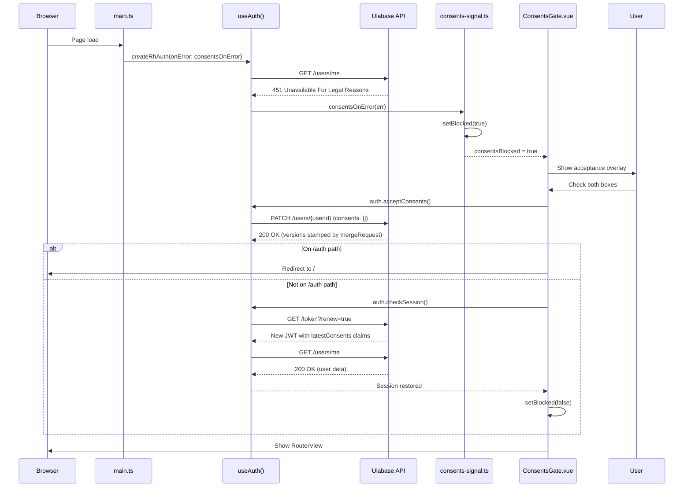

# Consents Gate (Terms and Privacy Acceptance)

The consents gate ensures every user must accept the current Terms of Service and Privacy Policy before using the application. This pattern spans three layers: a server-side Guards rule that blocks with HTTP 451, a client-side signal that detects the blockage, and a Vue component that presents the acceptance overlay.

## Architecture Overview

The gate operates as a three-layer enforcement and UX system:

1. **Server-side enforcement** — A Guards rule on the Ulabase service blocks all authenticated requests when the user's consents don't match current versions, responding with HTTP 451 (Unavailable For Legal Reasons)
2. **Client-side signal** — `consents-signal.ts` watches for 451 responses and raises a reactive flag
3. **UX overlay** — `ConsentsGate.vue` presents a blocking acceptance form when the flag is raised



*Complete consents gate flow from page load through acceptance.*

## Server-Side Enforcement

### Guards Rule Configuration

The Guards rule is defined in `ulabase.setup.consents.ts` with ID `consentsGate`. It blocks authenticated users whose consents don't match current versions:

```typescript
const CONDITION = [
  "equals(@authenticated, 'true')",
  "not path-prefix('/auth')",
  "not path-prefix('/token')",
  "not (method(PATCH) and path-template('/users/{userId}') and bson-request-whitelist(consents))",
  `not (equals(@user.latestConsents.tos, '${TOS_VERSION}') and equals(@user.latestConsents.pp, '${PP_VERSION}'))`,
].join(' and ');
```

The rule blocks when **either** acceptance is missing (`not (A and B)`), not when both are missing (`not A and not B`). This ensures users who accepted only one document are still blocked.

### Key Exclusions

- **Anonymous callers** — Excluded via `@authenticated` check, not by listing every public path
- **Auth endpoints** — `/auth/*` excluded so blocked users can sign in
- **Token endpoints** — `/token/*` excluded so blocked users can get tokens
- **Acceptance request** — The `PATCH /users/{userId}` with `bson-request-whitelist(consents)` is excluded so the acceptance can be recorded while still blocked

### Critical: `/users/me` is NOT excluded

The `/users/me` endpoint is deliberately not excluded. This is what makes the gate work without any probing on the client side: reading the user document is the first thing any app does on load, so a blocked user trips the gate immediately.

### Permission for Acceptance

The `userCanPatchOwnConsents` permission allows users to update their own consents:

```typescript
{
  predicate:
    "path-template('/users/{userId}') and method(PATCH) and " +
    '(equals(@user._id, ${userId}) or equals(@user.sub, ${userId})) and ' +
    'bson-request-whitelist(consents)',
  roles: ['user'],
  priority: 1,
  mongo: {
    mergeRequest: {
      latestConsents: accepted, // { tos: TOS_VERSION, pp: PP_VERSION, acceptedAt: '@now' }
      _$push: { consents: accepted },
    },
  },
}
```

The `mergeRequest` stamps the versions and timestamp server-side; `_$push` (escaped, unescaped before the merge) grows the `consents` history instead of overwriting it, and `latestConsents` is a nested object rather than dotted keys (a request setting both a field and a path inside it would be refused by MongoDB with `ConflictingUpdateOperators`). The client sends `{"consents": []}` and states nothing about what is accepted—this prevents users from accepting terms they were never shown or backdating acceptances.

### JWT Claims

Two claims must travel in the JWT token: `latestConsents/tos` and `latestConsents/pp`. The guard reads the token, not the database, so without these claims the condition would compare false for every token-authenticated user and block them permanently—including users who just accepted.

## Client-Side Implementation

### consents-signal.ts

The signal module (`src/consents-signal.ts`) provides:

- **`consentsBlocked`** — Read-only reactive ref that components can watch
- **`isBlocked()` / `setBlocked()`** — Read and set the blocked state
- **`consentsOnError`** — Callback passed to `createRhAuth` that watches for 451 responses

```typescript
const blocked = ref(false);
export const consentsBlocked = readonly(blocked);

export const consentsOnError = (err: ApiError): void => {
  if (err.status === 451) setBlocked(true);
};
```

### Integration with Auth Store

In `main.ts`, the `consentsOnError` callback is passed to `createRhAuth`:

```typescript
const rhAuth = createRhAuth({ apiBaseUrl: environment.apiUrl, onError: consentsOnError });
```

This bridges the gap between the auth store's session restoration (which happens on its own schedule and absorbs failures) and the consents gate UI. Without this callback, "blocked by consents" and "signed out" would be indistinguishable.

### ConsentsGate.vue Component

The component (`src/ConsentsGate.vue`) wraps the entire application:

```vue
<template>
  <slot v-if="!consentsBlocked" />
  <div v-else class="consents-overlay" role="dialog" aria-modal="true" aria-labelledby="consents-title">
    <!-- Acceptance form -->
  </div>
</template>
```

#### Why ConsentsGate Wraps RouterView

The ConsentsGate must sit **above** the router view in `App.vue`, not inside the authenticated shell:

1. A blocked user has no valid session—`/users/me` returns 451
2. The `authGuard` would bounce such a user to the login page
3. The user would never reach a screen inside the app to accept terms
4. By placing ConsentsGate at the root, blocked users see the acceptance overlay regardless of which route they attempt

The overlay is purely a user-experience feature; removing it via dev tools doesn't bypass enforcement—the server's Guards rule still returns 451 for all requests.

#### Acceptance Flow

When the user clicks "I accept":

1. `auth.acceptConsents()` is called (kit ≥ 0.7.0)
2. The kit performs `PATCH /users/{userId}` with `{"consents": []}`
3. The server's `mergeRequest` stamps the versions and timestamp
4. **If on `/auth` path**: `window.location.assign('/')` redirects to app root (gate usually opens on login page where the 451 blocked navigation)
5. **Otherwise**: `auth.checkSession()` performs `GET /token?renew=true` then `GET /users/me` to restore the session
6. The component calls `setBlocked(false)` to hide the overlay

The token renewal is critical: a JWT is a snapshot, and without a fresh one the rule keeps blocking the user for the whole life of the token they hold.

#### Sign-Out Functionality

The component also provides a `signOut()` function that:
1. Clears the blocked flag via `setBlocked(false)`
2. Calls `auth.logout()` to clear the session
3. Navigates to `/auth/login` via `router.push()` (Vue Router guards run on navigation, not session changes)

## Versioning Contract

### Single Source and Remaining Manual Places

`TOS_VERSION` and `PP_VERSION` in `ulabase.setup.consents.ts` are the single source: the permission's `mergeRequest` and the guard condition are both derived from the `accepted` object, so publishing new terms becomes editing two strings and re-running the setup. What remains manual is the human-readable version line in the two static documents: `public/terms.html` and `public/privacy.html` each display `Version 2026-07-01` and must be edited by hand alongside the constants.

### Current Versions

```typescript
const TOS_VERSION = '2026-07-01';
const PP_VERSION = '2026-07-01';
```

### Version Change Process

To publish new terms:
1. Edit `TOS_VERSION` and `PP_VERSION` in `ulabase.setup.consents.ts`
2. Update the "Version ..." line in both `public/terms.html` and `public/privacy.html`
3. Re-run `ulabase setup --srv <srvId> --file ulabase.setup.consents.ts`

Every user meets the acceptance form again on their next request; the acceptance they already gave stays in the `consents` history.

### Failure Mode

If versions don't agree between the setup constants and the two static documents, users will accept one version while the server records another. The failure is quiet—a user accepts, the acceptance is stamped with one version, the rule compares against another, and they are blocked forever by a form that says it worked.

## Legal Document Hosting

The legal documents are hosted as static files in `public/`:

- **`public/terms.html`** — Terms of Service
- **`public/privacy.html`** — Privacy Policy

The setup deliberately does not write these documents—they are yours; it only decides which versions the service demands.

### Why Static Files, Not App Routes

Static files rather than app routes on purpose:
- A blocked user has no session, so anything routed through the app would sit behind the gate they are trying to read their way out of
- A file in `public/` is served to anyone, in any state, and opens in a new tab without booting the app at all
- The documents carry `Version 2026-07-01` at the top, matching the server-side versions

## Server Setup

The complete server setup is in `ulabase.setup.consents.ts`, which imports the accounts setup `ulabase.setup.ts` and runs in order:

0. **Accounts steps** — `accounts.steps.filter(s => s !== appPointsAtService)` runs first: a gate that blocks users the service cannot create has nothing to block, and the permission below is written against the `users` collection the accounts feature owns
1. **User schema** (`userConsentsSchema`) — `putSchema(SCHEMA_ID, USER_SCHEMA)`; the check compares a canonicalized stored schema, so a service with an older schema is reported as outstanding
2. **Users collection binding** — a `PATCH /users` writes `jsonSchema: { schemaId: SCHEMA_ID }` after checking `/users/_meta` (the collection's own properties are at `_meta`; listing documents would never reveal the binding)
3. **Permission** (`userCanPatchOwnConsents`) — `putPermission`; without it the acceptance is a 403, since no out-of-the-box permission allows `PATCH /users/{userId}` and a guard never gets a say on a request the ACL already refused
4. **JWT claims** — `account-properties-claims` read from `/auth-config/{srvId}` and PATCHed to add `latestConsents/tos` and `latestConsents/pp` (merged, not replaced, so a service may carry claims of its own). Only these two claims are added: the `consents` history would grow at every acceptance inside a base64-readable token
5. **Guards feature** — `isFeatureInstalled` / `installFeature(srvId, 'guards')`
6. **Gate rule** (`consentsGate`) — written into the guards feature config with the CONDITION string, `action: 'block'`, `status_code: 451`, and `on_error: 'allow'`; the check compares the condition string and status, so bumping a version shows up as work outstanding
7. **`appPointsAtService`** — last, as in the plain setup: the app is pointed at the service once the gate is in place too

### `on_error: 'allow'`

The rule sets `on_error: 'allow'` explicitly: a rule that cannot be evaluated must not lock everyone out. The rule's message ("You must accept the current Terms of Service and Privacy Policy") is what the service returns with the 451.

### Schema Design

The user schema allows consent fields but doesn't require them (since registration doesn't write them and the document is validated at insert, before the team is attached):

```typescript
{
  latestConsents: {
    type: 'object',
    properties: {
      tos: { type: 'string' },
      pp: { type: 'string' },
      acceptedAt: { type: 'object', properties: { _$date: { type: 'number' } } },
    },
    required: ['tos', 'pp'],
  },
  consents: { type: 'array' },
}
```

The full schema still requires `_id` and `roles`, keeps `password`, `profile`, `socialAuths`, `teams` and `team` as optional properties, and is titled "User with consents". Note `_$date` with the underscore: `acceptedAt` is a BSON date, and the type keys are escaped inside a schema document so the parser doesn't read them as values. Declared as a plain string, every acceptance is rejected.

## Extending the Gate

### Custom Data Requests

If your own data requests should raise the flag (e.g., terms change while someone is mid-session), call `setBlocked(true)` when `auth.api` rejects with a 451. The starter doesn't do this because it makes no data requests of its own.

### Disabling the Gate

Set up the service with `ulabase.setup.ts` instead of `ulabase.setup.consents.ts`. No rule exists, no request is ever answered 451, the acceptance dialog never opens, and the user is never asked. Nothing to switch off in the app: an unasked question is the absence of a rule on the server, not a flag here.

## Related Pages

- [App Bootstrap and Entry Point](../architecture/app-bootstrap.md) — How the app initializes and mounts ConsentsGate
- [Service Model](../architecture/service-model.md) — The Ulabase service the gate guards
- [Authentication Flows](./authentication-flows.md) — Auth flows that interact with consents
- [Service Configuration](../operations/service-configuration.md) — Setting up the Ulabase service URL
- [OAuth Setup](../workflows/oauth-setup.md) — OAuth flows whose endpoints are excluded from the gate
