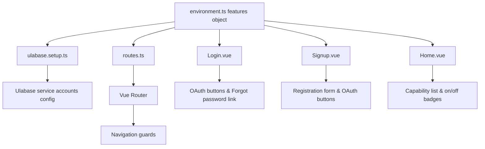

# Feature Flags

Feature flags are boolean toggles defined in `src/environments/environment.ts` that control which authentication and team features are enabled in both the client application and the Ulabase service. They ensure the UI never exposes a button that the server would reject, and they keep client and server configurations in lockstep.

## Flag Inventory

The `features` object in `environment.ts` contains five flags:

| Flag | Type | Default | Purpose |
|------|------|---------|---------|
| `emailRegistration` | `boolean` | `true` | Enables email-based sign-up and verification flows. |
| `passwordReset` | `boolean` | `true` | Enables forgot-password and reset-password forms. |
| `oauthLogin` | `boolean` | `false` | Enables OAuth social login (e.g., Google). |
| `oauthProviders` | `readonly string[]` | `['google']` | Lists which OAuth providers are available when `oauthLogin` is `true`. |
| `teamInvitations` | `boolean` | `true` | Enables the invitation acceptance page for new and existing users. |

These flags are imported by every component and route file that needs to conditionally render or register functionality.

## The Drift Problem

The flags must agree with the corresponding toggles on the Ulabase service. If the client enables a feature (e.g., `passwordReset: true`) but the server disables it, the server will respond with `403 Forbidden` when the user submits the reset form. Conversely, if the client disables a feature but the server enables it, the UI hides the button but the server still accepts the operation—wasting resources and potentially confusing administrators.

Historically, the two lists were maintained manually in separate repositories, with no automated check that they matched. Two symptoms of drift are common:

- **403 on a rendered button** – The client shows a "Forgot password?" link, but the server has the feature off, so the form submission returns `403 Forbidden`. Users are confused; developers debug a mismatch that could have been prevented.
- **A missing page and its link** – The client has a flag set to `false` (e.g., `teamInvitations: false`), so the route is never registered and the corresponding link does not appear. If the server still has the feature on, administrators may wonder why invitations never arrive.

## Bidirectional Contract

To eliminate drift, `ulabase.setup.ts` imports the **same** `environment.ts` file that the client uses and derives the server’s feature toggles from it. The flags are declared once, in one place, and both client and server consume that single source of truth.

```typescript
// ulabase.setup.ts (excerpt)
import { environment } from './src/environments/environment.ts';

const f = environment.features;

const features = {
  registration: f.emailRegistration,
  verification: f.emailRegistration,   // registration and verification are one flow
  'password-reset': f.passwordReset,
  invitations: f.teamInvitations,
  oauth: f.oauthLogin,
};
```

When `ulabase setup` runs, it compares the derived `features` object with the service’s current configuration and applies any missing changes. This ensures that turning `passwordReset` off in the app and re‑running the setup also turns it off on the service—there is no second place to forget.

## Client‑Side Gating

### Route Registration

`src/routes.ts` conditionally includes routes using the spread operator on an array literal. If the flag is `false`, the spread yields an empty array, and the route is not registered.

```typescript
const { emailRegistration, passwordReset, oauthLogin, teamInvitations } = environment.features;

export const routes: RouteRecordRaw[] = [
  { path: '/auth/login', component: Login, meta: { guard: 'public' } },
  ...(emailRegistration || oauthLogin
    ? [{ path: '/auth/signup', component: Signup, meta: { guard: 'public' as const } }]
    : []),
  ...(emailRegistration
    ? [{ path: '/auth/verify', component: Verify, meta: { guard: 'public' as const } }]
    : []),
  ...(passwordReset
    ? [
        { path: '/auth/forgot-password', component: ForgotPassword, meta: { guard: 'public' as const } },
        { path: '/auth/reset-password', component: ResetPassword, meta: { guard: 'public' as const } },
      ]
    : []),
  ...(teamInvitations ? [{ path: '/invitations/accept', component: Accept }] : []),
  // ... authenticated routes inside Shell
];
```

### UI Rendering

Vue components read the same `environment.features` object and conditionally render elements:

- **Login.vue** – Hides the “Forgot password?” link and the “Create an account” link when the corresponding flags are `false`. OAuth buttons appear only when `oauthLogin` is `true`.
- **Signup.vue** – Shows the email‑registration form only when `emailRegistration` is `true`; OAuth buttons appear only when `oauthLogin` is `true`. The “OR” divider appears only when both are enabled.
- **Home.vue** – Renders a capability list where each item’s “on/off” badge reflects the flag’s value. Features marked “off” get a visual de‑emphasis class (`feature‑off`).

### Guard Semantics

The `meta.guard` property (`'auth'` or `'public'`) is read by the global `beforeEach` guard in `main.ts`. The guard system itself is not flag‑dependent, but the routes it protects are. For example, `/auth/forgot-password` exists only when `passwordReset` is `true`; otherwise the guard never sees it.

## Server‑Side Configuration

`ulabase.setup.ts` maps the client flags to server‑side feature keys:

| Client Flag | Server Key(s) | Notes |
|-------------|---------------|-------|
| `emailRegistration` | `registration`, `verification` | Both are enabled together because a sign‑up flow without verification is undesirable. |
| `passwordReset` | `password-reset` | Direct mapping. |
| `teamInvitations` | `invitations` | Direct mapping. |
| `oauthLogin` | `oauth` | When enabled, the setup also checks for Google OAuth credentials (`client-id`, `client-secret`). |

The setup script performs a read‑modify‑write on the service’s `accounts` feature configuration, preserving any redacted secrets (stored as bullet characters) that the admin UI masks.

### OAuth Credential Handling

When `oauthLogin` is `true` **and** `'google'` is listed in `oauthProviders`, the setup script checks whether the Google OAuth credentials are already stored. If not, it reads `GOOGLE_CLIENT_ID` and `GOOGLE_CLIENT_SECRET` from the environment variables and writes them into the service configuration. This ensures the credentials are present only when the feature is actually enabled.

## How to Toggle Flags

1. Edit `src/environments/environment.ts` and set the desired flag to `true` or `false`.
2. If you changed a flag that affects the server (all except `oauthProviders`), re‑run `ulabase setup --srv <srvId>` (or `ulabase setup --srv <srvId> --dry-run` to preview changes). See [Service Configuration](../operations/service-configuration.md) for the full setup workflow and the mechanics of `ulabase setup`.
3. Restart the dev server (`npm run dev`) to pick up the new flag values.

Because both client and server read from the same file, there is no separate configuration step for the service—running the setup script is enough.

## Diagram: Flag Propagation



*Feature flags flow from the single source in `environment.ts` to both the client UI/routing and the server configuration.*

## Related Pages

- [Routing and Navigation Guards](../architecture/routing-and-guards.md) – Full route map and guard semantics.
- [Consents Gate Pattern](./consents-gate.md) – Server‑side enforcement that complements feature gating.
