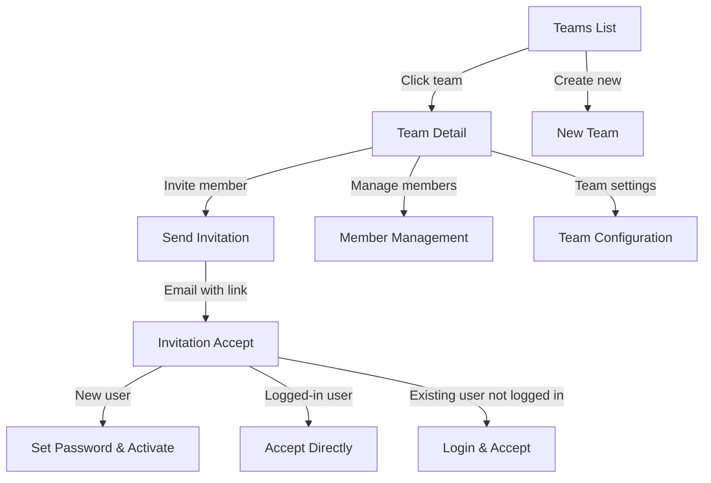
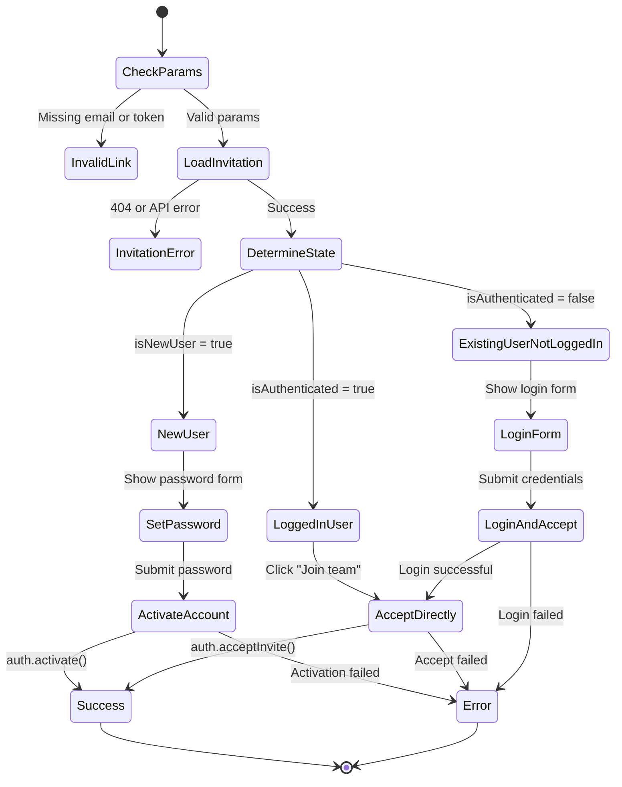

# Teams and Invitations

This page documents the team management system in the Ulabase Vue starter application. The system enables multi-team collaboration with role-based access control, invitation workflows, and team configuration management. Teams are a core feature of the application, allowing users to organize into groups with distinct membership and ownership structures.

## Team Architecture Overview

The team management system consists of four main components:

1. **Team List Page** (`/teams`) - Displays all teams the user belongs to
2. **Team Detail Page** (`/teams/:id`) - Manages team members, invitations, and settings
3. **New Team Page** (`/teams/new`) - Creates new teams
4. **Invitation Acceptance Page** (`/invitations/accept`) - Handles invitation acceptance for various user states



## Active Team Session and Shell Header

The application maintains an active team context on the session, which is reflected in the Shell header. The Shell component (`src/pages/shell/Shell.vue`) displays the active team name in the user dropdown menu.

### Active Team Detection

The Shell component computes the active team name by finding the team where `team.active` is true:

```typescript
const activeTeamName = computed((): string => {
  const active = auth.teams.value.find(t => t.active);
  return active?.name ?? '';
});
```

### Header Display

The active team name is displayed in the user dropdown menu with a "Team:" prefix:

```html
<span v-if="activeTeamName" class="dropdown-team">Team: {{ activeTeamName }}</span>
```

This provides visual feedback about which team context the user is currently operating in.

## Team List Page

The team list page at `/teams` displays all teams the current user belongs to and provides navigation to team details and team creation.

### Key Features

- **Team Display**: Shows team name, description, and user role
- **Active Team Indicator**: Highlights the currently active team with "current" badge
- **Team Switching**: Automatically switches to team context when navigating to team details
- **Empty State**: Shows message when user has no teams

### Implementation Details

The team list page uses the `useAuth()` composable to access the `auth.teams` property, which contains the user's team memberships. The page loads teams on mount via `auth.loadTeams()` and displays them in a list format.

**Navigation Behavior**: When clicking a team, the page checks if it's the active team. If not, it calls `auth.switchTeam()` to set the active team context before navigating to the team detail page. This ensures the backend knows which team context the user is operating in.

```typescript
// From src/pages/teams/Teams.vue
async function openTeam(team: TeamMembership): Promise<void> {
  if (!team.active) {
    switchingTo.value = team.id.$oid;
    await auth.switchTeam(team.id);
    switchingTo.value = null;
  }
  await router.push(`/teams/${team.id.$oid}`);
}
```

### Route Configuration

The team list route is defined in `src/routes.ts` and is protected by the `auth` guard through the Shell layout:

```typescript
{ path: 'teams', component: Teams }
```

## Team Detail Page

The team detail page at `/teams/:id` is the central hub for team management, featuring three main sections: members, invitations, and settings. The page uses a single component instance that reloads data when the team ID changes via route parameters.

### Component Reuse Strategy

Since Vue Router reuses component instances when only route parameters change, the TeamDetail component watches `route.params.id` rather than loading data once on mount:

```typescript
// From src/pages/teams/detail/TeamDetail.vue
watch(
  () => route.params.id,
  id => {
    if (typeof id === 'string' && id) load(id);
  },
  { immediate: true }
);
```

The `load()` function orchestrates three parallel data fetches:
1. `auth.loadTeams()` - Gets team details and sets local state
2. `auth.listTeamMembers()` - Retrieves team members
3. `auth.listInvitations()` - Retrieves pending invitations

### TeamDetail.vue API Calls

The TeamDetail component makes the following API calls:

1. **Data Loading**:
   - `auth.loadTeams()` - Loads team details and updates local state
   - `auth.listTeamMembers()` - Retrieves team members list
   - `auth.listInvitations()` - Retrieves pending invitations

2. **Member Management**:
   - `auth.updateMemberRole(email, role)` - Changes a member's role
   - `auth.removeMember(email)` - Removes a member from the team

3. **Invitation Management**:
   - `auth.invite(email, role)` - Sends a new invitation
   - `auth.resendInvite(email)` - Resends an existing invitation

4. **Team Management**:
   - `auth.updateTeam({ name, description })` - Updates team settings
   - `auth.deleteTeam()` - Deletes the team
   - `auth.switchTeam(teamId)` - Switches active team after deletion

### Reload and Redirect Behavior

After destructive actions, the component implements specific reload and redirect behaviors:

**After Team Deletion**:
1. Calls `auth.deleteTeam()` to delete the current team
2. Loads remaining teams via `auth.loadTeams()`
3. If remaining teams exist but none are active, switches to the first remaining team
4. Redirects to `/teams` list page

```typescript
async function deleteTeam(): Promise<void> {
  if (!team.value) return;
  deleting.value = true;
  deleteError.value = null;
  try {
    await auth.deleteTeam();
    const remaining = await auth.loadTeams();
    if (remaining.length > 0 && !remaining.some(t => t.active)) {
      await auth.switchTeam(remaining[0].id);
    }
    await router.push('/teams');
  } catch (err: unknown) {
    deleting.value = false;
    const e = err as { message?: string };
    deleteError.value = e?.message ?? 'Could not delete the team.';
  }
}
```

**After Member Removal**:
- Removes the member from the local `members` array immediately
- No page reload required as the UI updates reactively

**After Role Change**:
- Updates the member's role in the local `members` array
- If the API call fails, the select element is reverted to the original role

### Role-Based Visibility

The page implements role-based visibility using a computed property:

```typescript
const isOwner = computed(() => team.value?.role === 'owner');
```

**Owner-Only Features**:
- Member role management (change roles, remove members)
- Invitation management (send, resend invitations)
- Team settings (rename, description, delete team)

**Member View**:
- Can see team members and their roles
- Cannot modify team settings or manage members

### Members Tab

The members tab displays all team members with their roles and provides management actions for owners.

**Member Management Features**:
- **Role Assignment**: Owners can change member roles between "member" and "owner" using a dropdown
- **Member Removal**: Owners can remove members with a confirmation step
- **Self-Protection**: Owners cannot change their own role or remove themselves

**Role Change Implementation**:
```typescript
async function changeRole(member: TeamMember, role: 'owner' | 'member'): Promise<void> {
  if (member.role === role) return;
  memberActionPending.value = member.email;
  try {
    await auth.updateMemberRole(member.email, role);
    members.value = members.value.map(m => (m.email === member.email ? { ...m, role } : m));
  } catch {
    // ignore
  }
  memberActionPending.value = null;
}
```

### Invitations Tab

The invitations tab manages pending invitations and provides the invitation sending interface.

**Invitation Sending**:
- Email validation (must contain @)
- Role selection (member or owner)
- Success/error feedback
- Automatic form reset after successful invite

**Invitation Resending**:
- **Cooldown System**: 5-minute cooldown between resends to prevent spam
- **Cooldown Display**: Shows remaining time in minutes (e.g., "Wait 3m")
- **Success Feedback**: Shows confirmation when invitation is resent

**Resend Cooldown Implementation**:
```typescript
const RESEND_COOLDOWN_MS = 5 * 60 * 1000; // 5 minutes

function canResend(email: string): boolean {
  const since = resendCooldowns.value[email];
  if (!since) return true;
  return now.value - since >= RESEND_COOLDOWN_MS;
}
```

The cooldown system uses a reactive `now` value that updates every 30 seconds via `setInterval`, ensuring the UI stays current without excessive re-renders.

### Settings Tab

The settings tab provides team configuration options for owners.

**Team Settings Features**:
- **Team Name**: Editable text field with validation
- **Description**: Optional textarea for team description
- **Save Changes**: Only enabled when form is dirty (has changes)
- **Delete Team**: Two-step confirmation process with danger zone styling

**Team Update Implementation**:
```typescript
async function saveTeam(): Promise<void> {
  if (!team.value) return;
  teamSaving.value = true;
  teamError.value = null;
  teamSaved.value = false;
  try {
    await auth.updateTeam({ name: teamName.value, description: teamDescription.value });
    teamSaving.value = false;
    teamSaved.value = true;
    teamDirty.value = false;
  } catch (err: unknown) {
    teamSaving.value = false;
    const e = err as { message?: string };
    teamError.value = e?.message ?? 'Something went wrong. Please try again.';
  }
}
```

**Team Deletion**:
- Only possible when no other members remain (enforced by backend)
- Two-step confirmation: "Delete team" button → "Are you sure?" confirmation
- After deletion, automatically switches to another team if available, or navigates to team list

## New Team Page

The new team page at `/teams/new` provides a simple form for creating teams.

### Implementation

The page uses `auth.createTeam()` with the team name, then redirects to the team list:

```typescript
async function createTeam(): Promise<void> {
  if (!teamName.value) return;
  saving.value = true;
  error.value = null;
  try {
    await auth.createTeam(teamName.value);
    await router.push('/teams');
  } catch (err: unknown) {
    saving.value = false;
    const e = err as { message?: string };
    error.value = e?.message ?? 'Something went wrong. Please try again.';
  }
}
```

### Route Configuration

The new team route is protected by the `auth` guard through the Shell layout:

```typescript
{ path: 'teams/new', component: NewTeam }
```

## Invitation Acceptance System

The invitation acceptance system at `/invitations/accept` handles the complete invitation workflow for all user states. This page is **unguarded** - it must work for signed-out invitees, signed-in users, and people without an account.

### Query Contract

The invitation acceptance page expects two query parameters:
- `email` - The email address the invitation was sent to
- `token` - The invitation token for validation

If either parameter is missing, the page displays an "Invalid invitation link" error.

### Three-State Acceptance Flow

The Accept.vue component implements a sophisticated state machine that handles three distinct user scenarios:



### Error Message Mapping

The component maps API errors to user-friendly messages:
- **404 status**: "This invitation is invalid or has expired."
- **401 status**: "Invalid password."
- **Other errors**: Displays the error message from the API or a generic fallback

```typescript
function messageFor(err: unknown): string {
  const e = err as { status?: number; message?: string };
  if (e?.status === 404) return 'This invitation is invalid or has expired.';
  if (e?.status === 401) return 'Invalid password.';
  return e?.message ?? 'Something went wrong. Please try again.';
}
```

### State Detection Logic

The component detects the appropriate state through a combination of:
1. **Route parameters**: `email` and `token` from query string
2. **Invitation data**: `isNewUser` flag from `auth.getInvitation()`
3. **Auth state**: `auth.isAuthenticated.value` from the auth composable

### New User Flow

When `invitation.isNewUser` is true, the user sees a password creation form:

1. **Password Validation**: Minimum 8 characters, with real-time validation
2. **Account Activation**: Calls `auth.activate()` with email, token, and password
3. **Automatic Redirect**: Redirects to home page after successful activation

**Password Requirements**:
- Minimum 8 characters
- Show/hide password toggle
- Client-side validation with error messages
- Disabled submit button until requirements met

### Logged-In User Flow

When the user is already authenticated (`auth.isAuthenticated.value` is true):

1. **Direct Acceptance**: Shows "Join team" button
2. **Single API Call**: Calls `auth.acceptInvite(token)`
3. **Success Feedback**: Shows "You're in" message with redirect

### Existing User Not Logged In Flow

When the invitation is for an existing user who isn't logged in:

1. **Login Form**: Shows email (pre-filled) and password fields
2. **Login then Accept**: Calls `auth.login()` then `auth.acceptInvite(token)`
3. **Seamless Experience**: User doesn't need to know they're doing two operations

### Error Handling

The component provides comprehensive error handling for all flows:

- **Invalid Link**: Missing email or token parameters
- **Expired Invitation**: 404 response from `auth.getInvitation()`
- **Invalid Password**: 401 response during login
- **General Errors**: Fallback error messages for unexpected failures

### Route Configuration

The invitation acceptance route is **unguarded** to work for all auth states:

```typescript
// From src/routes.ts
// No guard: it must work for signed-out invitees, signed-in users, and
// people without an account.
...(teamInvitations ? [{ path: '/invitations/accept', component: Accept }] : [])
```

This route is also feature-flagged behind `teamInvitations` to allow disabling the entire invitation system.

## Feature Flag Integration

The team management system integrates with the application's feature flag system:

| Feature Flag | Impact on Teams |
|--------------|-----------------|
| `teamInvitations` | Enables/disables invitation acceptance page and related UI |
| `emailRegistration` | Affects user creation flow during invitation acceptance |
| `oauthLogin` | May affect invitation flow for OAuth users |

The `teamInvitations` flag controls:
- Route registration for `/invitations/accept`
- Invitation-related UI components in team detail
- Backend API endpoints for invitations

## API Integration

The team management system uses the `useAuth()` composable from `@ulabase/kit-vue` for all API operations:

### Team Operations
- `auth.loadTeams()` - Load user's teams
- `auth.createTeam(name)` - Create new team
- `auth.updateTeam({ name, description })` - Update team settings
- `auth.deleteTeam()` - Delete team
- `auth.switchTeam(teamId)` - Switch active team context

### Member Operations
- `auth.listTeamMembers()` - List team members
- `auth.updateMemberRole(email, role)` - Change member role
- `auth.removeMember(email)` - Remove member from team

### Invitation Operations
- `auth.invite(email, role)` - Send invitation
- `auth.listInvitations()` - List pending invitations
- `auth.resendInvite(email)` - Resend invitation
- `auth.getInvitation(email, token)` - Get invitation details
- `auth.acceptInvite(token)` - Accept invitation (logged-in user)
- `auth.activate({ email, token, password })` - Activate account via invitation

## Security Considerations

### Role-Based Access Control
- Owners have full control over team settings and membership
- Members can only view team information
- Self-protection prevents owners from demoting themselves

### Invitation Security
- Tokens are time-limited (backend enforced)
- Email validation prevents invalid invitations
- Rate limiting via resend cooldown (5 minutes)
- Backend validates invitation ownership before acceptance

### Route Protection
- Team management routes are protected by `auth` guard
- Invitation acceptance is unguarded but validates tokens
- Feature flags prevent unauthorized access to disabled features

## Testing Considerations

### Key Test Scenarios
1. **Team Creation**: Verify team creation flow and redirect
2. **Member Management**: Test role changes, member removal, and self-protection
3. **Invitation Flow**: Test all three acceptance states
4. **Resend Cooldown**: Verify 5-minute cooldown enforcement
5. **Team Deletion**: Test deletion constraints and cleanup
6. **Feature Flags**: Verify behavior when `teamInvitations` is disabled

### State Management Testing
- Test component reuse when navigating between teams
- Verify data refresh when team ID changes
- Test concurrent operations (multiple role changes)

## Integration Points

### Authentication System
- Deep integration with `useAuth()` composable
- Relies on auth state for UI visibility and API calls
- Uses auth guards for route protection

### Router Integration
- Uses Vue Router for navigation and state management
- Route parameters drive component behavior
- Navigation guards enforce access control

### Backend Services
- All operations require backend API support
- Role enforcement happens on both client and server
- Invitation tokens validated by backend

## Future Extensions

### Potential Enhancements
1. **Team Permissions**: More granular permission system beyond owner/member
2. **Team Invitations**: Bulk invitations, invitation links
3. **Team Analytics**: Member activity, team usage statistics
4. **Team Settings**: Advanced configuration options
5. **Team Integrations**: External service integrations per team

### API Extensions
- Team search and filtering
- Member invitation history
- Team activity logs
- Advanced role management

This team management system provides a solid foundation for multi-user collaboration while maintaining security and usability across all user states and scenarios.
