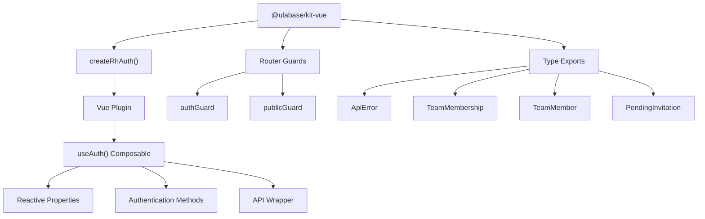
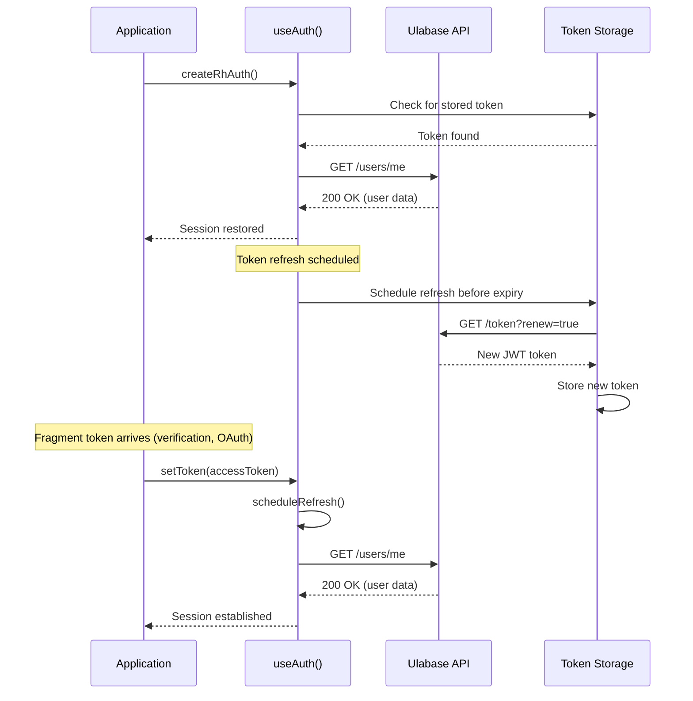

# @ulabase/kit-vue Integration

This page documents the `@ulabase/kit-vue` integration in the Ulabase Vue starter application. The kit provides Vue composables, router guards, and API integration for authentication and session management. It handles the entire authentication lifecycle from session restoration to token refresh and authenticated API calls.

## Kit Overview

The `@ulabase/kit-vue` package provides:

1. **Vue Plugin** - Created via `createRhAuth()` for app-wide authentication state
2. **`useAuth()` Composable** - Reactive authentication state and methods
3. **Router Guards** - `authGuard` and `publicGuard` for route protection
4. **API Wrapper** - `auth.api()` for authenticated fetch requests
5. **Type Exports** - TypeScript types for authentication entities



*Architecture of the @ulabase/kit-vue package showing main components and relationships.*

## createRhAuth Factory

The `createRhAuth()` function initializes the authentication system and returns a Vue plugin. It must be called once during application bootstrap.

### Function Signature

```typescript
createRhAuth(options: RhAuthOptions): RhAuthPlugin
```

### Options

| Option | Type | Description |
|--------|------|-------------|
| `apiBaseUrl` | `string` | The Ulabase service URL (e.g., `https://<srvId>.ulabase.app`) |
| `onError` | `(error: ApiError) => void` | Optional error handler for API responses |

### Return Value

The function returns an `RhAuthPlugin` object with:

1. **Vue Plugin** - Installable via `app.use(rhAuth)`
2. **Router Guards** - `authGuard` and `publicGuard` methods
3. **Auth Store** - Reactive authentication state

### Usage in main.ts

```typescript
import { createRhAuth } from '@ulabase/kit-vue';
import { consentsOnError } from './consents-signal';

const rhAuth = createRhAuth({ 
  apiBaseUrl: environment.apiUrl, 
  onError: consentsOnError 
});

// Install as Vue plugin
createApp(App).use(rhAuth).use(router).mount('#app');
```

### Critical Timing Considerations

The auth store checks the session immediately upon creation. Therefore:

1. **Token capture must run first** - Any tokens arriving via URL fragment must be stored before `createRhAuth()` is called
2. **API URL must be valid** - The store will attempt session checks against the provided URL
3. **Error handler runs on all API errors** - Including session restoration failures

## useAuth() Composable

The `useAuth()` composable provides access to authentication state and methods. It must be used within a component that has the auth plugin installed.

### Usage Pattern

```vue
<script setup lang="ts">
import { useAuth } from '@ulabase/kit-vue';

const auth = useAuth();
</script>
```

### Reactive Properties

| Property | Type | Description |
|----------|------|-------------|
| `user` | `Ref<User \| null>` | Current user object with profile information |
| `teams` | `Ref<TeamMembership[]>` | User's team memberships |
| `isAuthenticated` | `ComputedRef<boolean>` | Whether user has an active session |

### Key Methods

#### Authentication Methods

| Method | Parameters | Description |
|--------|------------|-------------|
| `login(email, password)` | `email: string, password: string` | Authenticates user with email/password |
| `register(userData)` | `userData: RegisterData` | Registers new user with team and profile |
| `logout()` | - | Signs out current user and clears session |
| `checkSession()` | - | Restores session from stored token, returns user |
| `verify(email, token)` | `email: string, token: string` | Verifies email address and returns redirect URL |
| `activate(data)` | `data: ActivateData` | Activates new user account with invitation |

#### Profile Methods

| Method | Parameters | Description |
|--------|------------|-------------|
| `updateProfile(profile)` | `profile: ProfileData` | Updates user's first and last name |
| `changePassword(current, new)` | `current: string, new: string` | Changes user's password |

#### Team Methods

| Method | Parameters | Description |
|--------|------------|-------------|
| `loadTeams()` | - | Loads user's team memberships |
| `createTeam(name)` | `name: string` | Creates a new team |
| `switchTeam(teamId)` | `teamId: TeamId` | Switches active team context |
| `listTeamMembers()` | - | Lists members of current team |
| `listInvitations()` | - | Lists pending invitations for current team |
| `invite(email, role)` | `email: string, role: TeamRole` | Sends team invitation |
| `acceptInvite(token)` | `token: string` | Accepts team invitation |
| `getInvitation(email, token)` | `email: string, token: string` | Gets invitation details |

#### Consents Methods

| Method | Parameters | Description |
|--------|------------|-------------|
| `acceptConsents()` | - | Performs the Terms-of-Service and Privacy-Policy acceptance PATCH and triggers a token renewal; the caller is responsible for reloading the session with `checkSession()` afterward |

#### API Method

| Method | Parameters | Description |
|--------|------------|-------------|
| `api(path, options?)` | `path: string, options?: RequestInit` | Authenticated fetch wrapper |

## auth.api() - Authenticated Fetch Wrapper

The `auth.api()` method provides an authenticated fetch wrapper that automatically attaches the bearer token and handles errors.

### Basic Usage

```typescript
const auth = useAuth();

// Fetch data from your collections
auth.api('/notes?pagesize=10')
  .then(res => res.json())
  .then(notes => { /* handle notes */ })
  .catch((err: ApiError) => { /* handle error */ });
```

### Error Handling

- **Non-2xx responses** reject with `ApiError` containing `{ status, message }`
- **401 Unauthorized** - Session expired or invalid
- **403 Forbidden** - ACL or Guards rule blocking access
- **451 Unavailable For Legal Reasons** - Consents gate blocking (triggers `onError` handler)

### Important Notes

1. **Pass paths, not URLs** - Use `/notes` not `https://service.example.com/notes`
2. **Plain fetch is unauthenticated** - Using `fetch()` directly returns 401
3. **Error status codes are meaningful** - 403 indicates permission issues, 451 indicates consents gate

## Session Lifecycle

The session lifecycle involves restoration, token refresh, and fragment token capture.



*Session lifecycle from restoration through refresh and fragment token capture.*

### Session Restoration

1. **On app start** - `checkSession()` is called automatically
2. **Token validation** - Stored token is validated against the service
3. **User data loaded** - `/users/me` returns user profile and team memberships
4. **Session state updated** - `user`, `teams`, and `isAuthenticated` reactively update

### Token Refresh

1. **Scheduled automatically** - `scheduleRefresh()` runs before token expiry
2. **Silent renewal** - `GET /token?renew=true` gets a new JWT
3. **Seamless transition** - User experiences no interruption

### Fragment Token Capture

When tokens arrive via URL fragment (verification links, OAuth callbacks):

1. **Capture in main.ts** - `consumeFragmentToken()` runs before `createRhAuth()`
2. **Store token** - `setToken(accessToken)` saves to storage
3. **Schedule refresh** - `scheduleRefresh()` sets up renewal
4. **Clean URL** - Fragment is removed from browser URL

## Type Exports

The kit exports TypeScript types for authentication entities:

### ApiError

```typescript
interface ApiError {
  status: number;
  message: string;
}
```

### TeamMembership

```typescript
interface TeamMembership {
  id: { $oid: string };
  name: string;
  description?: string;
  role: 'owner' | 'member';
  active: boolean;
}
```

### TeamMember

```typescript
interface TeamMember {
  email: string;
  role: 'owner' | 'member';
  joinedAt: string;
}
```

### PendingInvitation

```typescript
interface PendingInvitation {
  email: string;
  role: 'owner' | 'member';
  sentAt: string;
  expiresAt: string;
}
```

## Router Guards

The kit provides two router guards for route protection:

### authGuard

- **Purpose** - Protects authenticated routes
- **Behavior** - Redirects unauthenticated users to login
- **Usage** - Applied to routes requiring authentication

### publicGuard

- **Purpose** - Protects public routes (login, signup)
- **Behavior** - Redirects authenticated users to app
- **Usage** - Applied to routes for unauthenticated users

### Guard Implementation

```typescript
// In main.ts
const noNext: NavigationGuardNext = () => undefined;
router.beforeEach((to, from) => {
  if (to.meta.guard === 'auth') return rhAuth.authGuard.call(undefined, to, from, noNext);
  if (to.meta.guard === 'public') return rhAuth.publicGuard.call(undefined, to, from, noNext);
  return true;
});
```

## Integration with Consents Gate

The kit integrates with the consents gate pattern through the `onError` handler:

1. **451 Detection** - `onError` receives `ApiError` with status 451
2. **Signal Propagation** - Error handler sets consents blocked flag
3. **UI Response** - `ConsentsGate.vue` shows acceptance overlay
4. **Acceptance Flow** - `auth.acceptConsents()` performs the acceptance PATCH and a token renewal, then `auth.checkSession()` is called explicitly to reload the user and teams with the new token

### ConsentsGate accept() Flow

The `ConsentsGate` component sits above the router view in the component tree so it can intercept 451-blocked users regardless of whether they have a valid session. Its `accept()` function handles the full sequence:

```typescript
async function accept(): Promise<void> {
  busy.value = true;
  error.value = null;
  try {
    // acceptConsents() performs the PATCH and token renewal — the fresh token
    // is mandatory because the server-side guard keeps blocking for the
    // lifetime of the old JWT.
    await auth.acceptConsents();
    // If the gate opened on the login page (login was refused with 451),
    // redirect to home rather than staying on a page the user can't use.
    if (window.location.pathname.startsWith('/auth')) {
      window.location.assign('/');
      return;
    }
    // The token is new and /users/me now answers: reload the session so the
    // app starts with a user and their teams rather than a blank shell.
    await auth.checkSession();
    setBlocked(false);
  } catch {
    error.value = 'We could not record your acceptance. Please try again.';
  } finally {
    busy.value = false;
  }
}
```

When the acceptance succeeds while on an auth page, the component performs a full page navigation (`window.location.assign('/')`) rather than a router push, because the login page itself was blocked with 451 and there is no meaningful route to push to.

## Error Handling Patterns

### Common Error Scenarios

| Status | Meaning | Typical Cause |
|--------|---------|---------------|
| 401 | Unauthorized | Expired token, invalid credentials |
| 403 | Forbidden | ACL rule blocking, insufficient permissions |
| 409 | Conflict | Duplicate email during registration |
| 451 | Unavailable For Legal Reasons | Consents gate blocking |

### Error Handling Example

```typescript
try {
  await auth.login(email, password);
  await router.push('/');
} catch (err: unknown) {
  const e = err as { status?: number; message?: string };
  if (e?.status === 401) error.value = 'Invalid email or password.';
  else error.value = e?.message ?? 'Something went wrong.';
}
```

## Configuration and Setup

### Environment Configuration

The kit requires a valid API base URL in `src/environments/environment.ts`:

```typescript
export const environment = {
  apiUrl: 'https://<srvId>.ulabase.app',
  features: {
    emailRegistration: true,
    passwordReset: true,
    oauthLogin: false,
    oauthProviders: ['google'] as const,
    teamInvitations: true,
  },
};
```

### Service Setup

The Ulabase service must be configured with:

1. **Accounts feature** - Installed and configured
2. **Feature flags** - Matching the app's `environment.features`
3. **Origin allowlist** - Including the app's origin
4. **OAuth credentials** - If OAuth login is enabled

## Best Practices

### 1. Always Use auth.api() for Service Calls

```typescript
// ✅ Correct - authenticated
const data = await auth.api('/my-collection');

// ❌ Wrong - unauthenticated (returns 401)
const data = await fetch('https://service.example.com/my-collection');
```

### 2. Handle Errors Appropriately

```typescript
try {
  const result = await auth.api('/protected-resource');
  // Handle success
} catch (err) {
  if (err.status === 451) {
    // Consents gate - show acceptance UI
  } else if (err.status === 403) {
    // Permission denied
  } else {
    // Other errors
  }
}
```

### 3. Check Session State Before Operations

```typescript
const auth = useAuth();

// Ensure user is authenticated
if (!auth.isAuthenticated.value) {
  await auth.checkSession();
}

// Proceed with authenticated operations
```

### 4. Use Reactive Properties for UI Updates

```vue
<template>
  <div v-if="auth.isAuthenticated.value">
    Welcome, {{ auth.user.value?.profile?.name }}
  </div>
  <div v-else>
    Please log in
  </div>
</template>
```

## Common Pitfalls

### 1. Timing Issues with Fragment Tokens

**Problem**: Token arrives via URL fragment but session check finds no token.

**Solution**: Run `consumeFragmentToken()` before `createRhAuth()`.

### 2. Plain Fetch Returns 401

**Problem**: Using `fetch()` instead of `auth.api()` returns 401.

**Solution**: Always use `auth.api()` for service requests.

### 3. Missing Error Handler

**Problem**: 451 errors not caught, consents gate not triggered.

**Solution**: Provide `onError` handler to `createRhAuth()`.

### 4. Token Refresh Failures

**Problem**: Token expires but refresh fails silently.

**Solution**: Handle errors in `onError` handler.

## Testing Considerations

### Unit Testing

- Mock `useAuth()` composable for component tests
- Test error handling for various API responses
- Verify reactive property updates

### Integration Testing

- Test complete authentication flows
- Verify token refresh behavior
- Test consents gate integration

### E2E Testing

- Test login/logout flows
- Verify team switching functionality
- Test invitation acceptance flows

## Related Pages

- [App Bootstrap and Entry Point](../architecture/app-bootstrap.md) - How authentication is initialized
- [Authentication Flows](../concepts/authentication-flows.md) - Detailed authentication flows
- [Consents Gate Pattern](../concepts/consents-gate.md) - Consents gate implementation
- [Teams and Invitations](./teams-and-invitations.md) - Team management features
