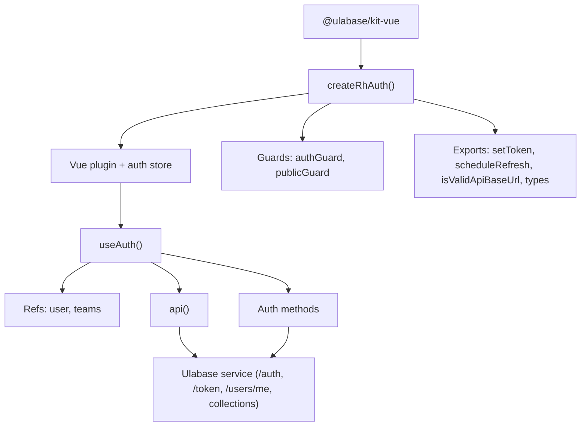
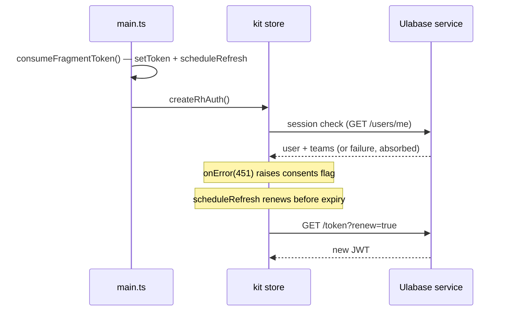

# The @ulabase/kit-vue Integration

The starter has no server code of its own: everything authentication-related is delegated to the `@ulabase/kit-vue` package, which supplies a Vue plugin, the `useAuth()` composable, router guards, an authenticated fetch wrapper, and TypeScript types. The app's own code only calls into the kit and reacts to its errors.

The starter pins [`@ulabase/kit-vue` `^0.13.6`](https://ulabase.com/docs/kit) in `package.json` (matched by `@ulabase/cli ^0.13.6`); the kit itself builds on the framework-agnostic `@ulabase/kit` package.



*How the kit's exports fit together: the plugin owns the store; components reach it through `useAuth()`; the store talks to the service.*

## Bootstrap: createRhAuth() in main.ts

`createRhAuth({ apiBaseUrl, onError })` is called once in `src/main.ts`. It returns an installable Vue plugin whose `store` holds the reactive auth state, plus the `authGuard` / `publicGuard` functions. The starter passes `consentsOnError` as `onError` — see [Consents Gate](../concepts/consents-gate.md).

Two timing facts constrain the bootstrap order:

1. **Fragment token capture must run first.** The auth store checks the session the moment it is created, so `consumeFragmentToken()` — which stores any `access_token` from the URL fragment via `setToken(accessToken)` and starts renewal via `scheduleRefresh({ apiBaseUrl })` — must run before `createRhAuth()`, or the first session check finds no token.
2. **The API URL is validated first.** `isValidApiBaseUrl(environment.apiUrl)` gates the whole bootstrap: without a valid `https://` service URL, the app mounts a bare `ConfigPage` with no router and no auth store, because the store would start a session check against nowhere.

## The auth surface, grouped by area

Everything below is reached via `const auth = useAuth()`. The reactive refs are `user` (`Ref<User | null>`), `teams` (`Ref<TeamMembership[]>`), and the derived `isAuthenticated`. Methods reject with `ApiError` (`{ status, message }`).

| Area | Method(s) | Used by the starter for |
|---|---|---|
| **Session** | `checkSession()` | Restores the session from the stored token and returns the user. Called automatically when the store is created; called again by `Account.vue` on mount and by `ConsentsGate.accept()` after acceptance |
| **Session** | `logout()` | Clears the session (`ConsentsGate.signOut()`, `Shell.vue`) |
| **Registration / verification** | `register(userData)` | Email/password signup with team + profile (`Signup.vue`) |
| **Registration / verification** | `verify(email, token)` | Verifies an email address and resolves to a redirect URL (`Verify.vue`) |
| **Registration / verification** | `activate({ email, token, password })` | Activates a new account created through an invitation (`Accept.vue`) |
| **Registration / verification** | `forgotPassword(email)`, `resetPassword({ email, token, password })` | Password reset flow |
| **Login** | `login(email, password)` | Email/password login (`Login.vue`, `Accept.vue`) |
| **Invitations** | `getInvitation(email, token)`, `acceptInvite(token)` | Inspecting and accepting an invite (`Accept.vue`) |
| **Teams** | `loadTeams()`, `createTeam(name)`, `switchTeam(teamId)` | Team list, creation, and active-team switching (`Teams.vue`, `NewTeam.vue`) |
| **Teams** | `listTeamMembers()`, `invite(email, role)`, `removeMember(email)`, `resendInvite(email)`, `updateMemberRole(email, role)`, `listInvitations()` | Member and invitation management (`TeamDetail.vue`) |
| **Teams** | `updateTeam({ name, description })`, `deleteTeam()` | Team settings and deletion (`TeamDetail.vue`; after deleting, the app re-loads teams and switches to a remaining one) |
| **Consents** | `acceptConsents()` | PATCHes the acceptance, renews the token (`GET /token?renew=true`), refreshes `/users/me`, and updates `user` — kit ≥ 0.7.0 |
| **Profile** | `updateProfile({ firstName, lastName })`, `changePassword(current, new)` | Account page |
| **Raw API** | `api(path, options?)` | Authenticated fetch wrapper for any collection (`Home.vue` fetches `/demo`) |

## auth.api(): authenticated fetch, not plain fetch

`auth.api(path, options?)` applies the session to outgoing requests — the caller never attaches the bearer token by hand. Two rules matter:

- **Pass a path, not a URL** — `/notes?pagesize=10`, not an absolute URL.
- **A plain `fetch` to the same URL is unauthenticated and answers `401`** — which reads as "logged out" rather than "you forgot the header". This is the one mistake worth knowing about in advance.

Any non-2xx rejects with an `ApiError` carrying `{ status, message }`, so callers branch on status instead of parsing bodies: `401` (session expired/invalid), `403` (ACL or permission), `409` (e.g. duplicate email or already-a-member), and `451` (consents gate).

## Router guards

Routes declare `meta.guard: 'auth' | 'public'` in `src/routes.ts`; children inherit the guard from the shell. One global `router.beforeEach` in `main.ts` dispatches to the kit:

```typescript
const noNext: NavigationGuardNext = () => undefined;
router.beforeEach((to, from) => {
  if (to.meta.guard === 'auth') return rhAuth.authGuard.call(undefined, to, from, noNext);
  if (to.meta.guard === 'public') return rhAuth.publicGuard.call(undefined, to, from, noNext);
  return true;
});
```

Two kit behaviors the app relies on:

- **The guards ignore `next` and return their verdict**, so a no-op `noNext` stands in for the Vue-Router signature and the returned value drives the navigation.
- **Guards only run on navigation.** When the session ends while a signed-in page is open (logout, an expired or refused token), nothing redirects by itself — `main.ts` watches `rhAuth.store.user` and pushes to `/auth/login` when a user turns from present to absent on an auth-guarded route. The invitation-acceptance route is deliberately unguarded so it works signed-out, signed-in, and accountless.

## Session lifecycle and token handling



*Session restoration, the consents side-channel, and silent token renewal.*

Key behaviors:

- **Restoration happens on the store's own schedule.** The store calls the equivalent of `checkSession()` when `createRhAuth()` runs and absorbs the failure — `checkSession().catch(() => null)` — to keep the app usable. **`onError` is therefore the only observer of why session restoration failed**; without it, "blocked user" and "signed-out user" look identical to the app.
- **`setToken(token)` and `scheduleRefresh({ apiBaseUrl })` are standalone exports** used by `consumeFragmentToken()` in `main.ts` for tokens arriving in the URL fragment (email verification, OAuth callbacks). The fragment is scrubbed from the URL with `history.replaceState` afterwards.
- **`acceptConsents()` renews the token because a JWT is a snapshot**: without a fresh token, the server-side Guards rule keeps blocking the user for the lifetime of the one they hold. Its result lands directly in `user`, so in the consents flow `checkSession()` afterwards is a belt-and-braces reload (see [Consents Gate](../concepts/consents-gate.md)).

## Types

The kit exports the entity types the app types its state with: `ApiError` (`{ status: number; message: string }`), `TeamMembership` (`{ id: { $oid }, name, description?, role: 'owner' | 'member', active }`), `TeamMember` (`{ email, role, joinedAt }`), and `PendingInvitation` (`{ email, role, sentAt, expiresAt }`) — all imported in `TeamDetail.vue`, for example.

## Related Pages

- [App Bootstrap and Entry Point](../architecture/app-bootstrap.md) - how the kit is initialized
- [Authentication Flows](../concepts/authentication-flows.md) - the flows built on this surface
- [Consents Gate Pattern](../concepts/consents-gate.md) - the 451 / onError integration
- [Teams and Invitations](./teams-and-invitations.md) - the team methods in depth
