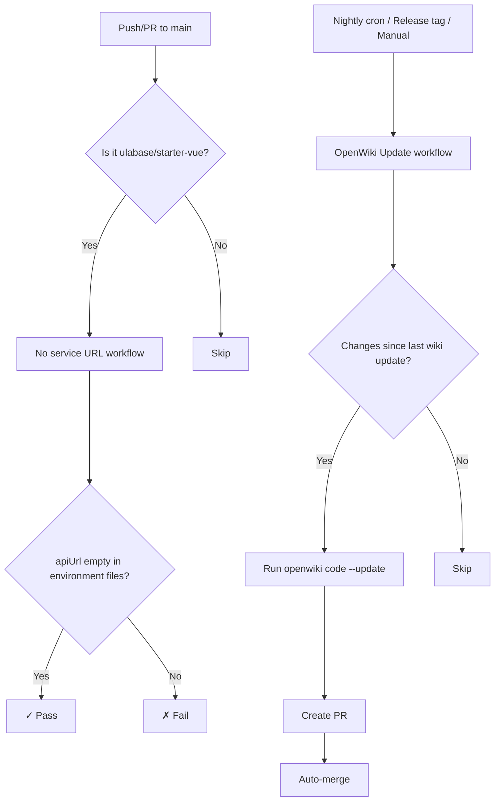

# CI and GitHub Actions Workflows

This repository uses two GitHub Actions workflows to maintain code quality and keep documentation in sync with the source code.

## Workflow Overview



## No Service URL Workflow

**File**: `.github/workflows/no-service-url.yml`

### Purpose

This workflow prevents real service URLs from being committed to the main branch of the starter repository. It ensures that every clone of the starter begins with an empty `apiUrl`, showing the "configure your service" screen rather than pointing to a specific service instance.

### Trigger Conditions

- **Push to main**: Runs when code is pushed directly to the main branch
- **Pull requests to main**: Runs on PRs targeting main

### Scope Restriction

The workflow only runs in the `ulabase/starter-vue` repository:

```yaml
if: github.repository == 'ulabase/starter-vue'
```

Forks or copies pushed elsewhere have different repository names, so the check is skipped there.

### Enforcement Logic

The job greps all TypeScript environment files in `src/environments/` for non-empty `apiUrl` values:

```bash
found=$(grep -nE "^\s*apiUrl:\s*'[^']+'" src/environments/*.ts || true)
```

If any match is found, the workflow fails with instructions to set `apiUrl` back to empty string (`''`).

### Why the Check Is Scoped to ulabase/starter-vue

The `if: github.repository == 'ulabase/starter-vue'` condition sits on the **job**, not on the workflow's triggers, so pushes and PRs still register in forks but the check job itself is skipped. This is deliberate: `ulabase setup` writes the service URL into the environment file, which is exactly what a developer wants in their own copy (and commits when they publish their app). A fork renamed to `me/starter-vue` is a real app with a real service URL, and the empty-`apiUrl` invariant should not apply there.

### apiUrl Is a Local Change, Not a Committed One

On this repository (`ulabase/starter-vue`), the committed `src/environments/environment.ts` keeps `apiUrl: ''`. Running `ulabase setup --srv <srvId>` rewrites the file **locally only**; as long as the developer does not commit and push that change to `main`, the workflow passes. Developers should treat the filled-in `apiUrl` as an uncommitted local configuration and be careful never to push it to `main` (committing it is only expected when publishing their own forked app).

### Why This Matters

A real service URL committed to main would become the service that every new clone communicates with, creating a shared state problem and potential security issue. The empty value forces each developer to configure their own service instance.

## OpenWiki Update Workflow

**File**: `.github/workflows/openwiki-update.yml`

### Purpose

This workflow automatically regenerates the OpenWiki documentation when source code changes, ensuring the wiki stays current without manual intervention.

### Trigger Conditions

The workflow runs under three circumstances:

1. **Nightly schedule**: Every day at 03:00 UTC (`cron: "0 3 * * *"`)
2. **Release tags**: When a semantic version tag (e.g., `1.2.3`) is pushed
3. **Manual dispatch**: With an optional message parameter for special instructions

### Change Detection Logic

To avoid unnecessary model costs, the workflow skips scheduled runs when no source files have changed since the last wiki update:

```bash
last=$(git log -1 --format=%H -- openwiki)
changed=$(git diff --name-only "$last" HEAD -- . ':!openwiki' ':!AGENTS.md' ':!CLAUDE.md' | wc -l)
```

This logic:
1. Finds the last commit that touched the `openwiki/` directory
2. Counts files changed between that commit and HEAD
3. Excludes `openwiki/`, `AGENTS.md`, and `CLAUDE.md` (generated files)
4. Only proceeds if at least one source file changed

Release tags and manual dispatches always run regardless of changes.

### Concurrency Control

The workflow uses a concurrency group to prevent parallel updates:

```yaml
concurrency:
  group: openwiki-update
  cancel-in-progress: false
```

This ensures that if a new run starts while a previous one is still executing, the new run waits rather than canceling the in-progress work.

### Update Process

When changes are detected:

1. **Checkout**: Always checks out the `main` branch (even when triggered by a tag)
2. **Environment setup**: Installs Node.js 22 and the `openwiki` npm package
3. **Mode selection**: Uses `--update` when an `openwiki/` directory already exists (incremental update of existing pages), and `--init` when it does not (first-generation run). Both modes run `openwiki code --print`; a manually supplied `message` is appended as a run-specific instruction that an incremental update would not infer on its own (for example, a rename to apply throughout the wiki)
4. **Execution**: Runs `openwiki code --update` (or `--init`) with optional message from manual dispatch
5. **Pull request creation**: Uses `peter-evans/create-pull-request` to create/update a PR on the `openwiki/update` branch
6. **Auto-merge**: Immediately merges the PR using `gh pr merge --squash --delete-branch --auto`

### Environment Variables

The workflow configures OpenWiki with:
- **Provider**: OpenRouter (`openrouter`)
- **API Key**: Stored in repository secrets (`OPENROUTER_API_KEY`)
- **Model**: `xiaomi/mimo-v2.5-pro`
- **Tracing**: Disabled (`LANGCHAIN_TRACING_V2: "false"`)

### Generated Files

The workflow commits changes to:
- `openwiki/` directory (wiki content)
- `AGENTS.md` (agent instructions)
- `CLAUDE.md` (Claude-specific instructions)

## Workflow Relationships

Both workflows serve different purposes but work together to maintain repository integrity:

| Workflow | Trigger | Purpose | Repository Scope |
|----------|---------|---------|------------------|
| No service URL | Push/PR to main | Prevent real URLs in starter | ulabase/starter-vue only (job-level `if`; forks skip it) |
| OpenWiki Update | Schedule/Tag/Manual | Keep docs in sync with code | All repositories |

## Troubleshooting

### No Service URL Workflow Fails

If the workflow fails with "A service URL is committed in an environment file":

1. Open `src/environments/environment.ts`
2. Set `apiUrl` back to empty string: `apiUrl: ''`
3. Commit and push the change

### OpenWiki Update Workflow Skips

If the workflow skips with "files changed since [hash]: 0":

- **Scheduled runs**: Normal behavior when no source code changed
- **Manual runs**: Should always proceed; check if the workflow was triggered correctly
- **Release runs**: Should always proceed; verify the tag format matches `[0-9]+.[0-9]+.[0-9]+`

### OpenWiki Update Workflow Fails

Common failure points:
- **Missing API key**: Ensure `OPENROUTER_API_KEY` is set in repository secrets
- **Model errors**: Check OpenRouter status or try a different model
- **Permission issues**: Verify the repository has "Allow auto-merge" enabled

## Configuration

### Repository Settings Required

For the OpenWiki Update workflow to function properly:

1. **Secrets**: `OPENROUTER_API_KEY` must be configured
2. **Permissions**: Repository must allow auto-merge
3. **Branch protection**: No required status checks on `openwiki/update` branch (otherwise auto-merge waits indefinitely)

### Customizing Update Frequency

To change the nightly schedule, modify the cron expression in `.github/workflows/openwiki-update.yml`:

```yaml
schedule:
  - cron: "0 3 * * *"  # Current: 03:00 UTC daily
```

### Adding Manual Instructions

When manually triggering the OpenWiki Update workflow, you can provide a message that will be passed to OpenWiki:

1. Go to Actions → OpenWiki Update → Run workflow
2. Enter instructions in the "message" field (e.g., "Rename authentication module to auth throughout wiki")
3. Click "Run workflow"

The message will be passed as `--print "$MESSAGE"` to the `openwiki code` command.

## Relationships

- [Service Configuration](service-configuration.md) — the setup files and environment file that the no-service-url check guards.
- [Validation and Testing](../testing/validation-and-testing.md) — how changes are validated before they reach these pipelines.
- [First-Run Setup](../workflows/first-run-setup.md) — the developer flow that writes `apiUrl` locally.
