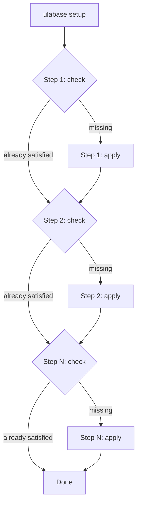

# Service Configuration

The starter uses two declarative setup files—`ulabase.setup.ts` and `ulabase.setup.consents.ts`—to configure an Ulabase service to match the Vue application. Each file defines an ordered list of **steps**, where every step has a `check` (is the desired state already present?) and an `apply` (make it so). Running `ulabase setup` against an already-configured service writes nothing and reports every step as satisfied.

## Core Pattern: step/check/apply

The `defineSetup` and `step` helpers from `@ulabase/cli` implement an idempotent configuration pattern:

- **`check`** returns `true` when the service already matches the desired state.
- **`apply`** makes the change only when `check` returned `false`.
- Running `ulabase setup --dry-run` executes only the checks, answering "what is this service missing?"
- Running `ulabase setup` executes checks first, then applies only the missing steps.

This makes the setup safe to run repeatedly: a fully-configured service is a no-op, and a partially-configured service picks up where it left off.



*Setup runs checks sequentially; only unsatisfied steps trigger their apply.*

## ulabase.setup.ts

The base setup file configures the **accounts** feature and related service settings. It imports the app's `environment.ts` to derive server-side feature toggles from the client's single source of truth, eliminating the drift problem where client and server configurations diverge silently.

### Environment Variables

| Variable | Default | Purpose |
|----------|---------|---------|
| `APP_URL` | `http://localhost:5173` | Where the app is served from. Used for email links, OAuth redirects, and the origin allowlist. Trailing slash is stripped. |
| `APP_NAME` | `Ulabase Starter` | Shown in verification, reset, and invitation emails. |

Both can be overridden via environment variables before running setup.

### Feature Flag Derivation

The file imports `environment.features` and maps client flags to server-side feature keys:

```typescript
const f = environment.features;

const features = {
  registration: f.emailRegistration,
  verification: f.emailRegistration,   // one flow in the app
  'password-reset': f.passwordReset,
  invitations: f.teamInvitations,
  oauth: f.oauthLogin,
};
```

`emailRegistration` controls two server flags because signing up and confirming the address are one flow from the app's perspective.

### Steps (in order)

1. **Accounts feature installed** — Installs the `accounts` plugin if not present. Treats HTTP 409 ("already installed") as success.

2. **Accounts configured to match the app** — Sets `app-name`, `frontend-url`, `frontend-app-url`, and the derived `features` block. Uses a read-modify-write pattern that preserves redacted secrets (the server replaces the whole document and restores stored values for any field still holding a redaction placeholder).

3. **Google OAuth credentials** *(conditional)* — Only included when `oauthLogin` is `true` and `'google'` is in `oauthProviders`. Ensures `enabled: true` and that `client-id` and `client-secret` are configured. Secrets are resolved via `fromEnv()` only when not already stored, so a re-run against a configured service needs no secrets in the environment.

4. **The app origin may call the service** — Installs `origin-allowlist` if needed, then adds `APP_URL` to the allowed origins. Origins are added, never replaced, so a service reached from multiple origins (localhost and deployed app) keeps both.

5. **The app points at this service** — The `appPointsAtService` step, exported separately and always placed **last**. Writes the service's URL into `environment.ts`'s `apiUrl` field using regex replacement that preserves comments and other lines. Placed last so that a partial setup leaves the "configure your service" screen visible rather than a sign-up page that fails.

### The apiUrl Write Mechanism

The `appPointsAtService` step reads `environment.ts` fresh each time (not the cached import), matches the `apiUrl: '...'` line with a regex, and replaces only the URL value:

```typescript
const API_URL_LINE = /^(\s*apiUrl:\s*)'[^']*'/m;
// ...
writeFileSync(ENV_FILE, text.replace(API_URL_LINE, `$1'${url}'`));
```

The capture group `$1` preserves leading whitespace and the `apiUrl:` key, so comments, flags, and formatting are untouched.

## ulabase.setup.consents.ts

The consents setup extends the base accounts setup by importing its steps and appending the documents needed for the [consents gate](../concepts/consents-gate.md). It is invoked with:

```
ulabase setup --srv <srvId> --file ulabase.setup.consents.ts
```

### Version Constants

Two version strings govern which Terms of Service and Privacy Policy the service demands:

```typescript
const TOS_VERSION = '2026-07-01';
const PP_VERSION = '2026-07-01';
```

Every other value—permission `mergeRequest`, guard rule condition—is derived from these constants. Publishing new terms means editing two strings and re-running setup.

### Steps (in order)

The file imports the accounts steps from `ulabase.setup.ts`, filters out `appPointsAtService` (to keep it last), then appends:

1. **User schema stored** — Creates a JSON Schema (`userConsentsSchema`) defining the user document shape, including `latestConsents` and `consents` fields. Note `_$date` (escaped BSON date type key) and that `latestConsents` and `consents` are **not** required—the schema validates documents at insertion time, before the initial team is attached, so requiring those fields would reject every registration.

2. **Users collection validated by it** — Attaches the schema to the `/users` collection via its `_meta` endpoint. Reads `/users/_meta` (not `/users`) to check current attachment.

3. **The acceptance is permitted** — Creates the `userCanPatchOwnConsents` permission allowing users to PATCH their own consents. The server-side `mergeRequest` stamps `latestConsents` with current versions and `$push`es to the `consents` history array. The client sends `{"consents": []}` and states nothing—the server decides what is accepted.

4. **The two claims travel in the token** — Adds `latestConsents/tos` and `latestConsents/pp` to the service's `account-properties-claims` so the guard can read them from the JWT without a database lookup. Claims are added, not replaced.

5. **Guards feature installed** — Installs the `guards` plugin if not present.

6. **The gate blocks users who have not accepted** — Creates or updates the `consentsGate` guard rule with a condition that blocks authenticated users whose consents don't match current versions, responding with HTTP 451 (Unavailable For Legal Reasons). The condition excludes anonymous callers (`@authenticated`), auth/token endpoints, and the acceptance request itself. Importantly, `/users/me` is **not** excluded—blocking it is what makes the gate work with no client-side probing.

7. **The app points at this service** — The same `appPointsAtService` step from the base setup, placed last.

### Why the Gate Works Without Client-Side Probing

The consents gate relies on the app's natural first request: `GET /users/me`. Since this endpoint is not excluded from the guard condition, a blocked user trips the gate immediately on page load. The client-side `consents-signal.ts` watches for 451 responses and raises a reactive flag that `ConsentsGate.vue` uses to show the acceptance overlay.

## Running the Setup

```bash
npm i -D @ulabase/cli
ulabase login

# Base setup (accounts only):
ulabase setup --srv <srvId> --dry-run    # what is missing
ulabase setup --srv <srvId>              # make it so

# With consents gate:
ulabase setup --srv <srvId> --file ulabase.setup.consents.ts
```

A service already configured by `ulabase.setup.ts` can be upgraded to include the consents gate by running the consents setup—it will apply only the new steps.
