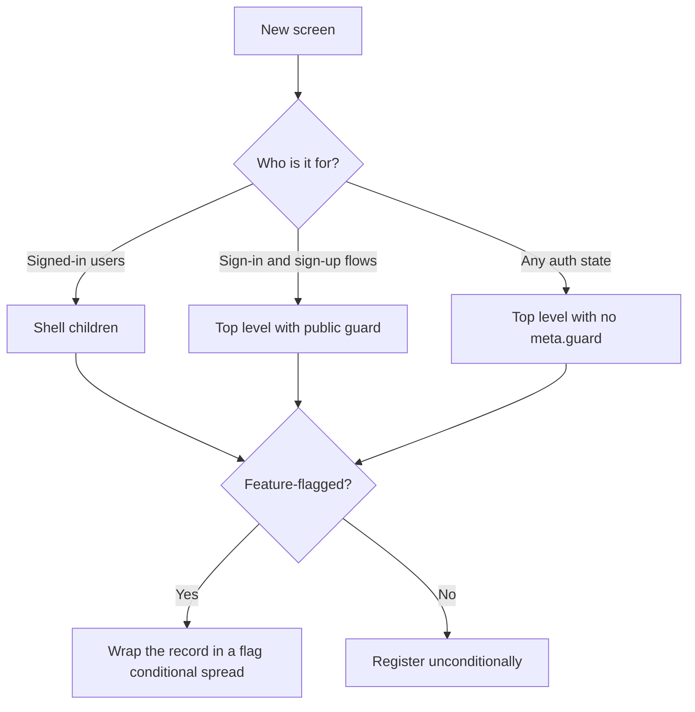

# Adding a New Page or Route

This workflow guides you through adding a new screen to the Ulabase Vue starter application. The process involves creating a Vue component under `src/pages/`, registering it in `src/routes.ts` with a lazy import, choosing the right guard placement, optionally gating it behind a feature flag, and optionally adding a navigation link in the app shell.

For the full route map and guard semantics, see [Routing and Navigation Guards](../architecture/routing-and-guards.md). For how flags keep client and server in sync, see [Feature Flags](../concepts/feature-flags.md).

## 1. Create the Page Component

Create a new directory under `src/pages/` with your page name (in kebab-case), then create the Vue component file inside it.

**Directory structure:**
```
src/pages/
├── your-page-name/
│   ├── YourPage.vue
│   └── YourPage.css  # Optional: component-specific styles
```

**Component template:**
```vue
<script setup lang="ts">
// Import any needed utilities
import { ref, onMounted } from 'vue';
import { useAuth } from '@ulabase/kit-vue';
import './YourPage.css';

const auth = useAuth();
// Your component logic here
</script>

<template>
  <section class="card">
    <h1>Your Page Title</h1>
    <p>Your page content here.</p>
  </section>
</template>
```

**Key points:**
- Use Vue 3 Composition API with `<script setup>`
- Import component-specific CSS if needed (`./YourPage.css`)
- Use `useAuth()` from `@ulabase/kit-vue` for authentication state and API calls
- Reuse shared UI where it fits, for example `src/ui/alert/Alert.vue` for inline success/error messages
- Follow existing component patterns (see `src/pages/home/Home.vue` and `src/pages/account/Account.vue` for reference)

## 2. Register the Route in `src/routes.ts`

Every page is a lazy chunk: add a lazy import at the top of `src/routes.ts`, then register the route record in `routes`:

```typescript
const YourPage = () => import('./pages/your-page-name/YourPage.vue');
```

Where the record goes depends on who the screen serves and how it is guarded:



*Decision flow for where and how to register a new route record.*

### For Authenticated Pages (Recommended)

Most new pages should be authenticated and added as children of the Shell route. This places them inside the app shell layout and puts them behind the `auth` guard inherited from the parent record.

Add the route as a child of the Shell route, keeping the existing children and appending yours:

```typescript
{
  path: '/',
  component: Shell,
  meta: { guard: 'auth' },
  children: [
    { path: '', component: Home },
    { path: 'home', component: Home },
    { path: 'teams', component: Teams },
    { path: 'teams/new', component: NewTeam },
    { path: 'teams/:id', component: TeamDetail },
    { path: 'account', component: Account },
    { path: 'your-page-path', component: YourPage },  // Add here
  ],
},
```

**Route structure notes:**
- Child paths are relative to the parent (`/`), so the route above is served at `/your-page-path`
- The parent declares `meta: { guard: 'auth' }`; children inherit it from the matched parent record
- No need to specify `meta.guard` for children of the Shell

### For Public Pages

If your page should be accessible to unauthenticated users and is part of the sign-in surface (for example a login-adjacent page), register it at the top level of the routes array with `meta: { guard: 'public' }`. The `public` guard sends an already signed-in user into the app instead of leaving them on the public page.

```typescript
export const routes: RouteRecordRaw[] = [
  { path: '/auth/login', component: Login, meta: { guard: 'public' } },
  // ... other auth routes
  { path: '/your-public-path', component: YourPublicPage, meta: { guard: 'public' } },
  // ... other routes
];
```

### For Pages That Must Work in Any Auth State

If the page has to serve signed-out visitors, signed-in users, and people without an account alike, omit `meta.guard` entirely. Routes without the meta stay unguarded: the global `beforeEach` in `src/main.ts` lets them through.

This is the pattern used by the invitation acceptance page. It is one component registered at two paths, because the service's invitation email links a new user to `/auth/activate` and an existing user to `/invitations/accept` — keep both paths if you extend or mirror that flow:

```typescript
// One page, two paths: the service's invitation email links a new user to
// /auth/activate and an existing one to /invitations/accept. No guard on
// either: it must work for signed-out invitees, signed-in users, and people
// without an account.
...(teamInvitations
  ? ['/auth/activate', '/invitations/accept'].map(path => ({ path, component: Accept }))
  : []),
```

The allowed `meta.guard` values are `'auth' | 'public'` (see the `RouteMeta` augmentation in `src/vite-env.d.ts`); leaving the field out is the explicit opt-out.

### For Feature-Flag Gated Pages

If your page should only exist when a specific feature flag is enabled, wrap the route record in a conditional spread driven by `environment.features`. A `false` flag yields an empty array, so the route is never registered.

**Single path:**
```typescript
const { yourFeatureFlag } = environment.features;

export const routes: RouteRecordRaw[] = [
  // ... other routes
  ...(yourFeatureFlag ? [{ path: '/your-feature', component: YourFeaturePage, meta: { guard: 'public' as const } }] : []),
  // ... other routes
];
```

**One page, several paths** (the invitation pattern):
```typescript
...(teamInvitations
  ? ['/auth/activate', '/invitations/accept'].map(path => ({ path, component: Accept }))
  : []),
```

For an authenticated feature-flagged page, put the conditional spread inside the Shell's `children` array instead. The flags in `src/environments/environment.ts` are the single source of truth: the same values drive the UI and, through `ulabase.setup.ts`, the service configuration, so a flag you add here should also be mapped there if the server must honor it.

### How `meta.guard` Is Enforced

`src/main.ts` installs one global `beforeEach` hook keyed on `to.meta.guard`:

```typescript
const noNext: NavigationGuardNext = () => undefined;
router.beforeEach((to, from) => {
  if (to.meta.guard === 'auth') return rhAuth.authGuard.call(undefined, to, from, noNext);
  if (to.meta.guard === 'public') return rhAuth.publicGuard.call(undefined, to, from, noNext);
  return true;
});
```

- **`auth`** — signed-out users are redirected to `/auth/login`; the hook runs for Shell children too
- **`public`** — signed-in users are redirected into the app (`/`)
- **absent** — the navigation is allowed regardless of session state

A `watch` on `rhAuth.store.user` in `src/main.ts` also sends the user to `/auth/login` when a session ends while an `auth`-guarded page is open.

## 3. Add a Navigation Link (Optional)

If your page should appear in the main navigation, add a link in `src/pages/shell/Shell.vue`, in the `<nav class="nav" aria-label="Main">` block (marked with the comment `Your section links go here.`):

```vue
<nav class="nav" aria-label="Main">
  <RouterLink to="/home" :class="['nav-link', { active: isActive('/home') }]">Home</RouterLink>
  <RouterLink to="/teams" :class="['nav-link', { active: isActive('/teams') }]">Teams</RouterLink>
  <!-- Your section links go here. -->
  <RouterLink to="/your-page-path" :class="['nav-link', { active: isActive('/your-page-path') }]">Your Page</RouterLink>
</nav>
```

**Navigation link behavior:**
- Uses the `isActive()` helper to highlight the link when active
- `isActive()` returns true when the current path equals the link path or starts with it as a prefix, so a section link stays lit on its sub-pages
- Links use the `.nav-link` class; the `active` class provides the visual highlight

Some screens are reachable without a top-level nav entry — `Account` is opened from the user menu dropdown rather than the main `<nav>`. Choose the placement that matches how users should find the page.

## 4. Example: Complete Page Addition

Here's a complete example adding a "Settings" page:

**1. Create component:**
```
src/pages/settings/Settings.vue
```

**2. Add to routes.ts:**
```typescript
const Settings = () => import('./pages/settings/Settings.vue');

// In the Shell children array:
children: [
  { path: '', component: Home },
  { path: 'home', component: Home },
  { path: 'teams', component: Teams },
  { path: 'teams/new', component: NewTeam },
  { path: 'teams/:id', component: TeamDetail },
  { path: 'account', component: Account },
  { path: 'settings', component: Settings },  // New page
],
```

**3. Add navigation link in Shell.vue:**
```vue
<nav class="nav" aria-label="Main">
  <RouterLink to="/home" :class="['nav-link', { active: isActive('/home') }]">Home</RouterLink>
  <RouterLink to="/teams" :class="['nav-link', { active: isActive('/teams') }]">Teams</RouterLink>
  <RouterLink to="/settings" :class="['nav-link', { active: isActive('/settings') }]">Settings</RouterLink>
</nav>
```

## Important Considerations

### Route Ordering
- Vue Router matches routes in the order they're defined
- The catch-all route (`/:pathMatch(.*)*`) must stay last in the array; it renders `Home`
- Register more specific routes before less specific ones so they are not shadowed

### Lazy Loading
- Always use lazy loading with `() => import(...)` for page components
- This keeps each page in its own chunk; the router loads it only when needed

### Guard Inheritance
- Children of the Shell route inherit the `auth` guard from the parent record
- You don't need to specify `meta.guard` for child routes
- For public sign-in pages, explicitly set `meta: { guard: 'public' }`
- For pages that must work signed-in and signed-out, omit `meta.guard` (see the invitation routes)

### Feature Flags
- Declare flags in `src/environments/environment.ts`
- Use conditional spreads to register routes only when the flag is on, and hide the matching UI the same way
- Keep client flags and the service configuration in step (see [Feature Flags](../concepts/feature-flags.md))

### Navigation Link Styling
- Navigation links use the `.nav-link` class with an `active` modifier
- Active state is computed by `isActive()`
- For visual treatment of links and the rest of the shell chrome, see [Customizing the Visual Skin](./customizing-the-visual-skin.md)

## Testing Your New Page

1. **Development server:** Run `npm run dev` and navigate to your page path
2. **Authentication:** For Shell children, confirm a signed-out visit redirects to `/auth/login`; for `public` pages, confirm a signed-in visit lands in the app
3. **Unguarded pages:** Exercise the page in all three states — signed out, signed in, and (for invitation-like flows) without an account
4. **Navigation:** Verify the navigation link works and highlights correctly, including on sub-pages
5. **Feature flags:** If using feature flags, test with both enabled and disabled states, and re-run `ulabase setup` when the flag also affects the service
6. **Responsive:** Test on different screen sizes to ensure proper layout

See [Validation and Testing](../testing/validation-and-testing.md) for the broader manual-check workflow.

## Troubleshooting

### Page not loading
- Ensure the lazy import path is correct
- Check that the component file exists at the specified path
- Verify the component is properly exported (default export)

### Navigation not working
- Check that the route is properly registered in `routes.ts`
- Ensure the path doesn't conflict with existing routes (watch for `teams/:id`-style dynamic children)
- Verify the route is registered before the catch-all

### Guard issues
- For authenticated pages, ensure they're children of the Shell route
- For public sign-in pages, ensure `meta: { guard: 'public' }` is set
- For pages that must serve every auth state, ensure `meta.guard` is absent rather than set
- Check that the feature flag (if any) is enabled in `environment.ts`

### Navigation link not highlighting
- Ensure you're using the `isActive()` function correctly
- Check that the path matches exactly (including leading slash)
- Verify the link is inside the `<nav>` element with proper classes

## Related Pages

- [Routing and Navigation Guards](../architecture/routing-and-guards.md) — Full route map, guard decision flow, and shell layout.
- [Feature Flags](../concepts/feature-flags.md) — Flag inventory and client/server consistency.
- [Customizing the Visual Skin](./customizing-the-visual-skin.md) — Styling pages and shell chrome.
- [Validation and Testing](../testing/validation-and-testing.md) — Manual validation workflow.
