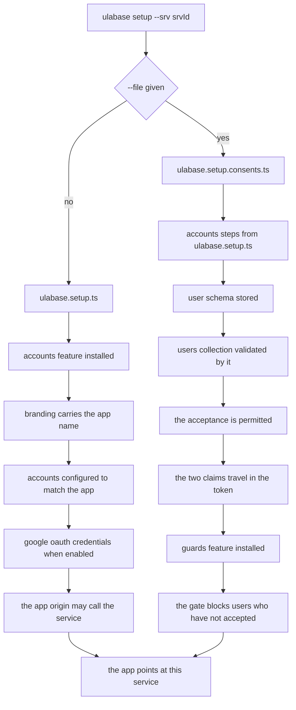

# First-Run Setup

This page walks through the complete first-run setup process for the Ulabase Vue starter application, from cloning the repository to running the development server. The process involves four main steps: cloning the repository, creating a Ulabase service, configuring the service with `ulabase setup`, and starting the development server.

## Prerequisites

Before beginning, ensure you have:

- **Node.js 22.18 or later** — required to run the TypeScript setup file
- **A free Ulabase account** — sign up at [ulabase.com](https://ulabase.com) (free tier available)
- **Git** — for cloning the repository

The toolchain itself is pinned in `package.json`, so `npm install` yields a known-good combination:

| Package | Version | Role |
|---------|---------|------|
| `@ulabase/kit-vue` | `^0.14.0` | runtime library the app is built on (`dependencies`) |
| `@ulabase/cli` | `^0.14.0` | provides the `ulabase` command used for setup (`devDependencies`) |
| `vue` | `^3.5.0` | framework |
| `vue-router` | `^4.4.0` | routing |
| `vite` | `^6.0.0` | dev server and bundler |
| `typescript` | `~5.6.0` | types |
| `vue-tsc` | `^2.2.0` | type-check before build |
| `vitest` | `^2.0.0` | tests |
| `@vitejs/plugin-vue` | `^5.2.0` | Vite plugin for single-file components |

`npm run dev` runs `vite`, `npm run build` runs `vue-tsc -b && vite build`, and `npm run test` runs `vitest`.

## Step 1: Clone and Install

```bash
git clone https://github.com/ulabase/starter-vue.git
cd starter-vue
npm install
```

This installs the Vue application dependencies and the `@ulabase/cli` development dependency (listed in `devDependencies` in `package.json`). Because that CLI is installed locally, the `npx ulabase …` commands shown by the app's configuration screen work in this folder without a global install.

## Step 2: Create a Ulabase Service

Create a **free service** at [ulabase.com](https://ulabase.com). The service ID is the first six characters of its URL (e.g., `abc123` from `https://abc123.ulabase.app`). You'll need this ID for the setup step.

## Step 3: Configure the Service

The Ulabase service needs specific configuration to work with the Vue starter application. Instead of manually configuring each setting through the console, the starter uses a declarative setup file (`ulabase.setup.ts`) that configures the service automatically.

### Install the CLI and Authenticate

```bash
npm install -g ulabase
ulabase login                              # paste a token from ulabase.com
```

### Run the Setup

```bash
ulabase setup --srv <srvId>
```

Replace `<srvId>` with your six-character service ID.

### What the Setup Does

The `ulabase.setup.ts` file defines an ordered list of **steps**, where each step has a `check` (is the desired state already present?) and an `apply` (make it so). This creates an idempotent configuration pattern:

- **`check`** returns `true` when the service already matches the desired state
- **`apply`** makes the change only when `check` returned `false`
- Running `ulabase setup` against an already-configured service writes nothing and reports every step as satisfied

The setup performs these steps in order:

1. **Accounts feature installed** — Installs the `accounts` plugin if not present. Treats HTTP 409 ("already installed") as success.

2. **Branding carries the app name** — Writes `APP_NAME` into the Branding feature's `name`. The step reads the current branding document first and merges into it (`{ ...current, name: APP_NAME }`), so a color or logo set in the console survives. The name is what appears on the sign-in page and in every email the service sends.

3. **Accounts configured to match the app** — Sets `frontend-url`, `frontend-app-url`, and the derived `features` block. Uses a read-modify-write pattern that preserves redacted secrets.

4. **Google OAuth credentials** *(conditional)* — Only included when `oauthLogin` is `true` and `'google'` is in `oauthProviders`. Ensures `enabled: true` and that `client-id` and `client-secret` are configured. Secrets are read from `GOOGLE_CLIENT_ID` / `GOOGLE_CLIENT_SECRET` only when not already stored, so a re-run against a configured service needs no secrets in the environment.

5. **The app origin may call the service** — Installs `origin-allowlist` if needed, then adds `APP_URL` to the allowed origins. Origins are added, never replaced, so a service reached from multiple origins (localhost and deployed app) keeps both.

6. **The app points at this service** — The `appPointsAtService` step, exported separately and always placed **last**. Writes the service's URL into `environment.ts`'s `apiUrl` field using regex replacement that preserves comments and other lines. Placed last so that a partial setup leaves the "Connect your service" screen visible rather than a sign-up page that fails.



*Both setup files run the accounts steps first and point the app at the service last; only the consents file adds the gate's documents in between.*

### Feature Flag Derivation

The setup file imports the **same** `environment.ts` file that the client uses and derives the server's feature toggles from it. This eliminates the drift problem where client and server configurations diverge silently.

```typescript
// ulabase.setup.ts (excerpt)
import { environment } from './src/environments/environment.ts';

const f = environment.features;

const features = {
  registration: f.emailRegistration,
  verification: f.emailRegistration,   // registration and verification are one flow
  'password-reset': f.passwordReset,
  invitations: f.teamInvitations,
  oauth: f.oauthLogin,
};
```

The flags are declared once, in one place, and both client and server consume that single source of truth. When `ulabase setup` runs, it compares the derived `features` object with the service's current configuration and applies any missing changes.

### The --dry-run Flag

To see what a service is missing without making any changes:

```bash
ulabase setup --srv <srvId> --dry-run
```

This runs only the checks, giving you an honest answer to "what is this service missing?" without touching the service configuration.

### The --file Flag for Consents

To set up the service with the **consents gate** (requiring users to accept Terms of Service and Privacy Policy):

```bash
ulabase setup --srv <srvId> --file ulabase.setup.consents.ts
```

This uses `ulabase.setup.consents.ts` instead of the default `ulabase.setup.ts`. The consents setup does not restate the accounts configuration: it imports the base setup's steps, filters out `appPointsAtService` so it can stay last, and appends the gate's documents:

1. **User schema stored** — Stores the `userConsentsSchema` document. The check does not merely test that a schema exists: it compares the stored schema with the desired one in canonical form (store-added `_id`, `_etag`, `$schema` and `$id` dropped, `_$date` unescaped to `$date`), so a service carrying an older schema is detected and rewritten rather than left refusing what this one allows.

2. **Users collection validated by it** — Attaches that schema to the `users` collection, verified through `/users/_meta` (listing `/users` shows documents, not the collection's own metadata).

3. **The acceptance is permitted, and nothing else is** — A permission that lets a user PATCH their own `consents`. The server stamps `latestConsents` with the current `TOS_VERSION` / `PP_VERSION` and appends to the `consents` history; the client sends `{"consents": []}` and states nothing.

4. **The two claims travel in the token** — `latestConsents/tos` and `latestConsents/pp` are added to the **auth** feature's `account-properties-claims` (merged with any claims the service already carries, never replacing them). The guard then compares consent versions straight from the JWT instead of reading the database.

5. **Guards feature installed** and **the gate blocks users who have not accepted** — A `guards` rule (`consentsGate`) that answers `451` when either acceptance is missing or out of date. Bumping `TOS_VERSION` or `PP_VERSION` makes the rule's condition disagree with what users hold, which the check reports as outstanding work.

The gate lives on the server, so it holds for a mobile client and for `curl` too — not just for this app. Skip the file and nobody is ever asked: the acceptance screen waits for a refusal that never comes.

**Important:** Replace the placeholder `public/terms.html` and `public/privacy.html` files with your actual legal documents. Publishing new terms means bumping `TOS_VERSION` / `PP_VERSION` in the setup file and re-running the setup.

### Environment Variables

The setup uses these environment variables:

| Variable | Default | Purpose |
|----------|---------|---------|
| `APP_URL` | `http://localhost:5173` | Where the app is served from. Used for email links, OAuth redirects, and the origin allowlist. Trailing slash is stripped. |
| `APP_NAME` | `Ulabase Starter` | Written to the service's Branding: shown on the sign-in page and in verification, reset, and invitation emails. |

Both can be overridden via environment variables before running setup.

## Step 4: Start the Development Server

```bash
npm run dev
```

The Vite development server starts, and you can access the application at `http://localhost:5173`. The app will show the "Connect your service" screen if `apiUrl` is empty, or the full application if setup completed successfully.

## Google Sign-in (Optional)

The app starts with email and password authentication by default. To add Google OAuth sign-in:

1. **Create OAuth client** — In the Google Cloud console, create an OAuth client of type *Web application* with this redirect URI: `https://<srvId>.ulabase.app/auth/oauth/callback/google`

2. **Enable the feature** — In `src/environments/environment.ts`, set `oauthLogin: true` (the `oauthProviders` array already lists `google`)

3. **Re-run setup with credentials** — The credentials go to the service, never into the app:

```bash
GOOGLE_CLIENT_ID=… GOOGLE_CLIENT_SECRET=… ulabase setup --srv <srvId>
```

The setup step for Google OAuth credentials only runs when `oauthLogin` is `true` and `'google'` is in `oauthProviders`. This ensures a server with the feature on but no credentials doesn't answer OAuth redirects with errors.

## The apiUrl Configuration

The `apiUrl` field in `src/environments/environment.ts` must be empty on the main branch. The CI pipeline enforces this in the no-service-url workflow. When you run `ulabase setup`, the `appPointsAtService` step writes the service URL into this field, but you should:

- **For local development:** Keep the URL after setup
- **For commits to main:** Leave `apiUrl` empty (the CI will fail if it's not)
- **For your own deployment:** Commit the file with your service URL

To keep your local `apiUrl` edit out of `git status`:
```bash
git update-index --assume-unchanged src/environments/environment.ts
```

## Troubleshooting

### Everything fails, and the console says the origin is not allowed
The service only answers pages it has been told about. Re-run `ulabase setup` after changing where the app is served from, or add the origin under *Service → Origin Allowlist*.

### A page is missing and its link is gone
The feature flags in `environment.ts` must match the service's *Sign-up Mgmt → Features* toggles. `ulabase setup` reads the flags from that same file and sets the service to match, so re-running it is usually the fix.

### `401` on a request you wrote yourself
<!-- openwiki: broken internal link [../integrations/ulabase-kit-vue.md#authapi---authenticated-fetch-wrapper] heading anchor "authapi---authenticated-fetch-wrapper" does not exist in "../integrations/ulabase-kit-vue.md". Fix the href or restore the target, then delete this comment. -->
A plain `fetch` carries no session. Use `auth.api()`, which attaches it — see [auth.api() - Authenticated Fetch Wrapper](../integrations/ulabase-kit-vue.md#authapi---authenticated-fetch-wrapper).

### `ulabase` runs something about OpenShift
A different, retired tool of the same name is first in your `PATH`. `type -a ulabase` shows both.

## Next Steps

After completing the first-run setup:

1. **Customize the look** — See [Customizing the Visual Skin](customizing-the-visual-skin.md) for instructions on restyling the starter
2. **Add OAuth** — See [OAuth Setup](oauth-setup.md) for detailed Google OAuth configuration
3. **Understand the architecture** — See [App Bootstrap and Entry Point](../architecture/app-bootstrap.md) for how the application initializes
4. **Learn about feature flags** — See [Feature Flags](../concepts/feature-flags.md) for how flags control both client and server behavior
5. **Deep dive into service configuration** — See [Service Configuration](../operations/service-configuration.md) for complete details on the setup process
6. **Understand the consents gate** — See [Consents Gate](../concepts/consents-gate.md) for what the gate does once the service has it
