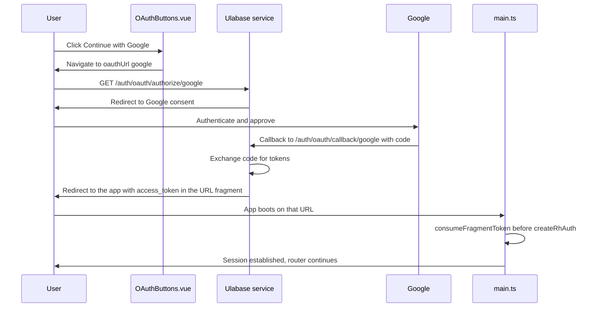

# Adding Google OAuth Sign-In

The starter ships with email and password authentication working and Google sign-in off. Turning Google on is not a single edit: it is a coordinated change across three places that must agree — the Google Cloud OAuth client, the `oauthLogin` flag in `src/environments/environment.ts`, and the `accounts` feature configuration on the Ulabase service. The reason it is coordinated is that the flag alone is not enough to make sign-in work, and the credentials alone are not enough to make the button appear.

This page covers the order to do it in, what each step actually changes, and the failure modes that appear when one layer lags behind the others.

## Why the three layers must move together

The flag `oauthLogin` does two independent jobs at once:

- **On the client**, it controls whether OAuth UI exists at all — the buttons on the login and signup pages, and whether the signup route is registered.
- **On the service**, `ulabase.setup.ts` derives the server's `oauth` toggle from the same flag (`oauth: f.oauthLogin`) when it configures the `accounts` feature.

Because the setup file imports the *same* `environment.ts` the app imports, flipping one boolean changes both sides the next time setup runs. What setup cannot supply by itself is the Google client credentials; those come from the Google Cloud console, and the setup only knows to look for them when the flag is on.

The ordering consequence: enabling the flag before creating the Google client is safe (setup will fail its check and report a missing step), while creating the client and never running setup again leaves the service with the feature enabled but no credentials. That second state is the dangerous one — see [the invariant below](#why-a-service-with-the-feature-on-and-no-credentials-is-worse-than-no-button).

## Step 1: Create the OAuth client in Google Cloud

In the [Google Cloud console](https://console.cloud.google.com/), go to **APIs & Services** → **Credentials** → **Create Credentials** → **OAuth client ID**, choose **Web application**, and register this authorized redirect URI:

```
https://<srvId>.ulabase.app/auth/oauth/callback/google
```

`<srvId>` is the six-character id of your Ulabase service — the first label of its URL (`https://abc123.ulabase.app` has id `abc123`). The callback is hosted on the **service** domain, not on the app's domain, because the service is the party that talks to Google; the app never sees the authorization code.

Note the generated **Client ID** and **Client Secret**. They are needed in [Step 3](#step-3-re-run-setup-with-the-credentials), and they go to the service only.

## Step 2: Flip the flag in environment.ts

Set `oauthLogin: true` in `src/environments/environment.ts`. The file as shipped:

```typescript
export const environment = {
  apiUrl: '',
  features: {
    emailRegistration: true,
    passwordReset: true,
    oauthLogin: false, // Google sign-in: off until you create its OAuth client
    oauthProviders: ['google'] as const,
    teamInvitations: true,
  },
};
```

`oauthProviders` already lists `'google'`, so the only edit is the boolean. Changing it has three client-side effects:

1. `Login.vue` and `Signup.vue` render `<OAuthButtons :providers="features.oauthProviders" />` behind `v-if="features.oauthLogin"`. On signup the "OR" divider is gated separately on `emailRegistration`, so the page stays coherent when only OAuth is on.
2. `/auth/signup` is registered in `src/routes.ts` when `emailRegistration || oauthLogin`, so the route survives even with email registration disabled.
3. The home page capability list shows "Social login" as enabled, describing it via `features.oauthProviders.join(', ')`.

Restart the dev server afterwards; the flag is read once at module load.

## Step 3: Re-run setup with the credentials

```bash
GOOGLE_CLIENT_ID=<your-client-id> GOOGLE_CLIENT_SECRET=<your-client-secret> ulabase setup --srv <srvId>
```

Preview first if you want to see the change without making it:

```bash
ulabase setup --srv <srvId> --dry-run
```

Credentials are passed as environment variables to the CLI run. They are written into the service's `accounts` configuration and are never written to the app's source, `environment.ts`, or any file in this repository — the app has no knowledge of them at all.

## The conditional setup step

The Google step in `ulabase.setup.ts` is not always present. It is spliced into the step list only when both conditions hold:

```typescript
...(f.oauthLogin && (f.oauthProviders as readonly string[]).includes('google')
  ? [ step('google oauth credentials', { /* check + apply */ }) ]
  : []),
```

So a project that leaves `oauthLogin: false` runs a setup with no Google step at all, and providing `GOOGLE_CLIENT_ID` to such a run changes nothing. The step exists exactly when the app claims to offer Google — which keeps the two layers from drifting apart in the direction that matters.

When present, the step's check is satisfied only when all three of `oauth['google'].enabled === true`, `client-id` is configured, and `client-secret` is configured. A dry run therefore answers, directly, "is my Google client fully wired up on the service?"

## Secrets, re-runs, and redaction

The apply path is a read-modify-write of the whole `accounts` feature document, and it treats stored secrets carefully:

```typescript
'client-id': configured(google['client-id'])
  ? google['client-id']
  : fromEnv('GOOGLE_CLIENT_ID'),
'client-secret': configured(google['client-secret'])
  ? google['client-secret']
  : fromEnv('GOOGLE_CLIENT_SECRET'),
```

Two mechanisms combine here:

- **`fromEnv()` is called only when a value is not already stored.** The environment variable is named, not captured at import time; it is resolved at apply time, and only for the fields that are still blank. A re-run against an already-configured service therefore needs no secrets in the environment at all — plain `ulabase setup --srv <srvId>` continues to report the step satisfied.
- **Redacted stored values are passed back untouched.** The API returns stored secrets masked, and the server restores the real value for any field returned still holding the mask. The helper

  ```typescript
  /** A stored secret reads back as bullets; one never set reads back blank. */
  const configured = (value: unknown) =>
    isRedacted(value) || (typeof value === 'string' && value.length > 0);
  ```

  is what lets the apply distinguish "bullets, i.e. already stored" from "blank, i.e. never set", and re-send the bullets verbatim. Diffing the document or stripping "empty-looking" fields would write bullets over a real secret and silently break sign-in.

The same read-modify-write discipline applies to the `accounts` step's other fields, which is why setup is safe to run repeatedly.

## Why a service with the feature on and no credentials is worse than no button

The two failure directions are not symmetric.

With `oauthLogin: false`, there is no button and no `/auth/oauth/authorize/google` traffic — the app simply does not offer Google. Nothing is broken.

With the feature on at the service but no credentials stored, the app renders "Continue with Google", the user clicks it, the browser navigates to the service's authorize endpoint, and the service answers the redirect with an error. The user is now stuck somewhere they cannot fix, on a flow they were invited into. That is why the setup file's comment is blunt about it, and why the Google step forces `enabled: true` *and* both credentials in the same apply rather than enabling the provider alone.

The setup's ordering reflects the same caution more broadly: the `appPointsAtService` step runs last on purpose, so a setup that stops partway leaves the "connect your service" screen rather than a sign-in page that fails.

## What the UI renders once it is wired



The button click through Google to a session established in the app. The service holds the client secret and does the code exchange; the app only ever receives the resulting token.

The button list is generated from `oauthProviders`, so it stays correct without further edits:

```vue
<a v-for="provider in providers" :key="provider" class="oauth-button" :href="oauthUrl(provider)">
  <svg v-if="provider === 'google'" class="oauth-icon" viewBox="0 0 24 24" aria-hidden="true">…</svg>
  <span>Continue with {{ label(provider) }}</span>
</a>
```

Each anchor's href comes from `oauthUrl()`:

```typescript
export function oauthUrl(provider: string): string {
  return `${environment.apiUrl}/auth/oauth/authorize/${provider}?noauthchallenge`;
}
```

It is a plain link against `environment.apiUrl` — the same base URL setup wrote into `apiUrl`. If `apiUrl` is empty or wrong, the href is wrong, which is one more reason the service URL step is part of the same setup run.

On return, `main.ts` calls `consumeFragmentToken()` **before** `createRhAuth`, deliberately: the auth store checks the session the moment it is created, so the token from the fragment must already be stored by then or the first check finds no session. The function then clears the fragment with `history.replaceState` so the token does not linger in the address bar.

## Verifying the result

1. Run `ulabase setup --srv <srvId> --dry-run` — the `google oauth credentials` step should report satisfied, and all other steps should too.
2. Open `/auth/login` — the "Continue with Google" button and the "OR" divider should appear above the email form.
3. Click through once with a Google account that is not yet registered; the account is created by the OAuth flow and you land in the app signed in.

## Troubleshooting

**The button does not appear.** `oauthLogin` is `false`, or the dev server was not restarted after the edit. `oauthProviders` already contains `'google'`, so an empty array is the only other way to lose the button.

**The dry run does not mention the Google step at all.** The step is only spliced in when `oauthLogin` is `true` *and* `'google'` is in `oauthProviders`. Check both before assuming the CLI is at fault.

**`Invalid redirect URI` from Google.** The URI in the Google client must match exactly: `https://<srvId>.ulabase.app/auth/oauth/callback/google`, with no trailing slash, and `<srvId>` must be the service the app's `apiUrl` points at — not a different service you also own.

**The button appears, then the redirect errors.** The provider is enabled but credentials are missing or revoked. Re-run setup with `GOOGLE_CLIENT_ID` and `GOOGLE_CLIENT_SECRET` (they are only read when the stored values are blank), or check that the client secret was not rotated in Google Cloud.

**A `403` on the callback.** The app's origin is not allowed to call the service, or the flag has drifted. Re-run `ulabase setup`, which both re-derives the server toggles and adds `APP_URL` to the origin allowlist.

**Setup demands credentials you know are stored.** `configured()` treats a masked value as stored and a blank as unset. A secret that reads back blank means it genuinely is not on the service — usually the sign that an earlier run wrote the mask over a real value, so set it again from the Google console.

## Related Pages

- [Authentication Flows](../concepts/authentication-flows.md) — the full set of sign-in, verification and reset flows this plugs into
- [Feature Flags](../concepts/feature-flags.md) — how `oauthLogin` and `oauthProviders` reach both client and server
- [First Run Setup](first-run-setup.md) — the base setup run this page extends
- [Service Configuration](../operations/service-configuration.md) — the check/apply model, `--dry-run`, and the `accounts` feature document
- [Routing and Guards](../architecture/routing-and-guards.md) — why `/auth/signup` survives on `emailRegistration || oauthLogin`
- [App Bootstrap and Entry Point](../architecture/app-bootstrap.md) — fragment token capture relative to `createRhAuth`
