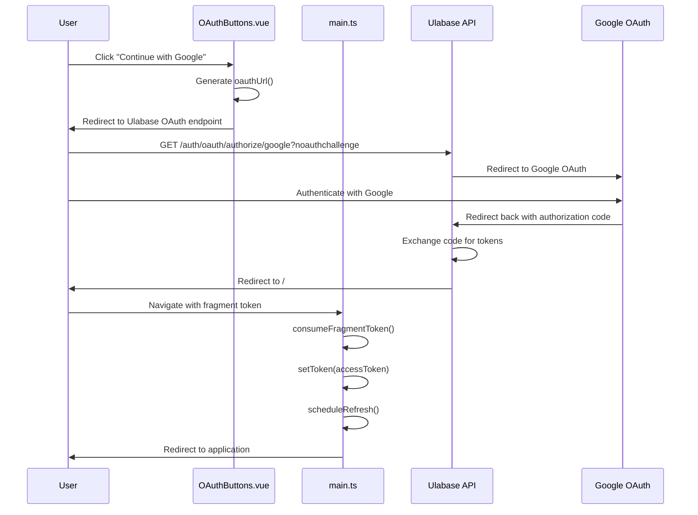

# OAuth Provider Setup

This workflow walks through enabling OAuth sign-in for the Ulabase Vue starter app. The app starts with email and password authentication by default; adding Google OAuth requires three steps: creating an OAuth client in Google Cloud, enabling the feature flag, and running setup with credentials.

## Overview

The OAuth system is designed with security and maintainability in mind:

1. **Credentials never touch the app** - OAuth client secrets are stored on the Ulabase service, never in the application code or environment
2. **Feature flags control visibility** - The app only shows OAuth buttons when the feature is enabled
3. **Idempotent setup** - Running `ulabase setup` multiple times is safe; it checks what's already configured
4. **Bidirectional contract** - The same feature flags control both client UI and server behavior, eliminating drift

## Step 1: Create OAuth Client in Google Cloud Console

Before enabling OAuth in the app, you need to create an OAuth client ID in the Google Cloud Console:

1. Go to the [Google Cloud Console](https://console.cloud.google.com/)
2. Navigate to **APIs & Services** → **Credentials**
3. Click **Create Credentials** → **OAuth client ID**
4. Select **Web application** as the application type
5. Add an authorized redirect URI with this pattern:
   ```
   https://<srvId>.ulabase.app/auth/oauth/callback/google
   ```
   Replace `<srvId>` with your Ulabase service's six-character ID (the first label of its URL)

6. Note the generated **Client ID** and **Client Secret** - you'll need these in Step 3

## Step 2: Enable OAuth Feature Flag

Edit `src/environments/environment.ts` to enable OAuth login:

```typescript
export const environment = {
  apiUrl: '',
  features: {
    emailRegistration: true,
    passwordReset: true,
    oauthLogin: true, // Change from false to true
    oauthProviders: ['google'] as const, // Already configured
    teamInvitations: true,
  },
};
```

**Key points:**
- `oauthLogin: true` enables OAuth buttons on login and signup pages
- `oauthProviders` already lists `'google'` by default
- The app will only show OAuth buttons when both conditions are met

## Step 3: Run Setup with OAuth Credentials

Run `ulabase setup` with your Google OAuth credentials as environment variables:

```bash
GOOGLE_CLIENT_ID=<your-client-id> GOOGLE_CLIENT_SECRET=<your-client-secret> ulabase setup --srv <srvId>
```

**Important security notes:**
- Credentials go to the Ulabase service, never into the app
- The setup stores credentials securely on the server
- On re-runs, `isRedacted()` checks if credentials are already stored before requiring env vars
- You don't need to provide credentials again once they're configured

## How OAuth Works

### OAuth Flow Diagram



*OAuth flow from button click through Google authentication to session establishment.*

### Key Components

1. **`src/pages/auth/oauth-buttons/OAuthButtons.vue`** - Renders provider-specific buttons with proper styling
2. **`src/oauth-url.ts`** - Constructs the OAuth authorization URL
3. **`src/environments/environment.ts`** - Contains feature flags controlling OAuth availability
4. **`ulabase.setup.ts`** - Handles OAuth credential configuration on the server

### OAuth Button Rendering

The `OAuthButtons.vue` component dynamically renders buttons for each provider in the `oauthProviders` array:

```vue
<script setup lang="ts">
import { oauthUrl } from '../../../oauth-url';

type Provider = 'google' | 'github' | (string & {});

defineProps<{ providers: readonly Provider[] }>();

function label(provider: Provider): string {
  return provider === 'github' ? 'GitHub' : provider.charAt(0).toUpperCase() + provider.slice(1);
}
</script>

<template>
  <div class="oauth-buttons">
    <a v-for="provider in providers" :key="provider" class="oauth-button" :href="oauthUrl(provider)">
      <!-- SVG icons for Google and GitHub -->
      <span>Continue with {{ label(provider) }}</span>
    </a>
  </div>
</template>
```

### OAuth URL Construction

The `oauthUrl()` function builds the authorization URL pointing to Ulabase's OAuth endpoint:

```typescript
import { environment } from './environments/environment';

export function oauthUrl(provider: string): string {
  return `${environment.apiUrl}/auth/oauth/authorize/${provider}?noauthchallenge`;
}
```

This URL includes `?noauthchallenge` to indicate this is an OAuth flow, not a standard authentication request.

## Credential Storage Security

OAuth credentials are stored securely on the Ulabase service with these protections:

1. **Never in application code** - Credentials are only passed via environment variables during setup
2. **Redaction masking** - When retrieved, stored credentials are masked as `••••••••`
3. **Read-modify-write pattern** - Setup reads current config, applies changes, and writes back
4. **Conditional updates** - Only updates credentials when they're not already configured

The `configured()` helper in `ulabase.setup.ts` checks if credentials are already stored:

```typescript
/** A stored secret reads back as bullets; one never set reads back blank. */
const configured = (value: unknown) =>
  isRedacted(value) || (typeof value === 'string' && value.length > 0);
```

## Feature Flag Integration

The OAuth setup integrates with the broader feature flag system:

- **Client-side**: `oauthLogin` and `oauthProviders` control button visibility
- **Server-side**: `ulabase.setup.ts` derives `oauth: f.oauthLogin` for server configuration
- **Bidirectional contract**: Both client and server use the same source of truth in `environment.ts`

This eliminates the "drift problem" where client and server configurations could diverge, causing 403 errors or hidden functionality.

## Troubleshooting

### OAuth button not appearing
1. Verify `oauthLogin: true` in `src/environments/environment.ts`
2. Check that `'google'` is in the `oauthProviders` array
3. Ensure you've run `ulabase setup` after enabling the feature

### "Invalid redirect URI" error
1. Verify the redirect URI in Google Cloud Console matches exactly:
   ```
   https://<srvId>.ulabase.app/auth/oauth/callback/google
   ```
2. Ensure there are no trailing slashes or extra characters

### 403 error on OAuth redirect
1. Run `ulabase setup --dry-run` to check if credentials are configured
2. Verify OAuth credentials were stored correctly on the service
3. Check that the service's OAuth feature is enabled

### Credentials not being accepted
1. Ensure you're providing both `GOOGLE_CLIENT_ID` and `GOOGLE_CLIENT_SECRET`
2. Check that the credentials are from a "Web application" type OAuth client
3. Verify the credentials haven't been revoked in Google Cloud Console

## Next Steps

After setting up OAuth:

1. **Test the flow** - Try signing in with Google on the login page
2. **Add more providers** - Extend `oauthProviders` array and create additional OAuth clients
3. **Customize styling** - Modify `src/pages/auth/oauth-buttons/OAuthButtons.css` for button appearance
4. **Review security** - Understand how OAuth tokens are handled in `src/main.ts`

## Related Pages

- [Authentication Flows](../concepts/authentication-flows.md) - Complete authentication system documentation
- [Feature Flags](../concepts/feature-flags.md) - How feature flags control client and server behavior
- [Service Configuration](../operations/service-configuration.md) - Declarative setup process details
- [First Run Setup](first-run-setup.md) - Initial application setup workflow
